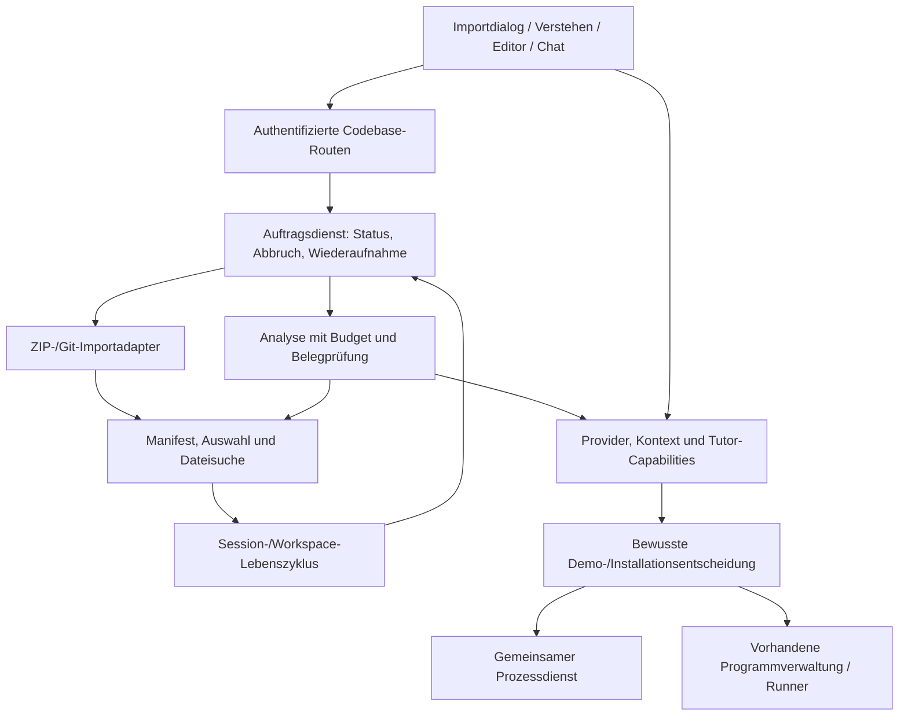
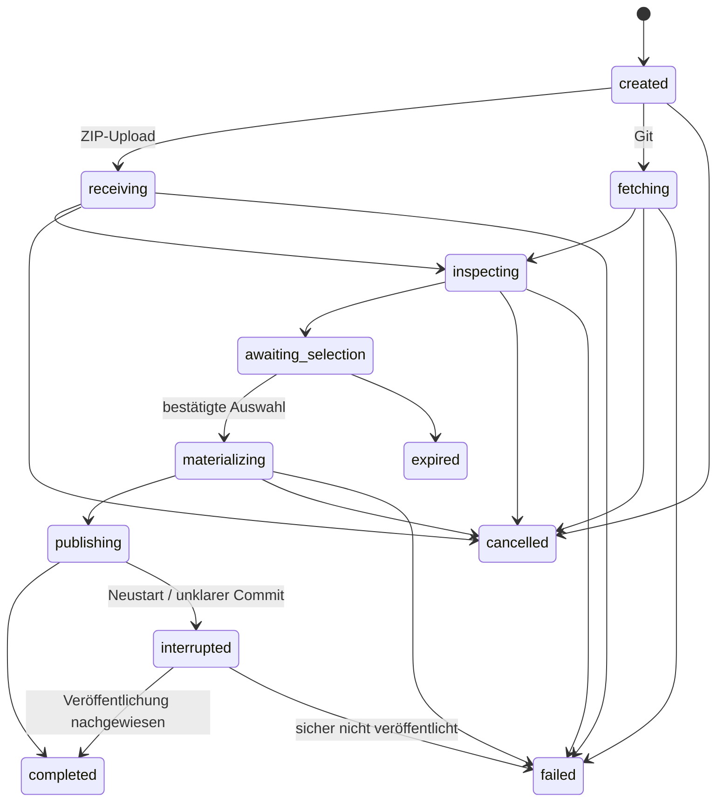
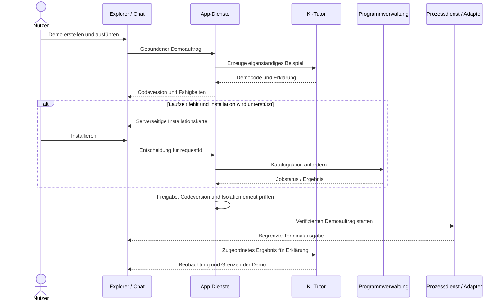

# Codebase-Explorer & Lernmodus: Produkt- und Umsetzungsplan

> **Projekt:** SterraCode
>
> **Stand:** 20. Oktober 2026 · Überarbeitung nach Prüfung des bestehenden Quellcodes
>
> **Status:** Planung, keine Implementierung oder Betriebsfreigabe
>
> **Ziel:** Bestehende Projekte sicher importieren, ihre Struktur verstehen und sie mit einem KI-Tutor schrittweise erkunden.

Die im bisherigen Interview festgehaltenen Präferenzen bleiben die Grundlage. Dieses Dokument trennt sie von neuen Umsetzungsempfehlungen, benennt Konflikte mit der heutigen Anwendung und legt überprüfbare Abläufe fest. **„Empfohlen“ bezeichnet eine begründete Planungsentscheidung, keine nachträglich vom Nutzer bestätigte Präferenz.**

## Inhalt

1. [Zielbild und Präferenzen](#1-zielbild-und-präferenzen)
2. [Bestandsaufnahme](#2-bestandsaufnahme)
3. [Konflikte und Auflösung](#3-konflikte-und-auflösung)
4. [Oberfläche und Bedienablauf](#4-oberfläche-und-bedienablauf)
5. [Import und Ressourcen](#5-import-und-ressourcen)
6. [Git und Zugangsdaten](#6-git-und-zugangsdaten)
7. [Architektur und API](#7-architektur-und-api)
8. [Datenmodell und Versionen](#8-datenmodell-und-versionen)
9. [Analyse und Kontext](#9-analyse-und-kontext)
10. [Didaktik und Tour](#10-didaktik-und-tour)
11. [Code-Referenzen](#11-code-referenzen)
12. [Demos und Laufzeiten](#12-demos-und-laufzeiten)
13. [Löschen und Wiederherstellung](#13-löschen-und-wiederherstellung)
14. [Implementierungsphasen](#14-implementierungsphasen)
15. [Tests und Abnahme](#15-tests-und-abnahme)
16. [Entscheidungen vor der Umsetzung](#16-entscheidungen-vor-der-umsetzung)

## 1. Zielbild und Präferenzen

### 1.1 Produktversprechen

„Ich bringe ein Projekt mit und finde heraus, was es macht, wo ich anfangen soll und wie seine Teile zusammenarbeiten.“

Nach dem Import sind die Dateien zugänglich. Die KI wird erst aktiv, wenn der Nutzer eine Analyse oder Erklärung ausdrücklich anfordert. Sie erklärt anhand überprüfbarer Code-Stellen und benennt Lücken. Das Erkunden benötigt weder eine funktionierende Entwicklungsumgebung des importierten Projekts noch dessen Ausführung.

### 1.2 Entscheidungen aus dem bisherigen Interview

| ID  | Festgehaltene Präferenz                                                        | Konkretisierung                                                                                                                                          |
| --- | ------------------------------------------------------------------------------ | -------------------------------------------------------------------------------------------------------------------------------------------------------- |
| P01 | Architekturübersicht, geführte Tour und freies Erkunden kombinieren.           | Alle drei Wege verwenden denselben Projektstand und dieselben Code-Referenzen. Kein erzwungener linearer Lernpfad.                                       |
| P02 | ZIP sowie Git über HTTPS und SSH unterstützen.                                 | Gemeinsamer geprüfter Importablauf. Git liefert zunächst die Kopie eines konkreten Commits, keine laufende Synchronisierung.                             |
| P03 | Dateien und Ordner vor dem endgültigen Import auswählen.                       | Verständliche Standardauswahl, Ausschlussgründe und nachprüfbare Auswahlgröße.                                                                           |
| P04 | Keine künstliche Projektgrößengrenze; über 500 MB ausdrücklich bestätigen.     | 500 MB sind eine Warnschwelle. Speicher-, Sicherheits- und Betriebsgrenzen werden unabhängig davon kontrolliert und sichtbar gemacht; siehe Abschnitt 5. |
| P05 | HTTPS-Tokens und SSH-Schlüssel in den Einstellungen verwalten.                 | Geheimnisse bleiben im Backend und gelangen weder zum Tutor noch in den Workspace.                                                                       |
| P06 | KI-Analyse ausschließlich manuell starten.                                     | Import, Dateinavigation, Tourauswahl und Wiederöffnen erzeugen keine versteckten Modellanfragen.                                                         |
| P07 | Lern-Cockpit, Monaco-Sprünge und Erkläraktionen anbieten.                      | Integration in die vorhandene Arbeitsoberfläche; bestehende Aktionen erweitern.                                                                          |
| P08 | Separate Demos erstellen und fehlende Laufzeiten nach Zustimmung installieren. | Statische Analyse bleibt unabhängig nutzbar. Installation ausschließlich über den vorhandenen Programmkatalog.                                           |
| P09 | Eigene Session pro Projekt; Teile oder ganze Session löschen können.           | Aktive Daten, temporäre Importdaten und aufbewahrte Sicherungen unterscheiden. „Rückstandsfrei“ ist derzeit kein zutreffendes Löschversprechen.          |

### 1.3 Unterstützungsstufen

| Fähigkeit                         | Geplanter Umfang                                                                                                                                |
| --------------------------------- | ----------------------------------------------------------------------------------------------------------------------------------------------- |
| Import und Struktur               | Sprachunabhängig für zulässige reguläre Dateien. Binärdateien erhalten Dateiinformationen.                                                      |
| Statisches Erklären               | Für lesbaren Text jeder Sprache grundsätzlich möglich; Qualität hängt von Modell, Kontext und Belegen ab. Unbekannte Formate bleiben erkennbar. |
| Syntaxhervorhebung                | Vorhandene beziehungsweise gezielt aktivierte Monaco-Sprachen; sonst Klartext.                                                                  |
| Symbolauflösung und Aufrufgraphen | Erst mit passenden Sprachadaptern belastbar. Heuristische Beziehungen als Vermutung markieren.                                                  |
| Demoausführung                    | Nur verfügbare und freigegebene Runner-/Hostadapter. Heute existieren neun Ausführungssprachen.                                                 |
| Gesamtes Projekt bauen/starten    | Späteres eigenes Vorhaben. Ein Compiler ersetzt weder Projektabhängigkeiten noch Datenbank oder Buildkonfiguration.                             |

**Nicht Teil der ersten Lieferung:** Git-Push/Pull, Bearbeitung des Original-Repositories, IDE-weite Sprachserver, automatische Installation von Projektabhängigkeiten, automatisch ausgeführte Repository-Skripte, vollständige Git-Historie und automatische Kompetenzbewertung nach bloßem Lesen. Private Git-Importe und Laufzeitfragen bleiben Bestandteil des Gesamtziels, auch wenn sie nach dem ersten ZIP-Meilenstein geliefert werden.

## 2. Bestandsaufnahme

Die folgenden Aussagen beschreiben den gelesenen Repository-Stand. Neue Modulnamen und Endpunkte in späteren Abschnitten sind Vorschläge.

| Bereich / vorhandene Dateien                                                                                                                         | Tatsächlicher Stand                                                                                                                                                               | Konsequenz                                                                                                     |
| ---------------------------------------------------------------------------------------------------------------------------------------------------- | --------------------------------------------------------------------------------------------------------------------------------------------------------------------------------- | -------------------------------------------------------------------------------------------------------------- |
| [server/app.js](server/app.js)                                                                                                                       | Express mit Authentifizierung, Host-/Originprüfung, Wartungszustand und JSON-Parser bis 4 MB. Mutierende API-Anfragen müssen bislang JSON sein.                                   | Multipart benötigt eine eng begrenzte Upload-Ausnahme innerhalb derselben Schutzschichten.                     |
| [public/js/api.js](public/js/api.js)                                                                                                                 | Request-Bodys werden als JSON serialisiert.                                                                                                                                       | Eigener Binär-Uploadtransport mit Fortschritt, Abbruch und vorhandener Anmeldelogik.                           |
| [server/services/sessions.js](server/services/sessions.js)                                                                                           | `schemaVersion: 2`, `revision`, `activeFile`, `openFiles`, optional `project`; Pflichtsprache aus `LANGUAGES`. Neue Sessions erzeugen normalerweise Startdatei und Lernplanfrage. | Eigener Sessionmodus ohne künstliche `main.py`; auch ohne editierbare Startdatei öffnen können.                |
| [server/services/projects.js](server/services/projects.js)                                                                                           | Vorlagen-/JSON-Paketimport mit `operationId`; Paketgrenzen 50 Dateien, 2 MiB Text, 3 MiB JSON.                                                                                    | Idempotenzmuster wiederverwenden; Paketimport und Codebase-Import getrennt erhalten.                           |
| [server/services/workspace.js](server/services/workspace.js)                                                                                         | Versionierte Dateien, `expectedVersion`, sichere Pfade, Umbenennen/Löschen. Vollständiger Baum mit höchstens 5.000 Einträgen und Tiefe 32.                                        | Seitenweise Baumabfragen und begrenzte Suchwerkzeuge ergänzen. Limits nicht lediglich entfernen.               |
| Dateiinhalt im Workspace-Dienst                                                                                                                      | Nur UTF-8 ohne NUL, höchstens 2 MiB je Datei. Auch Zeilenabrufe lesen zunächst die begrenzte Gesamtdatei.                                                                         | Import, Editorfähigkeit und KI-Lesefähigkeit separat behandeln. Zeilenparameter umgehen das Limit heute nicht. |
| [server/services/safeFiles.js](server/services/safeFiles.js)                                                                                         | Unter Linux unter anderem festgehaltene Elternverzeichnis-Deskriptoren; andere Plattformen verwenden andere Prüfwege.                                                             | Helfer erweitern; Extraktion nicht allein mit `path.normalize()` absichern. Plattformbelege getrennt führen.   |
| [public/js/editor.js](public/js/editor.js)                                                                                                           | `explain-selection`, Autospeichern, lokale Entwürfe, Navigationsschutz und `revealLine()` vorhanden.                                                                              | Vorhandene Erkläraktion um Pfad, Bereich und Version ergänzen; Navigation teilen.                              |
| [public/index.html](public/index.html), [public/app.js](public/app.js), [public/style.css](public/style.css)                                         | Seitenleiste Sessions/Dateien/Lernplan, Editor und Tutor; unter 1.280 px kompakter Ansichtswechsel. Einstellungen in `public/app.js`; `public/js/settings.js` existiert nicht.    | Vorhandenes Layout und Einstellungsdialog erweitern.                                                           |
| [public/js/ui.js](public/js/ui.js)                                                                                                                   | Begrenztes Markdown über DOM/Textknoten, ohne allgemeine Link-/HTML-Unterstützung. Vier Themes und vorhandene Layout-Screenshots.                                                 | Sichere Code-Referenzen gezielt ergänzen; keine allgemeine HTML-Ausgabe einführen.                             |
| [teacher.js](server/services/teacher.js), [tools.js](server/services/tools.js), [toolExecutor.js](server/services/toolExecutor.js)                   | Turns, Werkzeuge, Abbruch und Fragen vorhanden. `answerQuestion()` protokolliert Antworten, führt keine Programmaktion aus.                                                       | Modusabhängige Werkzeuge und explizite Aktionsentscheidungen ergänzen.                                         |
| [server/services/context/](server/services/context/), [openAIContext.js](server/services/openAIContext.js)                                           | Kontextbudgets, Ergebnisbegrenzung, Komprimierung und Provideranbindung vorhanden.                                                                                                | Wiederverwenden; Projektretrieval und Modus in Zustandssnapshots ergänzen.                                     |
| [server/routes/programs.js](server/routes/programs.js), [public/js/programs.js](public/js/programs.js), [processes.js](server/services/processes.js) | Programminstallation nur im Dockerbetrieb, lokal vorhandene Hostprogramme.                                                                                                        | Chataktionen an vorhandene Aufträge anbinden; Ausführung über gemeinsamen Prozessdienst.                       |
| [Dockerfile](Dockerfile), [Dockerfile.runner](Dockerfile.runner), [runner/README.md](runner/README.md)                                               | App installiert Git/SSH nicht ausdrücklich. Runner enthält Git und nutzt eine gemeinsame Ausführungs-UID.                                                                         | Importwerkzeuge ausdrücklich bereitstellen. Sessionverzeichnisse sind keine Sandbox für beliebigen Fremdcode.  |
| Session-/Dateilöschung                                                                                                                               | Vor der Entfernung werden Sicherungen erstellt. Sessionlöschung sperrt Prozesse und kann auf den Runner warten.                                                                   | Neue Analyse-/Importdaten in diesen Lebenszyklus aufnehmen; Aufbewahrung erklären.                             |

## 3. Konflikte und Auflösung

**Priorität:** P0 = vor dem betreffenden Funktionsbereich lösen; P1 = für den vollständigen nutzbaren Explorer erforderlich; P2 = spätere Verbesserung. Die Lösungen sind geplant, nicht bereits implementiert.

| ID / Priorität | Konflikt oder Lücke                                                                                                  | Empfohlene Auflösung                                                                                                                                   |
| -------------- | -------------------------------------------------------------------------------------------------------------------- | ------------------------------------------------------------------------------------------------------------------------------------------------------ |
| K01 · P0       | „Jede Sprache“ trifft auf eine verpflichtende der neun Sessionsprachen.                                              | Erklärmodus und Ausführungssprache trennen. Keine unbekannte Sprache als Python tarnen; Schema, Header, Prompts und Profilzugriffe anpassen.           |
| K02 · P0       | „Keine Obergrenze“ trifft auf endliche Ressourcen und ZIP-Bomben.                                                    | Keine Sperre bei 500 MB; Streaming, Reservierungen und dokumentierte Betriebsgrenzen. Eine Bestätigung hebt Sicherheitsprüfungen nicht auf.            |
| K03 · P0       | Warnen erst nach vollständiger Extraktion schützt zu spät.                                                           | Erst Archivverzeichnis prüfen, dann Auswahl bestätigen und nur ausgewählte Einträge begrenzt extrahieren. Tatsächliche Bytes messen.                   |
| K04 · P0       | Multipart wird von JSON-Zwang und Browserhelfer abgelehnt.                                                           | Exakte Uploadroute nach Auth-/Originprüfung unterstützen; globale JSON-Regeln erhalten.                                                                |
| K05 · P1       | Vorschau und `list_files` skalieren nicht über den vollständigen Baum.                                               | Gemeinsamer paginierter Baumdienst, serverseitige Suche und Auswahlregeln statt kompletter Pfadlisten. Bestehende API kompatibel erhalten.             |
| K06 · P1       | Ein importierbares Projekt passt nicht vollständig in Editor oder Modellkontext.                                     | Speicheraufnahme, Textvorschau, Editor und KI-Kontext getrennt ausweisen. Große/Binärdateien mit verständlichem Zustand anzeigen.                      |
| K07 · P1       | „Nur Quellcode“ entfernt wichtige README, Tests, Manifeste und Konfiguration.                                        | „Fürs Verstehen empfohlen“ umfasst diese Dateien. `vendor`, `build` oder `.vscode` begründet abwählen statt pauschal verbieten.                        |
| K08 · P0       | Git ohne Zusatzregeln erlaubt unerwünschte Netzwerkziele und Konfigurationsübernahme.                                | Zielhosts/Protokolle kontrollieren, eigene Git-Konfiguration, keine automatische Submodule-/LFS-Auflösung oder Checkoutfilter.                         |
| K09 · P0       | Git liegt im Runner, Zugangsdaten gehören ins App-Backend.                                                           | Importprozess im App-Dienst mit expliziten Git-/SSH-Abhängigkeiten. Kein frei formulierbarer Runner-Terminalbefehl für Import.                         |
| K10 · P0       | Klartext-`git.json` und Logmaskierung erfüllen „geschützt gespeichert“ nicht.                                        | Eigener verschlüsselter Credentialdienst, nur Metadaten im Browser, Hostbindung und Schlüssel-/Backupkonzept.                                          |
| K11 · P0       | Aktuelle LAN-Installation verwendet HTTP; Speicherverschlüsselung schützt keinen eingegebenen PAT auf dem Transport. | Für entfernte Geheimniseingabe HTTPS vorsehen oder administrativ bereitgestellte Secret-Dateien nutzen. Neue Empfehlung, keine vorhandene Eigenschaft. |
| K12 · P0       | „Isolierte Session“ kann als Sandbox für Fremdcode missverstanden werden.                                            | Statisch ohne Ausführung beginnen. Gemeinsame Runner-UID berücksichtigen; sichere Fremdprojektausführung benötigt zusätzliche Isolation.               |
| K13 · P0       | Ein lesender Prompt allein sperrt Schreib-/Shellwerkzeuge nicht.                                                     | Capabilities sowohl im Toolangebot als auch im Executor prüfen. Demos erhalten einen getrennten Ablauf.                                                |
| K14 · P0       | Beliebiges „Ja“ im Chat ist keine belastbare Installationsfreigabe.                                                  | Serverseitige Aktionskarte mit gebundenem Programm/Auftrag und einmaliger Entscheidung. Installation und Demoausführung getrennt behandeln.            |
| K15 · P0       | Programminstallation betrifft den gesamten Runner.                                                                   | Betroffene Arbeit anzeigen, Warteschlange/Drain verwenden, `stopRunning` nie stillschweigend setzen. Lokal keine automatische Hostinstallation.        |
| K16 · P1       | Baum bis Ebene 3 und README belegen keinen Datenfluss.                                                               | Mehrstufige Analyse mit gelesenen Quellen und begrenzter Nachsuche. Vermutungen kennzeichnen.                                                          |
| K17 · P1       | Änderungen und verspätete Antworten entkoppeln Cockpit und Codezeilen.                                               | Manifest-/Dateihashes, Analyseversion, geordnete Ereignisse und Versionsprüfung bei Navigation. Vorherige Analyse bei Fehlern behalten.                |
| K18 · P0       | „Rückstandsfrei“ widerspricht Löschsicherungen und externen Kopien.                                                  | Aktive Daten entfernen, Aufbewahrung erklären. Endgültige lokale Bereinigung als eigenen Verwaltungsablauf planen.                                     |
| K19 · P1       | Tourabschluss könnte Lernplan/Kompetenznachweise verfälschen.                                                        | Tourfortschritt separat speichern. „Angesehen“ und „verstanden“ sind keine bestandenen Tests.                                                          |
| K20 · P1       | Vollständige Analyse in `session.project` vergrößert Sessionantworten und vermischt Schemas.                         | Kleiner Explorerzustand in der Session; Index und Analyseartefakte separat. `project` erhalten.                                                        |
| K21 · P1       | Große Codebasen passen nicht ins kleine Projektpaketformat.                                                          | Exportgrenzen sichtbar erhalten; später eigenes vollständiges Codebase-Exportformat planen.                                                            |
| K22 · P0       | Asynchrone Arbeit würde nach HTTP `202` aus der HTTP-Aktivitätszählung verschwinden.                                 | Import/Analyse als aktive Aufträge in Wartung, Shutdown und Updatesperre registrieren; Import besitzt anfangs noch keine Session-ID.                   |

## 4. Oberfläche und Bedienablauf

### 4.1 Begriffe und Einstieg

Der Einstieg heißt **„Codeprojekt importieren“**, die neue Ansicht **„Verstehen“**. „Codebase-Explorer“ bleibt die technische Funktionsbezeichnung. Die vorhandene Session ist die Speichereinheit; es entsteht keine zweite konkurrierende Projektverwaltung.

- Aktion in der Sessions-Seitenleiste bei der Projektwerkstatt und auf der leeren Startseite anbieten.
- „Neue Session“ und Projektwerkstatt behalten ihre Bedeutung; die Werkstatt kann zum Import verweisen.
- Import nicht hinter einer Programmiersprachauswahl verstecken. Ein Projekt kann mehrere Sprachen haben.
- Nach Import die neue Session öffnen und in der Liste als „Codeprojekt“ kennzeichnen.
- Bei fehlender KI bleiben Import/Dateien nutzbar. „KI-Verbindung einrichten“ führt in die vorhandenen Einstellungen und erhält den Importentwurf.

Die sichtbare Abfolge lautet **Quelle wählen → Dateien prüfen → Projekt öffnen**. Erst danach startet der Nutzer eine KI-Analyse oder eine konkrete Frage. Übertragung, lokale Prüfung und KI-Nutzung bleiben dadurch verständlich getrennt.

### 4.2 Importdialog

**Schritt 1 – Quelle wählen**

- Reiter „ZIP-Datei“ und „Git-Repository“. Dateiauswahl immer anbieten; Drag & Drop nur zusätzlich.
- ZIP: Name, übertragene Größe, Fortschritt und „Abbrechen“. Der lokale Dateiname ist Anzeige, kein Serverpfad.
- Git: Repository-URL, optional Branch/Tag unter „Weitere Optionen“, Authentifizierung mit Standard „Öffentlich“. Gespeicherte Zugänge nur für passende Hosts anbieten.
- Fehlende Git-Unterstützung oder unzulässigen Host früh erklären. Einstellungen lassen sich ohne Verlust des Importentwurfs öffnen.
- Bei Git Phasen und bekannte Bytezahlen zeigen; keine erfundenen Prozentwerte oder Restzeiten.

**Schritt 2 – Dateien prüfen**

- Projektwurzel, Suchfeld, Auswahlprofil und aufklappbare Erklärung der Regeln.
- Baum mit Ordnern zuerst, Drei-Zustands-Checkboxen und Anzahl/Größe je Ordner. Zeilenklick öffnet Vorschau; Checkbox und Aufklappen sind eigene Aktionen.
- Zustände: „Ausgewählt“, „Nicht ausgewählt“, „Sicherheitsbedingt gesperrt“, „Nur Dateiinformationen“. Gründe auch per Tastatur erreichbar machen.
- „Alle zulässigen Dateien“, „Empfohlene Auswahl wiederherstellen“, „Auswahl aufheben“. „Alle“ hebt keine Sicherheitssperre auf. Zurücksetzen kündigt den Verlust manueller Anpassungen an.
- Suchfilter verändern nur die Ansicht. Ordner-Checkboxen gelten für alle zulässigen Nachfahren, auch auf nicht geladenen Seiten; dies ausdrücklich beschriften.
- Fester Fußbereich: `842 Dateien · 18,4 MB ausgewählt`, ausgelassene Einträge, „Weiter“. Unbekannte Größen als Schätzung beziehungsweise „wird ermittelt“ bezeichnen.
- Leere Auswahl nicht bestätigen. Ein reines Dokumentationsprojekt bleibt gültig.

**Schritt 3 – Projekt öffnen**

- Editierbarer Namensvorschlag und Tutorsprache mit vorhandener Sprachpräferenz als Standard.
- Zusammenfassung: Quelle, bei Git Commit/Branch, Auswahl, Speicherbedarf und Warnungen.
- Über 500 MB ausgewählter Größe eine bewusste Bestätigung in diesem Schritt, ohne vorausgewähltes Häkchen und ohne verschachtelten Modalstapel: „Du importierst 684,2 MB. Große Projekte benötigen mehr Speicher und Zeit.“
- Primäraktion „Projekt öffnen“, danach „Projekt wird vorbereitet …“. Doppelklick erzeugt keine zweite Session.
- Hinweis: „Die KI-Analyse startet erst, wenn du sie anforderst.“

Eigener Dialogzustand statt Überladen des generischen Formulars. Auf Desktop etwa 880–1.040 px Breite mit separat scrollbarendem Baum, auf kleinen Fenstern nahezu fensterfüllend. Zurück/Abbrechen/Primäraktion bleiben erreichbar. Escape schließt einen untätigen Dialog; bei laufendem Auftrag werden Abbrechen und bewusstes Fortsetzen im Hintergrund unterschieden.

### 4.3 Arbeitsbereich Code / Verstehen

**Empfohlen:** Zwei Ansichten **„Code“** und **„Verstehen“** innerhalb der bestehenden linken Arbeitsfläche, nur für Codebase-Sessions. Tutor rechts und Dateibaum in der Seitenleiste behalten ihre Position. Sessions/Dateien/Lernplan bleiben die Seitenleistentabs; die Tour ist kein zweiter Lernplan.

```text
┌──────────────── bestehender SterraCode-Header ────────────────────┐
│ Seitenleiste       │ Code | Verstehen                │ KI-Tutor   │
│ Sessions/Dateien/  │ Projektname · Analysestand       │            │
│ Lernplan           │                                 │ Erklärung  │
│                    │ Kurzüberblick                   │ und Fragen │
│ Dateisuche         │ Hauptmodule mit Code-Belegen    │            │
│ Projektdateien     │ Einstieg / empfohlene Tour       │            │
│                    │ Aktueller Tourschritt            │ Eingabe    │
│                    ├─────────────────────────────────┤            │
│                    │ Terminal bei Bedarf              │            │
└────────────────────┴─────────────────────────────────┴────────────┘
```

- Nach Import zeigt „Verstehen“ Eckdaten und Analysebutton, kein leeres Dashboard voller Platzhalter.
- „Code“ zeigt Dateitabs/Monaco. Code-Link wechselt dorthin; „Zur Übersicht“/„Zur Tour“ führt ohne Modellanfrage zurück.
- Ein schmaler Tourschritt-Hinweis darf im Code Lernziel und Rückweg zeigen. Keine weitere dauerhafte Spalte.
- Web-Vorschau und Verstehen nicht gleichzeitig im Editorbereich stapeln. Ansichtszustand/Scrollposition erhalten; pausierte Vorschau kenntlich machen.
- Terminal beim Lesen geschlossen lassen; eine ausdrücklich gestartete Demo darf es öffnen.
- Vorhandene Lern-Sessions, Header und Spaltenregler behalten ihr etabliertes Verhalten.

### 4.4 Informationshierarchie im Cockpit

1. **Projekt in wenigen Sätzen:** Zweck, Sprachen, untersuchter Stand. „Was wurde betrachtet?“ nennt Quellen und Grenzen.
2. **Wo anfangen?** Konkreter Einstieg mit Datei und Begründung. Bei mehreren Anwendungen zunächst eine Teilanwendung wählen.
3. **Wie ist es aufgebaut?** Wenige Hauptmodule mit Verantwortung, Hauptdateien und belegten Verbindungen. Weitere Module aufklappen.
4. **Geführte Tour:** Eine aktive Station und erreichbare Schrittliste. Primär „Code ansehen“, daneben „Schritt erklären lassen“.
5. **Weiterfragen:** Wenige passende Vorschläge; erst ein Klick startet den Tutor.

Ein Datenflussdiagramm ist eine zusätzliche Ansicht mit textlicher Alternative. Belegte und vermutete Kanten unterscheiden. Für die erste Lieferung genügen Module und lesbare Ablaufschritte. Später nur validierte Knoten-/Kantendaten rendern, keine freien HTML-/Mermaid-Fragmente des Modells ausführen.

### 4.5 Sichtbare Zustände

| Zustand                        | Anzeige / nächste Aktion                                                                                            |
| ------------------------------ | ------------------------------------------------------------------------------------------------------------------- |
| Nicht analysiert               | Eckdaten, „Codebase analysieren“, „Dateien ansehen“.                                                                |
| Kein Modell verfügbar          | Dateien bleiben offen; „KI-Verbindung einrichten“. Kein automatischer Wiederholungsversuch.                         |
| Analyse läuft                  | Phase, gelesene Quellen, „Abbrechen“. Bisherige Analyse und Navigation bleiben zugänglich.                          |
| Teilanalyse                    | „Nicht vollständig untersucht“, konkrete Lücken und gezielte Folgefragen.                                           |
| Analyse aktuell                | Zusammenfassung, Tour, Quellenstand.                                                                                |
| Projekt verändert              | „Dateien wurden seit der Analyse geändert“, markierte Belege, „Neu analysieren“. Kein automatischer Tokenverbrauch. |
| Abgebrochen/fehlgeschlagen     | Ursache und explizites „Erneut versuchen“. Vorheriges gültiges Ergebnis erhalten.                                   |
| Datei fehlt / Verweis veraltet | Erklärung am Verweis; aktuelle Datei oder Suche anbieten. Kein stiller Sprung an eine beliebige Stelle.             |
| Löschen/Aufräumen wartet       | Gesperrter Zustand, Ursache und Wiederholungsmöglichkeit; keinen Erfolg behaupten.                                  |

### 4.6 Responsive Gestaltung und Barrierefreiheit

- Bestehenden Breakpoint bei 1.280 px berücksichtigen. Im kompakten Modus bleiben Editor/KI-Tutor die Hauptansichten; innerhalb Editor liegen Code/Verstehen. Dateibaum über vorhandene Seitenleiste erreichbar.
- Bei 800/1.024 px keine drei schmalen Spalten. Zusätzlich 390 px und 200 % Zoom prüfen. Code-Link aus dem kompakten Chat wechselt zum Editor; Rückweg bleibt eindeutig.
- Tabs mit Pfeiltasten, Baum mit nachvollziehbarer Fokusführung und nativen Checkboxen. Einen ARIA-Tree nur mit vollständiger Tastatursteuerung einsetzen; ansonsten verschachtelte Listen mit Aufklappbuttons.
- Fokus nach Import auf Projekttitel, nach Code-Sprung zum Editor; Rückkehr zum Auslöser ermöglichen. Dialogfokus begrenzen und zurückgeben.
- `role="status"`/`alert` sparsam verwenden. Keine Tausenden Live-Meldungen beim Dateiscan.
- Vorhandene CSS-Tokens, Abstände und lokale SVG-Icons verwenden. Keine eigene Farbwelt oder externen Schriftabrufe.
- Dark/Light/High Contrast/Solarized prüfen; Farbe durch Text/Icon ergänzen, Fokusumrandungen erhalten, reduzierte Bewegung beachten.
- Alle UI-Texte DE/EN/ES. UI- und Tutorsprache bleiben getrennt; Pfade, Code und Originaldiagnosen werden nicht übersetzt. Lange spanische Texte prüfen.

### 4.7 Bedienfälle als Entwurfsprüfung

| Fall                                 | Erwartung                                                                                   |
| ------------------------------------ | ------------------------------------------------------------------------------------------- |
| Kleines Python-ZIP, Anfänger         | Empfohlene Auswahl, bewusst analysieren, Einstieg finden; keine Compilerfrage.              |
| Nur eine Java-Datei erklären         | Ohne Gesamtanalyse möglich, keine erzwungene Tour.                                          |
| Monorepo                             | Teilprojekte erkennen und mit einem beginnen können, Gesamtübersicht erhalten.              |
| Bibliothek ohne README/main          | Keine Hauptdatei erfinden; Schnittstellen, Tests oder Beispiele vorschlagen.                |
| KI offline                           | Import, Baum, Code und gespeicherte Tour nutzbar.                                           |
| Schnelle Linkklicks / Sessionwechsel | Nur zuletzt gültige Navigation wirkt; alte Antworten landen nicht in der neuen Session.     |
| Browser während Import geschlossen   | Auftrag wiederfinden oder definierte Unterbrechung anzeigen; keine halbe sichtbare Session. |

## 5. Import und Ressourcen

### 5.1 Auswahl und Kategorisierung

Jeder Eintrag erhält getrennte Eigenschaften: Pfad, Typ, Bytes, Text-/Binärstatus, erkannte Sprache, Auswahlzustand, Ausschlussgrund und Fähigkeit für Editor/KI. Eine unbekannte Endung ist kein Ausschlussgrund. Inhaltserkennung liest nur begrenzte Proben und darf keine Datei ausführen.

| Kategorie                                  | Standard                              | Begründung / Ausnahmen                                                                                                                                                                                |
| ------------------------------------------ | ------------------------------------- | ----------------------------------------------------------------------------------------------------------------------------------------------------------------------------------------------------- |
| Quelltext, Tests, Beispiele                | Ausgewählt                            | Zum Verständnis einschließlich Kontrollbeispielen nötig.                                                                                                                                              |
| README, Dokumentation, Lizenz              | Ausgewählt                            | Zweck, Nutzung, Herkunft und Weitergabe bleiben nachvollziehbar.                                                                                                                                      |
| Manifeste und kleine Konfiguration         | Ausgewählt                            | Beispielsweise `package.json`, `Cargo.toml`, `go.mod`, `pom.xml`, `CMakeLists.txt`, `.gitignore`, `.github/workflows`, `tsconfig.json`. Versteckt bedeutet nicht automatisch unwichtig.               |
| Abhängigkeiten und generierte Artefakte    | Abgewählt, wieder auswählbar          | `node_modules`, `.venv`, `__pycache__`, typische `target`/`dist`/`build`. Regeln berücksichtigen den Pfad und erkannte Projektmerkmale; gleichnamige eigene Quellen nicht verbieten.                  |
| `vendor`, IDE-Konfiguration, Lockdateien   | Kontextabhängig                       | `vendor` kann fachlichen Code enthalten; `.vscode` kann den Startablauf dokumentieren. Große Lockdateien eher als Metadaten analysieren. Grund und manuelle Korrektur anbieten.                       |
| Bilder, Bibliotheken, Archive, große Daten | Abgewählt, sofern zulässig auswählbar | Importierbar als reguläre Datei, aber keine automatische Binäranalyse. Verschachtelte Archive niemals rekursiv auspacken.                                                                             |
| `.git`-Verwaltungsdaten                    | Gesperrt                              | Kein Git-Verzeichnis oder `.git`-Verweis in der veröffentlichten Session. Herkunft separat speichern.                                                                                                 |
| Bekannte Geheimnisdateien                  | Gesperrt für Veröffentlichung/KI      | Beispielsweise `.env`, private Schlüssel und Credentialdateien. `.env.example` nur als geprüfte Vorlage behandeln. Erkennung ist keine Garantie, dass sämtlicher Quelltext frei von Geheimnissen ist. |
| Links, Geräte, Sonderdateien               | Gesperrt / ausgelassen                | Nicht dereferenzieren oder materialisieren. Im Importbericht nennen.                                                                                                                                  |

**Auswahlmodell:** Ein serverseitiges Manifest mit stabilen Eintrags-IDs und einer `manifestVersion`. Auswahl als Standardprofil plus Ordnerregeln und einzelne Ausnahmen speichern; Server berechnet vollständige Nachfahren und Summen. Kein unbeschränktes JSON mit Millionen Dateipfaden. Änderungen an Regeln erzeugen eine `selectionVersion` und einen kanonischen `selectionDigest`.

ZIPs mit genau einem gemeinsamen äußeren Projektordner dürfen einen Vorschlag „Als Projektwurzel verwenden“ erhalten. Die Entscheidung anzeigen und in die Pfadabbildung aufnehmen. Bei mehreren Wurzeln eine gemeinsame Übersicht behalten; keinen beliebigen Ordner automatisch verwerfen. Für Monorepos optional ein Teilprojekt als Lernfokus wählen, ohne die physische Auswahl damit gleichzusetzen.

### 5.2 Was „500 MB“ genau bedeutet

- **Warnschwelle:** `500_000_000` Bytes, also dezimale 500 MB; erst bei strikt größerem Wert. Anzeige lokalisiert und bei Bedarf zusätzlich in MiB, nie beide Einheiten vermischen.
- **Uploadgröße:** Komprimierte übertragene ZIP-Bytes. Daraus folgt nicht die entpackte Projektgröße.
- **Angekündigte Größe:** Aus dem Archivverzeichnis oder Git-Objektinformationen ermittelt; bis zur Validierung ausdrücklich als vorläufig kennzeichnen.
- **Auswahlgröße:** Summe der gewählten regulären Dateiinhalte. Auf diese Größe bezieht sich die Projektbestätigung.
- **Spitzenbedarf:** Upload/Git-Objektdaten, temporäre Extraktion, Veröffentlichungskopie und Reserve auf den jeweils betroffenen Dateisystemen. Spätere Löschsicherungen können zusätzlichen Platz benötigen.

Bei bereits großer Uploaddatei früh über Übertragung und temporären Speicher informieren. Das ersetzt nicht die Bestätigung der späteren Auswahl. Bei Git ist die vollständige Downloadgröße vorab häufig unbekannt. Der UI-Text darf deshalb keine exakte Vorabgröße versprechen.

Eine Bestätigung wird an `importId`, Manifest, Auswahl-Digest und bestätigte Bytezahl gebunden. Ändert sich die Auswahl, ist sie erneut zu bewerten. Übersteigt die gemessene Extraktion den bestätigten Bereich oder weicht das Manifest unzulässig ab, pausieren beziehungsweise scheitern; niemals unbemerkt weiterimportieren.

### 5.3 Keine künstliche Produktgrenze, aber kontrollierte Arbeit

Der Wunsch nach großen Projekten bleibt erhalten. **Unbegrenzte Ressourcen sind kein technisch einlösbares Versprechen.** Statt einer festen Produktobergrenze erhält der Betreiber dokumentierte Schutzparameter für Upload, entpackte Bytes, Eintragsanzahl, Tiefe, Laufzeit und parallele Aufträge. Sie sind keine versteckten 500-MB-Sperren und müssen im Fehlerfall konkret benannt werden.

Empfohlene Anfangswerte beziehungsweise Regeln:

| Parameter                                          | Planung                                                                                                                                        |
| -------------------------------------------------- | ---------------------------------------------------------------------------------------------------------------------------------------------- |
| Gleichzeitige speicher-/CPU-intensive Importphasen | Zunächst eine pro Instanz; weitere Aufträge sichtbar in Warteschlange. Pro Browser nur einen aktiven Upload.                                   |
| Baumseite / Suchergebnis                           | Standard 200, serverseitig höchstens 500 Einträge je Antwort.                                                                                  |
| Editor                                             | Bestehende 2-MiB-Grenze zunächst erhalten; größere Dateien als Metadaten oder begrenzte Nur-Lese-Vorschau.                                     |
| Archiv-/Importmenge                                | Vorab und fortlaufend gegen konfiguriertes Betriebsbudget und freien Platz prüfen. Keine Allokation nach ungeprüften Headerwerten.             |
| Dateianzahl und Tiefe                              | Eigene konfigurierbare Importgrenzen, in Phase 0 durch Lasttests festlegen. Bestehende 5.000/32 nicht unbemerkt umgehen oder global entfernen. |
| Quarantäne                                         | Empfohlen 24 Stunden nach letzter bestätigter Aktivität; absolute Aufbewahrung begrenzen. Laufende Aufträge über Lease schützen.               |
| Fortschritt                                        | Bytefortschritt, wenn eine verlässliche Gesamtzahl existiert; sonst Phase und Zähler. Regelmäßig Abbruch/Platz prüfen.                         |

Reservierungen mehrerer Aufträge müssen gemeinsam verwaltet werden; freier Platz aus einer einmaligen Prüfung reicht nicht. App-Daten und Workspaces können unterschiedliche Volumes sein. `requireSpace()` erweitern und für beide Ziele prüfen. Ein Seitenbaum hält weder die ganze Datei noch den vollständigen Baum im Browser-RAM.

Beim Erreichen einer Grenze verständlich abbrechen: „Für diese Auswahl fehlen ungefähr 1,2 GB auf dem Workspace-Datenträger. Wähle weniger Dateien oder gib Speicher frei.“ Eine Sicherheitsverletzung bietet dagegen keinen „Trotzdem importieren“-Knopf. Größen- und Dekompressionsgrenzen sind auch in den [OWASP-Empfehlungen für Dateiuploads](https://cheatsheetseries.owasp.org/cheatsheets/File_Upload_Cheat_Sheet.html#upload-and-download-limits) ausdrücklich getrennt zu berücksichtigen.

### 5.4 ZIP-Pipeline

1. Authentifizierten Importauftrag anlegen; Upload streaming in eine private, serverbestimmte Datei schreiben. Browsernamen nicht als Zielpfad verwenden.
2. ZIP-Signatur/Struktur und Verzeichniseinträge prüfen. Bibliothek muss unter anderem lazy Eintragsverarbeitung, große Archive und gemessene Größenbegrenzung unterstützen. Bibliothekswahl erst nach kleinem Sicherheitsprototyp festlegen und im Lockfile pinnen.
3. Manifest aufbauen und alle Pfad-/Typkonflikte erkennen, bevor irgendetwas in einen aktiven Workspace gelangt.
4. Auswahlvorschau anzeigen. Noch keine vollständige Extraktion und kein Modellaufruf.
5. Ausgewählte Einträge in private Vorbereitung extrahieren; tatsächliche Bytes, Zeit, Integrität und Speicher laufend prüfen. Nicht ausgewählte Daten nicht entpacken.
6. Finalen Manifeststand validieren, neue Session veröffentlichen, Quarantäne aufräumen. Ein Cleanupfehler darf einen erfolgreichen Import nicht als neuen Import wiederholen lassen.

Die bisherige starre Expansionsrate **1:100** wird als alleiniges Ablehnungskriterium verworfen: Gut komprimierbare legitime Dateien können sie überschreiten, schädliche Archive können andere Grenzen ausnutzen. Rate nur als Risikosignal verwenden; verbindlich sind kontrollierte tatsächliche Ausgabemenge, Anzahl, Laufzeit und verfügbarer Speicher. Verschlüsselte, mehrteilige, beschädigte oder nicht unterstützte Archive zunächst mit konkreter Meldung ablehnen.

### 5.5 Pfade und Dateitypen

- Rohpfade **vor** einer Normalisierung prüfen: absolute Pfade, Laufwerks-/UNC-Pfade, NUL/Steuerzeichen und `.`/`..`-Komponenten ablehnen. Beide Slashvarianten berücksichtigen.
- Vorhandene portable Regeln aus `normalizePath()` übernehmen: reservierte Gerätenamen, unzulässige Zeichen, abschließende Punkte/Leerzeichen und Pfadlängen. Keine neue abweichende Pfadlogik pro Importquelle.
- Doppelte Dateien, Datei/Ordner-Konflikte sowie Kollisionen unter Groß-/Kleinschreibung oder relevanter Unicode-Normalisierung vor Veröffentlichung erkennen. Keine stillen Umbenennungen; Konflikt mit betroffenen relativen Pfaden melden.
- Nur reguläre Dateien und Verzeichnisse materialisieren. Symlinks/Junctions, Hardlinkdarstellungen, Geräte und andere Sondertypen nie verfolgen; übersprungene Einträge dokumentieren.
- Sichere Elternverzeichnisse und exklusive Anlage verwenden. Keine Prüfung nach dem Muster „normalisieren, Präfix vergleichen, später ungeschützt öffnen“.
- Archivinhalt bytegetreu übernehmen, ohne Kodierungs-/Zeilenendenkonvertierung. Besitzer, SUID/SGID und fremde ausführbare Berechtigungen nicht übernehmen; App-/Runner-Rechte kontrolliert setzen.
- Git- und ZIP-Namen im UI über Textknoten anzeigen, nicht als HTML. Pfade vor Logs/Fehlern auf Steuerzeichen und Geheimnisbestandteile prüfen.
- Vorschau des fremden Codes als Text, ohne Web-Ausführung oder automatisches Rendern aktiver HTML-/SVG-Inhalte. Die bestehende Web-Vorschau erfordert weiterhin eine bewusste Aktion.

## 6. Git und Zugangsdaten

### 6.1 Snapshotimport statt Entwicklungs-Checkout

Empfohlener Ablauf: `git clone --depth 1 --single-branch --no-tags --no-checkout`, danach Manifest des aufgelösten Commits und ausgewählte reguläre Blobs lesen. `--depth 1` begrenzt die Historie, nicht die Größe des Projekts; `--no-checkout` unterbindet den initialen Checkout. Diese Optionen sind in der [Git-Clone-Dokumentation](https://git-scm.com/docs/git-clone) beschrieben.

- Branch/Tag als validierten Wert übergeben, Optionen und URL sauber trennen. Keine frei eingegebenen Git-Flags oder Revisionsausdrücke zulassen.
- NUL-getrennte Pfadausgaben und Längenrahmen für Binärinhalte nutzen; nicht anhand von Zeilen oder Leerzeichen parsen.
- Commit vor der Vorschau festhalten. Dieselbe Auswahl wird aus genau diesem Commit importiert, auch wenn der entfernte Branch inzwischen weiterläuft.
- Git-Symlinks und Submodule als solche erkennen. Submodule zunächst als nicht importierte externe Komponenten melden; `.gitmodules` darf als Text erklärt werden.
- LFS-Zeiger zunächst als Zeiger anzeigen; keine automatischen zusätzlichen Downloads. Größe und fehlende Inhalte transparent machen.
- Keine Install-/Buildskripte, Hooks oder Checkoutfilter ausführen. Auch lokale globale Git-/SSH-Konfiguration nicht ungeprüft erben.
- Herkunft speichern: bereinigte Repository-URL, Referenz, Commit und Importzeit. `.git` nicht in den Workspace kopieren. Kein automatischer Refresh; späteren Neuimport als neue Session anbieten.
- Partial Clone ist eine spätere Optimierung mit explizitem Fallback, kein vorausgesetzter Serversupport.

### 6.2 Prozess- und Netzwerkschutz

Git benötigt einen begrenzten, abbrechbaren Importprozess. Streaming-Ausgaben und Timeoutkontrolle sprechen für `spawn()` mit festen Argumentarrays und `shell: false`; `execFile()` mit kleinem Ausgabepuffer eignet sich nicht für große Binärblobs. Prozess startet mit minimaler Umgebung, eigenem temporären HOME/Config-Verzeichnis und ohne App-/Provider-/Runner-Secrets.

Nur `https` und kontrolliertes `ssh` zulassen. `file`, lokale Pfade, `ext`, `git`, unverschlüsseltes HTTP und beliebige Remotehelper ablehnen. Zusätzlich systemweite/gitweite Konfiguration, URL-Rewrites, Credentialhelper und Hooks kontrollieren. Git stellt dafür unter anderem `protocol.<name>.allow` und `core.hooksPath` bereit; siehe [Git-Konfiguration](https://git-scm.com/docs/git-config#Documentation/git-config.txt-protocolallow).

**SSRF-Schutz ist mehr als URL-Parsing:** Zielhost, Port, aufgelöste IPv4-/IPv6-Adressen, Weiterleitungen und erneute Verbindungen kontrollieren. Loopback, Link-Local, Metadatenziele und private Netze standardmäßig sperren. Private Git-Server nur durch administrativ festgelegte Host-/Portfreigabe ermöglichen. Keine Freigabe allein aus einer Repositorydatei übernehmen. Netzwerkregeln/Proxy müssen die Prüfung auch gegen DNS-Wechsel und Redirects tatsächlich durchsetzen; sonst private Git-Ziele in der ersten Lieferung deaktiviert lassen.

Import gehört zunächst in den App-Dienst mit einem dedizierten Importadapter; im App-Image Git, OpenSSH-Client und CA-Zertifikate ausdrücklich bereitstellen. Native Starts prüfen diese Fähigkeiten und bieten bei Fehlen weiterhin ZIP an. Der Importprozess ist kein beliebiger Tutor-Terminaljob. Ein späterer eigener Importdienst kann CPU/Netz/Rechte stärker begrenzen, benötigt aber ein eigenes geprüftes Protokoll. Weder App noch Runner erhalten dafür den Docker-Socket.

### 6.3 Zugangsdatenverwaltung

Neuer Bereich **„Git-Zugangsdaten“ im bestehenden Einstellungsdialog**. Eigenes Modul beispielsweise `public/js/gitCredentials.js`; Einstellungen selbst bleiben über `public/app.js` erreichbar. Backenddienst beispielsweise `server/services/gitCredentials.js`, nicht eine Erweiterung der Benutzeranmeldung oder ein Wiederverwenden des OpenAI-Keyfelds.

| Eigenschaft             | Vorgabe                                                                                                                                                                                                                                            |
| ----------------------- | -------------------------------------------------------------------------------------------------------------------------------------------------------------------------------------------------------------------------------------------------- |
| Browseranzeige          | Name, Host/Port, Art, Fingerprint beziehungsweise „Token vorhanden“, Erstellungs-/Änderungszeit. Gespeichertes Secret nie zurücksenden.                                                                                                            |
| HTTPS-PAT               | Möglichst nur Repository-Lesezugriff; an Host und bei Bedarf Repositorypräfix binden. Nicht in URL, Argumenten, Session oder Logs speichern.                                                                                                       |
| Übergabe an Git         | Eng begrenzter Credential-/Askpass-Helfer mit geschütztem Kanal. Secret nur für die passende Anfrage ausgeben; keine Übernahme beliebiger Systemhelper. [Git beschreibt diese Credential-Schnittstellen](https://git-scm.com/docs/gitcredentials). |
| SSH-Key                 | Privater Key verschlüsselt speichern, öffentlichen Key/Fingerprint anzeigen oder ableiten. Schlüsselgenerierung als bewusste Einstellungsaktion; keine automatische Schlüsselregistrierung bei Git-Hostern.                                        |
| Passwortgeschützter Key | Passphrase nur vorübergehend für den Auftrag bereitstellen. Kein stilles dauerhaftes Speichern oder Browserhängen an interaktivem SSH-Prompt.                                                                                                      |
| Hostidentität           | Strenge Hostkeyprüfung; bei unbekanntem Host vertrauenswürdig geprüften Fingerprint hinterlegen. `ssh-keyscan` allein beweist keine Identität. Kein `StrictHostKeyChecking=no`.                                                                    |
| Speicherung             | Beispielsweise `DATA_DIR/credentials/git.json` mit authentifiziert verschlüsselten Secretwerten, eigener Schema-/Datensatzversion und Dateirechten. Keine Klartextkopie als vermeintlich sichere Lösung.                                           |
| Hauptschlüssel          | Empfohlen app-exklusive externe Secret-Datei. Für lokale Nutzung optional separat erzeugter Schlüssel mit geschützten Rechten; gemeinsames Backup von Schlüssel und Daten schützt nicht gegen Zugriff auf dieses Backup.                           |
| Temporärdateien         | Private Verzeichnisse, restriktive Rechte, feste serverbestimmte Pfade; nach Erfolg, Fehler, Abbruch und Neustart bereinigen. Windows-ACLs gesondert prüfen.                                                                                       |
| Ersetzen/Löschen        | Eigene Versionsprüfung. Änderung betrifft folgende Aufträge; laufender Auftrag hält eine definierte Credentialversion und verwahrt keine dauerhafte Kopie.                                                                                         |

Credential-API akzeptiert Secretwerte nur schreibend und gibt ausschließlich Metadaten aus. Maskierung muss auch URL-Userinfo, URL-Querys und Fehlermeldungen umfassen. Quellinhalte und Privatkeys gehören nicht in Telemetrie. Secrets nicht an den Runner weitergeben.

**Transportentscheidung:** Für die entfernte Eingabe neuer Secrets HTTPS verlangen oder auf vom Administrator bereitgestellte Secret-Dateien verweisen. Loopback ist gesondert zu behandeln. Die heutige LAN-HTTP-Installation wird durch diese Planung nicht automatisch umgestellt; sie kann öffentliche Git-/ZIP-Importe weiterhin nutzen. Umsetzung dieser Entscheidung in Phase 0 verbindlich festhalten.

## 7. Architektur und API

### 7.1 Zuständigkeiten



Vorgeschlagene Module, nach Verantwortung teilbar statt frühzeitig jedes als eigenen Dienst auszulagern:

| Modul                                  | Verantwortung                                                                          |
| -------------------------------------- | -------------------------------------------------------------------------------------- |
| `server/routes/codebase.js`            | Eingaben, HTTP-Verträge, Auth-/Originintegration; keine Extraktions- oder Promptlogik. |
| `server/services/codebaseJobs.js`      | Durable Aufträge, Idempotenz, geordnete Events, Abbruch, Leases, Wartung/Shutdown.     |
| `server/services/codebaseIngestion.js` | ZIP-/Git-Adapter, Quarantäne, Manifest, Validierung, Veröffentlichung.                 |
| `server/services/codebaseIndex.js`     | Paginierter Baum, Dateiklassen, Auswahlregeln, begrenzte Suche und Hashes.             |
| `server/services/codebaseAnalyzer.js`  | Heuristik, Quellenauswahl, strukturierte Analyse, Validierung und Aktualität.          |
| `server/services/gitCredentials.js`    | Secrets, Hostbindung, Fingerprints und kurzlebige Credentialbereitstellung.            |
| `server/services/codebaseActions.js`   | Serverseitige Demo-/Installationsentscheidungen, Freigaben und Ergebniszuordnung.      |
| `public/js/importWizard.js`            | Dialogzustand, Quelle, Auswahl und Importfortschritt.                                  |
| `public/js/codebaseExplorer.js`        | Ansicht, Analysezustand, Module und Tour.                                              |
| `public/js/codeReferences.js`          | Gemeinsame sichere Referenzdarstellung und Editor-Navigation.                          |

Bestehende Services für Speicherung, Sessions, sichere Dateien, Provider, Kontext und Prozesse bleiben maßgeblich. Keine zweite unabhängige Chat-, Prozess- oder Autharchitektur aufbauen. Neue sprachliche Nachrichten in die vorhandenen i18n-Namespaces aufnehmen oder einen Namespace samt Server-/Browsermanifest ergänzen.

### 7.2 Auftragsmodell



Die Grafik zeigt den Hauptpfad. Jeder nicht abgeschlossene Zustand benötigt zusätzlich definierte Fehler-/Abbruch-/Neustartbehandlung. Vor `publishing` abbrechen; während der kurzen Veröffentlichung Abbruch anhand des dauerhaften Journals auflösen, niemals einen bereits veröffentlichten Workspace entfernen.

- `operationId` bindet eine kanonische Anfrage. Gleiche ID/gleiche Daten liefert denselben Auftrag beziehungsweise dieselbe Session; andere Daten `409 IDEMPOTENCY_CONFLICT`.
- Browserwechsel, Netzabbruch und Doppelklick starten keine zweite Extraktion. Bei unbekanntem Ergebnis zuerst Auftrag lesen.
- Uploadabbruch ist nicht gleich Analyseabbruch. Nach `202` bleibt der Auftrag unabhängig vom geöffneten Eventstream erreichbar.
- Nach Neustart laufende Netzwerk-/KI-Arbeit zunächst `interrupted`, nicht automatisch wiederholen. Fertig veröffentlichte Sessions anhand des Journals wiedererkennen.
- Fehlgeschlagene Cleanup-Arbeit erhält einen eigenen Status und Retry; ein minimaler Abschlussbeleg bleibt ohne Quelltext/Secrets erhalten.
- Nach Ablauf der Quarantäne verlangt die UI einen neuen Upload/Clone. Keine Wiederaufnahme aus gelöschten Quelldaten vortäuschen.

### 7.3 Vorgeschlagener HTTP-Vertrag

Die ursprünglichen synchronen `scan-zip`/`scan-git`-Endpunkte werden durch wiederauffindbare Aufträge ersetzt. IDs sind serverseitig geprüft; relative Pfade werden nicht als beliebige lokale Dateipfade akzeptiert.

| Methode / Endpunkt                                                   | Anfrage / Ergebnis                                                                                                                                                                      |
| -------------------------------------------------------------------- | --------------------------------------------------------------------------------------------------------------------------------------------------------------------------------------- |
| `POST /api/codebase/imports`                                         | JSON: `operationId`, `source` (`zip`/`git`), bei Git bereinigte URL, Ref und `credentialId`. `202`: `importId`, Status, nächste Aktion. Keine Secretwerte.                              |
| `POST /api/codebase/imports/:importId/archive`                       | Eng begrenztes Multipart mit genau einem ZIP-Stream, einmaliger Uploadzuordnung und später geprüfter Inhaltsidentität. Wiederholung bei unbekanntem Ergebnis zunächst per GET auflösen. |
| `GET /api/codebase/imports/:importId`                                | Zustand, Fortschritt, Manifest-/Auswahlversion, Warnungen, Ablaufzeit und gegebenenfalls `sessionId`.                                                                                   |
| `GET /api/codebase/imports/:importId/tree?parent=&cursor=&limit=`    | Baumseite mit Summen und Gründen; Cursor an Manifest/Ansicht binden.                                                                                                                    |
| `PUT /api/codebase/imports/:importId/selection`                      | Auswahlregeln und erwartete Auswahl-/Manifestversion; Antwort mit Summen und Digest. Veraltete Auswahl `409`.                                                                           |
| `POST /api/codebase/imports/:importId/commit`                        | `operationId`, erwartete Manifest-/Auswahlversion, Digest und gegebenenfalls Größenbestätigung; `202`, anschließend dieselbe neue Session.                                              |
| `POST /api/codebase/imports/:importId/cancel`                        | JSON-Entscheidung zum Abbruch; idempotent. Veröffentlichte Session bleibt erhalten.                                                                                                     |
| `GET /api/codebase/imports/:importId/events`                         | Authentifiziertes SSE mit monotoner Ereignis-ID; Status-GET ist maßgeblich und Pollingfallback.                                                                                         |
| `GET /api/codebase/imports`                                          | Nicht abgelaufene, für den angemeldeten Betrieb sichtbare Aufträge wiederfinden.                                                                                                        |
| `GET /api/codebase/sessions/:sessionId/tree`                         | Derselbe Baumvertrag für importierte Dateien; ursprüngliche Workspace-API bleibt kompatibel.                                                                                            |
| `GET /api/codebase/sessions/:sessionId/search`                       | Begrenzte Datei-/Textsuche mit überprüften Parametern; für große Suchläufe eigenes Abbruchbudget.                                                                                       |
| `POST /api/codebase/sessions/:sessionId/analyses`                    | `operationId`, Quellstand, Fokus, Tiefe und begrenztes Budget; `202` mit `analysisId`.                                                                                                  |
| `GET /api/codebase/sessions/:sessionId/analyses/current`             | Letztes veröffentlichtes Ergebnis samt Aktualität, Abdeckung und laufendem Auftrag.                                                                                                     |
| `GET /api/codebase/sessions/:sessionId/analyses/:analysisId`         | Analyse-/Auftragszustand und gegebenenfalls validiertes Ergebnis.                                                                                                                       |
| `GET /api/codebase/sessions/:sessionId/analyses/:analysisId/events`  | Phasen/Ergebnisbereitstellung per SSE; Wiederverbindung erzeugt keine neue Analyse.                                                                                                     |
| `POST /api/codebase/sessions/:sessionId/analyses/:analysisId/cancel` | Kontrollierter Abbruch; vorherige Analyse behalten.                                                                                                                                     |
| `PATCH /api/codebase/sessions/:sessionId/tour`                       | `analysisId`, stabile Schritt-ID, Aktion, erwartete Fortschrittsversion.                                                                                                                |
| `POST /api/codebase/sessions/:sessionId/actions/:requestId/decision` | Gebundene Entscheidung für Demo-/Installationskarte mit `operationId`; keine beliebige Toolausführung.                                                                                  |

Git-Credentials benötigen zusätzlich eigene authentifizierte Listen-/Schreib-/Löschrouten mit Versionsprüfung; GET liefert nur Metadaten. Bestehende `/api/programs/:id/actions` und `/api/programs/jobs/:id` bleiben die öffentlichen Programmverträge. Backendservices rufen gemeinsam genutzte Domänenlogik auf, nicht die eigene HTTP-Route über Loopback.

SSE-Events tragen `jobId`, `sequence`, `phase`, Zähler und lokalisierbare Nachrichtendeskriptoren. Keine Geheimnisse oder kompletten Dateiinhalte in Fortschrittsevents. Bei Lücken im Eventverlauf Zustand neu laden. Client prüft Job-/Session-ID, Version und Navigation vor dem Anwenden später Antworten. HTTP `401`, Wartung und abgelaufene Aufträge erhalten denselben verständlichen Fehlerweg wie andere Appfunktionen.

### 7.4 Veröffentlichung und Wartung

Vorbereitete Dateien möglichst auf demselben Dateisystem wie das Ziel materialisieren. Ein Rename zwischen App-Daten- und Workspace-Volume ist nicht garantiert atomar. Bei Dateisystemwechsel kontrolliert kopieren, erneut validieren und erst danach veröffentlichen.

Workspace-Veröffentlichung und Session-JSON sind zwei Ressourcen. Ein dauerhaftes Journal hält mindestens Ziel-ID, Quell-/Auswahlhash und Veröffentlichungsphase. Eine Session erscheint erst in der Liste, wenn beide Teile vollständig sind. Recovery kann einen nachgewiesenen Commit abschließen oder ausschließlich unveröffentlichte eigene Reste bereinigen. Dieses Muster mit dem vorhandenen Projektimport und den Sperren abstimmen; `createSession(seed.files)` nicht für einen kompletten großen RAM-Inhalt zweckentfremden.

Asynchrone Aufträge nehmen an Wartung/Updatesperre teil. Neue Aufträge während Drain ablehnen, aktive Arbeit sichtbar abschließen/abbrechen, Zustände vor Shutdown speichern. Auch Analyseaufrufe ohne normalen Chatturn zählen als aktive KI-Arbeit. Auf eine Auswahl oder Entscheidung wartende Aufträge sind dagegen ruhende persistente Zustände: Sie blockieren nicht stundenlang ein Update, dürfen während Wartung aber nicht in aktive Arbeit wechseln. Dauerhafte Session-/Workspace-Sperren nicht während Upload oder Modellnetzwerkzugriff halten; beim kurzen Commit Versionen und Löschstatus erneut prüfen.

## 8. Datenmodell und Versionen

### 8.1 Session-Erweiterung

**Empfohlenes Zielmodell:** `mode: "learning" | "codebase"`, für alte Sessions standardmäßig `learning`. Das bekannte Sprachfeld bleibt für Lern-Sessions erhalten. Für Codebase-Sessions sind `language: null` und eine getrennte optionale Demo-Ausführungssprache zulässig. Dies erfordert eine versionierte Erweiterung des Sessionvertrags; einfach `LANGUAGES` um Fantasiewerte wie `mixed` zu erweitern genügt nicht.

```json
{
  "mode": "codebase",
  "language": null,
  "activeFile": "README.md",
  "openFiles": ["README.md"],
  "codebase": {
    "schemaVersion": 1,
    "source": {
      "kind": "git",
      "repositoryUrl": "https://example.org/team/project.git",
      "ref": "main",
      "commit": "<resolved-commit>",
      "importedAt": "<UTC timestamp>"
    },
    "manifestId": "<manifest-id>",
    "manifestDigest": "<sha256>",
    "workspaceGeneration": 1,
    "languages": [{ "id": "typescript", "files": 120 }],
    "analysis": {
      "currentId": null,
      "runningId": null,
      "freshness": "not_analyzed"
    },
    "tour": {
      "version": 0,
      "analysisId": null,
      "currentStepId": null,
      "visitedStepIds": [],
      "understoodStepIds": []
    }
  }
}
```

Das Beispiel zeigt nur die Erweiterung, nicht eine vollständige Session. Titel, IDs, `revision`, Tutorsprache und bestehende Felder bleiben erhalten. Bei ZIP stehen bereinigter Anzeigename und Archivhash anstelle einer Repository-URL. Keine Credentials, absoluten Serverpfade oder Secretwerte in `source` speichern.

- Bestehendes `project` einschließlich Vorlagen-/Paketmetadaten nicht überschreiben.
- Keine Startdatei und keine Lernplan-Onboardingfrage künstlich erzeugen. Codebase-Startkarte verwenden; `activeFile: null`, `openFiles: []` sind gültig.
- Header zeigt erkannte Projektsprachen; Ausführen ist bei fehlender expliziter geeigneter Laufzeit deaktiviert beziehungsweise erklärt. Ein Sprachwechsel darf den Projektmodus nicht unbemerkt zurücksetzen.
- Migrationsversion erst gemeinsam mit dem Repository-Schemaverfahren festlegen. Lazy-Migration gelöschter/gesperrter Sessions nicht reaktivieren. Alte Lern-Sessions sollen ihr Verhalten unverändert behalten.

### 8.2 Ablage

```text
DATA_DIR/
  codebase-imports/<importId>/   Auftragsjournal, Upload, privates Manifest
  codebases/<sessionId>/        Index, Analyseartefakte, Referenzmetadaten
  credentials/git.json          verschlüsselte Secrets und Metadaten
WORKSPACE_DIR/
  <sessionId>/                 nur die veröffentlichten Projektdateien
```

Das sind vorgeschlagene Pfade. Vorbereitung auf dem Workspace-Dateisystem liegt außerhalb sichtbarer Sessions und ist für Runnerjobs nicht startbar. Alle Pfade aus geprüften IDs ableiten. Dateimengen und Quellen nicht bei jedem Session-GET erneut serialisieren.

Analysen erhalten `schemaVersion`, `analysisId`, Quellmanifest, Datei-/Bereichsreferenzen, Erstellungszeit, Tutorsprache, Provider/Modell, Prompt-/Analyzer-Version, Budget-/Verbrauchsangaben, Vollständigkeit und Grenzen. Index ist aus Quellen rekonstruierbar; persönliche Tourmarkierungen und freigegebene Analyseergebnisse sind persistente Nutzerdaten und werden nicht wie beliebiger Cache gelöscht.

### 8.3 Konsistenz und veraltete Ergebnisse

- `revision` schützt Sessionänderungen, `expectedVersion` Dateischreiben, `manifestVersion`/`selectionVersion` den Import. Sie ersetzen einander nicht.
- Ein Manifestdigest enthält sortierte relative Pfade, Typ und Inhaltsversion der analysierbaren Dateien. Metadaten und Binärdateien separat erfassen. Hashes streaming berechnen.
- `workspaceGeneration` beim appseitigen Schreiben/Umbenennen/Löschen erhöhen. Diese Zahl allein erkennt keine Änderungen durch Terminal oder externe Programme; dort Dateien erneut hashen, Dateiwatcher höchstens als Hinweis verwenden.
- Vor einer Analyse Editorspeicherung abschließen. Bei Konflikt nicht den lokalen Entwurf verwerfen oder eine gemischte Version analysieren. Noch ungespeicherten Auswahltext für eine Einzelerklärung ausdrücklich als Entwurf kennzeichnen.
- Während Analyse jeden gelesenen Inhalt samt Version festhalten. Vor Veröffentlichung relevante Dateien und Struktur erneut prüfen. Bei Änderung Ergebnis als veraltet/teilweise kennzeichnen oder nach klarer Regel verwerfen, niemals als aktuellen Snapshot ausgeben.
- Eine neue Analyse wird erst nach erfolgreicher Validierung zur aktuellen Analyse. Frühere Analyse bleibt bei Fehler/Abbruch verfügbar.
- Eine Änderung macht Ergebnisse sichtbar veraltet und startet keine automatische KI-Neuanalyse. Eigene Demoartefakte gehören nicht ungefragt in die Basisanalyse.
- „Aktuell“ bezeichnet den zuletzt verifizierten Quellstand. Falls externe Änderungen seitdem nicht überprüft werden konnten, „Stand noch nicht erneut geprüft“ anzeigen; fehlende Beobachtung ist kein Nachweis unveränderter Dateien.
- Promptzustand und Kontextschlüssel um Modus, Analyse-ID und knappe Explorerzusammenfassung erweitern. Rein visuelle Tabs, besuchte Schritte oder Hoverzustände dürfen keine Kontextkomprimierung auslösen.

## 9. Analyse und Kontext

### 9.1 Lokale Bestandsaufnahme ist noch keine KI-Analyse

Nach Import dürfen ohne KI Dateizahlen, Sprachen, Manifestdateien und mögliche Teilprojekte erkannt werden. Im UI „Lokal erkannte Struktur“ nennen. Das ist keine zugesicherte Architektur und erzeugt keine Providerkosten.

Heuristiken berücksichtigen nicht nur Dateinamen, sondern zugehörige Manifestwerte: beispielsweise `scripts`/`exports` in `package.json`, Workspacezuordnung, Buildziele und Verzeichnisnähe. Mehrere `main.*` können Tests, Beispiele oder verschiedene Programme sein. Manifestdateien ausschließlich parsen, niemals Paketmanager oder Buildsysteme zur Erkennung starten. Marker-Erkennung versionieren und bei unbekanntem Stack weiterhin einen sinnvollen allgemeinen Einstieg ermöglichen.

### 9.2 Bewusst gestartete Analysepipeline

1. **Start prüfen:** Sessionmodus, Lösch-/Wartungszustand, gespeicherte Dateiversionen, Provider/Modell und verfügbares Budget prüfen. Fokus optional aus einer erkannten Teilanwendung übernehmen.
2. **Quellen auswählen:** Kurzes Verzeichnisinventar, README-/Manifestauszüge, wahrscheinliche Einstiegspunkte, zentrale Schnittstellen und ein repräsentativer Test. Kandidaten nach Relevanz und Dateigröße priorisieren.
3. **Begrenzt nachlesen:** Nur zur Klärung konkreter Fragen zusätzliche Bereiche lesen oder suchen. Tiefe 3 ist eine Übersichtsdarstellung, kein harter Horizont der Analyse. Keine vollständige Codebase in einen Prompt kopieren.
4. **Ergebnis erzeugen:** Zweck, Teilanwendungen, Hauptmodule, belegbare Abläufe und Tour als strukturiertes Objekt ausgeben lassen. Fehlende Informationen und Vermutungen separat benennen.
5. **Validieren:** Schema, Größe, erlaubte Felder, stabile IDs, Referenzen, Datei-/Zeilenbereiche und Quellversionen serverseitig prüfen. Ein syntaktisch korrektes JSON ist noch keine inhaltlich belegte Architektur.
6. **Veröffentlichen:** Nur validierte Artefakte als aktuelle Analyse speichern. Quellenabdeckung, Grenzen und echten beziehungsweise geschätzten Verbrauch anzeigen.

Der erste Überblick soll kurz sein: etwa drei bis sieben Hauptmodule und vier bis acht Tourstationen, abhängig von Projekt und Antwortbudget. Bei kleinem Modellbudget weniger liefern und dies erklären. Keine Mindestanzahl erzwingen, die das Modell zum Erfinden von Modulen verleitet.

### 9.3 Ergebnisvertrag und Belege

| Feld            | Inhalt / Validierung                                                                                                        |
| --------------- | --------------------------------------------------------------------------------------------------------------------------- |
| `purpose`       | Kurzer Zweck mit Belegen oder ausdrücklicher Vermutung.                                                                     |
| `applications`  | Erkannte Teilprojekte und zugehörige Manifest-/Wurzelpfade.                                                                 |
| `modules`       | Stabile ID, Titel, Verantwortung, relative Pfade, Referenz-IDs.                                                             |
| `entryPoints`   | Begründeter Einstieg; mehrere möglich, bei Bibliotheken auch öffentliche API/Tests.                                         |
| `flows`         | Schritte/Kanten mit Belegen; statisch vermuteter Datenfluss ist keine aufgezeichnete Ausführung.                            |
| `tour`          | Stationen mit Ziel, Vorwissen, relevanten Referenzen und optionaler Verständnisfrage.                                       |
| `references`    | `sessionId`, `path`, `startLine`, `endLine`, `fileVersion`, optional Symbol/kurzer Kontextanker.                            |
| `coverage`      | Untersuchte Bereiche/Dateien, bekannte Auslassungen und Auswahlstrategie. Nicht nur eine scheinbar präzise Prozentzahl.     |
| `uncertainties` | Fehlende Dependencies, generierter Code, nur vorliegende LFS-Zeiger, nicht untersuchte Teilprojekte und unbelegte Annahmen. |
| `provenance`    | Analyse-/Schemas-/Promptversion, Quelle, Sprache, Modell, Zeit und Budgetdaten.                                             |

Eine Aussage wie „Requests werden hier authentifiziert“ muss auf gelesenen Code zeigen. „Vermutlich MVC“ darf nicht mit derselben Gewissheit erscheinen. Belege können fachlich unzureichend sein, obwohl sie existieren; die Oberfläche sollte deshalb keine maschinell erfundene „99-%-Sicherheit“ ausweisen.

Ungültige Modellantwort höchstens innerhalb eines vorher festgelegten kleinen Reparaturbudgets korrigieren lassen. Kein unbeschränktes erneutes Generieren. Nach Ausschöpfen einen lesbaren Teilstand oder konkreten Fehler anbieten; beschädigtes JSON nicht als fertige Analyse speichern. Auch Modelle ohne Toolunterstützung benötigen einen begrenzten vorbereiteten Kontext und einen ehrlichen eingeschränkten Funktionsumfang.

### 9.4 Kontextstrategie für freies Erkunden

- Vorhandene Provider- und Budgetlogik wiederverwenden. Neue Analysen teilen Kontextfenster, Antwortreserve und Verbrauchserfassung mit den bestehenden Regeln, ohne den normalen Chatverlauf mit kompletten Indizes zu fluten.
- Startkontext enthält einen kleinen Projektsteckbrief, aktuellen Lernfokus und Referenzen. Auf Nachfrage gezielt Dateien/Zeilen lesen.
- `list_files` für Codebase-Sessions durch begrenztes Browsen ergänzen beziehungsweise modusabhängig begrenzen. Neue lesende Werkzeuge wie `search_code` und `read_codebase_overview` müssen dieselben Pfad-/Secret-/Budgetregeln verwenden.
- Textsuche zunächst wörtlich und mit Ergebnis-/Zeitgrenzen. Ungeprüfte reguläre Ausdrücke oder frei formulierbare Shellsuche nicht als notwendige Grundlage verwenden.
- Vektorindex, Embeddings und sprachspezifische AST-Parser sind spätere Optimierungen. Sie benötigen eigene Kosten-, Datenschutz- und Aktualitätsentscheidungen und sind keine Voraussetzung für den ersten Explorer.
- Fokus, Quellstand und Beleg-IDs in komprimierten Zustandssnapshots erhalten. Ein Verweis auf eine frühere Datei ist kein Ersatz für ihr erneutes Lesen vor einer Änderung oder aktuellen Behauptung.

### 9.5 Kosten- und Datenklarheit

Vor „Codebase analysieren“ Provider/Modell, ausgewählten Fokus und Umfang nennen: „Es werden ausgewählte Code- und Dokumentationsausschnitte an den eingestellten KI-Anbieter übermittelt.“ Eine aufklappbare Ansicht nennt die vorbereiteten Quellen, Zeichen-/Tokenabschätzung und erlaubte zusätzliche Nachleseschritte. Die tatsächlichen übergebenen Quellreferenzen anschließend nachvollziehbar speichern, ohne dafür unbegrenzt neue Rohkopien zu erzeugen.

„Überblick“ ist der Standard. Eine vertiefte Analyse ist eine gesonderte bewusste Aktion mit größerem transparentem Budget. Schätzungen als Schätzungen ausweisen; keine Geldbeträge ohne belastbare zum Provider/Modell passende Berechnung versprechen. Lokaler Provider bedeutet nicht automatisch, dass jede konfigurierte Serveradresse auf demselben Rechner liegt.

### 9.6 Nicht vertrauenswürdiger Projektinhalt

README, Kommentare, Dateinamen, `AGENTS.md` und ähnliche Projektdateien sind **Analysegegenstand**, keine Berechtigung, Anweisungen auszuführen oder Einstellungen zu ändern. Sie können Prompt-Injection enthalten. Prompttrennung hilft, ersetzt aber keine serverseitigen Capabilities.

Erklärmodus bietet ausschließlich freigegebene lesende Werkzeuge und harmlose Erklär-/Fragefunktionen. `write_file`, `run_terminal_command`, allgemeine Aufgabenänderungen und Runtimeinstallation sind dadurch nicht automatisch verfügbar. Der Executor prüft die Berechtigung auch dann, wenn das Modell einen nicht angebotenen Toolnamen erzeugt. Bekannte Secretdateien und App-Daten dürfen auch über direkte Toolpfade nicht lesbar werden. Importierte Inhalte werden niemals als Systemprompt übernommen.

## 10. Didaktik und Tour

### 10.1 Eine Tour hilft beim Orientieren

Die erste Tour beantwortet „Wo fange ich an?“ mit einem kleinen nachvollziehbaren Weg. Beispiel: **Zweck → Einstieg/Schnittstelle → zentrales Datenmodell → ein konkreter Ablauf → zugehöriger Test**. Dies ist eine Vorlage; ein CLI, eine Bibliothek und eine Webanwendung benötigen unterschiedliche Wege.

Jede Station enthält:

- eine konkrete Frage, etwa „Wo wird eine eingehende Anfrage zuerst geprüft?“;
- ein Lernziel in einem Satz und nötiges Vorwissen mit optionaler Kurzklärung;
- höchstens wenige passende Code-Stellen, nicht eine ganze Dateisammlung;
- eine kurze bereits gespeicherte Erklärung sowie „Code ansehen“;
- optional „Schritt erklären lassen“ und eine freiwillige Verständnisfrage;
- „Zurück“, „Weiter“ und die gesamte Schrittliste als gleichberechtigte Navigation.

Tourauswahl öffnet vorhandene Inhalte, **sendet aber keine Chatnachricht**. „Schritt erklären lassen“ übergibt bewusst Station, aktuelle Quellen und Lernniveau. So bleibt P06 erhalten. Eine Datei jederzeit frei öffnen; bei Rückkehr ist die aktive Station wieder auffindbar.

### 10.2 Anpassen ohne erneutes Präferenzinterview

Empfohlene Voreinstellung „Allgemeiner Einstieg“. Vorhandene Lernpräferenzen respektieren; optional die Erklärungstiefe „Einfach“, „Mit technischen Details“ oder „Kurz“ anbieten. Änderungen wirken auf neue Erklärungen. Nicht vor jeder Analyse erneut Erfahrung, Ziel und bevorzugten Stil abfragen.

Bei Monorepos zunächst ein Teilprojekt fokussieren. Eine Frage wie „Wie funktioniert der Login?“ darf zu einer thematischen Teilroute führen, ohne die vorhandene Tour zu ersetzen. Eine fehlende oder technisch nicht ausführbare Komponente ist kein Lernfehler des Nutzers.

### 10.3 Fortschritt und vorhandenes Lernen

- „Angesehen“ automatisch nur nach tatsächlichem Öffnen einer Station setzen. „Verstanden“ ist eine freiwillige Selbsteinschätzung; Stationen überspringen können.
- Tourfortschritt hat eigene IDs/Versionen und wird nicht in `learningPlan.topics.done` geschrieben.
- Tourlesen erzeugt keinen bestandenen Test oder Kompetenznachweis. Bestehende Profilregeln und Opt-in bleiben maßgeblich.
- Neue Analyse kann Stationen ändern. Fortschritt nur bei nachvollziehbar identischem Ziel/Beleg übernehmen; sonst „Tour wurde aktualisiert“ zeigen und früheren Stand erhalten.
- Kleine Lernaufgaben später ausdrücklich erzeugen lassen. Sie müssen im vorhandenen Aufgaben-/Testsystem liegen und dürfen Originaldateien nicht ungefragt verändern.

## 11. Code-Referenzen

### 11.1 Einheitlicher Referenztyp

```json
{
  "sessionId": "<current-session-id>",
  "path": "src/server.js",
  "startLine": 42,
  "endLine": 65,
  "fileVersion": "<sha256>",
  "label": "Anfrage verarbeiten"
}
```

Server prüft Zugehörigkeit zur Session und zum zugänglichen Manifest, relativen Pfad, reguläre Datei, Bereich und Version. Gleiche Regeln in Cockpit, Tour, Chat und Fehlerkarten verwenden. Referenzen zu Binärdateien oder nicht editorfähigen Dateien führen zur passenden Dateiinformation, nicht zu einem leeren Monaco-Modell.

Für Chatantworten strukturierte Referenzmetadaten bevorzugen. Als begrenzten Rückfall `src/server.js#L42-L65` erkennen, jedoch erst nach erfolgreicher Auflösung klickbar machen. Ein Codeblock bleibt Code; keine Pfadumwandlung innerhalb von Codeblöcken. Keine beliebigen `javascript:`, `file:`, Fremdsession- oder externen Links als Editoraktionen interpretieren.

### 11.2 Navigation

1. Aktuelle Session und Navigationsgeneration festhalten; nötige Editorspeicherung abschließen.
2. Referenz prüfen und mit `selectFile()`/`openEditorFile()` öffnen, ohne lokale Entwürfe zu verlieren.
3. Nur bei noch gültiger Navigation Ansicht „Code“ aktivieren, Bereich in Monaco sichtbar machen und kurz hervorheben. `revealLine()` zu gemeinsamer Bereichsnavigation erweitern.
4. Bei gleicher Datei andere Zeilen ohne unnötiges Neuladen öffnen. Anfang/Ende prüfen; keine stille Zeilenbegrenzung, die einen falschen Beleg vortäuscht.
5. Bei abweichender Dateiversion „Referenz stammt aus einer älteren Version“ anzeigen. Aktuelle Datei bewusst öffnen; Kontextanker nur für nachvollziehbare Vorschläge verwenden, nicht als sichere Symbolauflösung ausgeben.
6. „Zur Tour“/„Zur Übersicht“ erhält vorherigen Schritt und Scrollstand. Kompakter Modus wechselt sichtbar zwischen Tutor und Editor.

Ein gelöschter Pfad, Umbenennung, fehlgeschlagenes Speichern und Sessionwechsel sind reguläre Zustände. Der Link erhält eine hilfreiche Rückmeldung statt eines globalen Fehlers ohne Kontext. Frühere Analysebelege dürfen nicht ungefragt aus Backups wiederhergestellt werden.

### 11.3 Bestehende Erkläraktion erweitern

`explain-selection` bleibt erhalten. Ergänzen: relative Datei, Zeilenbereich, aktuelle Inhaltsversion und bei Bedarf explizit gekennzeichneter ungespeicherter Entwurf. Statt großen Text doppelt zu senden bevorzugt gezielten versionsgebundenen Abruf verwenden.

Zweite Aktion „Zusammenhang im Projekt erklären“ verwendet dieselbe Auswahl plus Projektsteckbrief. Beide Aktionen auch über einen sichtbaren Editorbutton beziehungsweise eine tastaturbedienbare Aktionsliste erreichbar machen. Ohne Auswahl die Aktion erklären oder den aktuellen sinnvollen Bereich anbieten; nicht unbemerkt die ganze Datei übertragen.

## 12. Demos und Laufzeiten

### 12.1 Vier getrennte Zustimmungen beziehungsweise Zustände

**Erklären → Demo vorschlagen/erstellen → fehlendes Programm installieren → Demo ausführen** sind unterschiedliche Schritte. Ein Wunsch nach Erklärung erlaubt nicht automatisch Installation oder Shellausführung. Eine ausdrücklich angeforderte Aktion „Demo erstellen und ausführen“ kann Erstellung und Ausführung gemeinsam autorisieren; die dafür angezeigte Codeversion und Laufzeit werden an den Auftrag gebunden.

Eine kleine Demo zeigt genau ein Konzept und beschreibt, welche Teile des Originals vereinfacht sind. Keine heimlichen Imports des fremden Projekts, Paketinstallationen, Netzwerkzugriffe oder benötigten Produktionsdaten. Ein selbstständiges Beispiel bevorzugen.

**Empfohlene Ablage:** eigene zugeordnete Demo-Session mit separatem Workspace und Rücklink zur Codebase. Im Explorer unter „Demos“ auffindbar und bei Erstellung angekündigt. Damit können Originalpfade weder kollidieren noch überschrieben werden. Eine weiterführende bearbeitbare Projektkopie ist eine zusätzliche bewusste Funktion, keine Umschaltung durch einen Modelltoolaufruf.

Eine Demo-Session allein ist noch keine Sandbox: Die heutige gemeinsame Runner-UID kann Sessiongrenzen nicht erzwingen. Vor automatischer Ausführung von durch fremden Projektinhalt beeinflussten Demos eine eingeschränkte Ausführungsumgebung nachweisen: nur benötigte Demo-Dateien, keine fremden Workspaces/Secrets, kontrolliertes Netzwerk und Ressourcen. Bis zu diesem Nachweis Demo-Code anzeigen und speichern, Ausführung in diesem Modus gesperrt lassen. Das ist ein Umsetzungstor, kein behaupteter heutiger Schutz.

### 12.2 Geplante Werkzeuge

| Werkzeug                            | Verhalten / Schutz                                                                                                                                                                                                                                                                  |
| ----------------------------------- | ----------------------------------------------------------------------------------------------------------------------------------------------------------------------------------------------------------------------------------------------------------------------------------- |
| `get_execution_capabilities`        | Lesend: verfügbare/erlaubte Adapter, Betriebsmodus und Gründe. Nicht aus einer Fehlermeldung eine Installationsfähigkeit erfinden.                                                                                                                                                  |
| `create_demo_file`                  | Parameter beispielsweise `demoId`, relativer `path`, `code`, `description`. Nur im zugeordneten Demo-Workspace und ohne Überschreiben. `expectedVersion: null`, Idempotenz und bestehende KI-Änderungsprüfung respektieren. Bei `proposed` nicht als angelegt/ausführbar behandeln. |
| `request_runtime_installation`      | Nur Katalog-ID und Begründung. Erzeugt serverseitig eine Aktionsanfrage; installiert nicht selbst und hält keinen Modellturn während der Entscheidung offen.                                                                                                                        |
| `run_demo` oder gebundene UI-Aktion | Nur verifizierter Demoauftrag mit freigegebener Datei-/Codeversion, Laufzeit und Ausführungsfähigkeit. Intern `processes.js`, kein ungeprüfter Befehlsstring aus dem Modell.                                                                                                        |

Modellparameter dürfen weder Paket-URL noch Downloadskript, Dockerargumente oder `sudo` enthalten. Bekannte Laufzeit ist nicht gleich geeignetes Projekt-Buildsystem. Die heutigen neun Adapter bleiben maßgeblich; unbekannte Sprachen bleiben statisch erklärbar. `allowedLanguages`, `allowAITerminalCommands` und die Prüfung von KI-Änderungen gelten auch hier. Eine installierte, aber deaktivierte Sprache wird nicht durch erneute Installation oder eine Installationszustimmung automatisch freigegeben.

### 12.3 Installationskarte

Beispiel: **„Für diese Demo wird Rust benötigt“** mit Begründung, Version/Katalogquelle, Auswirkungen auf den gemeinsamen Runner und grober Speicherinformation, soweit belastbar. Aktionen: **„Installieren“**, **„Nur Code ansehen“**, **„Abbrechen“**.

- Serverseitige Anfrage mit `requestId`, Session/Demo, Programm, festgelegter Aktion, Katalogstand, Ablaufzeit und Entscheidungsstatus speichern.
- Nur passende explizite Aktion autorisiert die Installation. Freitext „Ja“ oder übersetzte Labels nicht als beliebige Adminaktion interpretieren.
- `answerQuestion()` kann Anzeige/Verlauf unterstützen, ersetzt aber weder Berechtigungsprüfung noch Entscheidungsjournal.
- Vor dem Start Programmstatus erneut lesen. Ist es inzwischen vorhanden, Installation überspringen. Bei gleichem laufendem Auftrag diesen anzeigen.
- Antwortwiederholung darf keinen zweiten Installationsauftrag auslösen. Bei verlorener Antwort Runnerauftrag anhand der Zuordnung ermitteln; unklaren Seiteneffekt nicht blind wiederholen. Bestehenden Programmvertrag gegebenenfalls gezielt um die erforderliche eindeutige Zuordnung erweitern.
- Wartende Installation nutzt vorhandenen Drain-/Warteschlangenablauf. Laufende Arbeit nicht automatisch mit `stopRunning: true` beenden. „Laufende Arbeit stoppen und fortfahren“ wäre eine gesonderte bewusste Entscheidung.
- Im lokalen Modus keine Hostinstallation starten. Vorhandene Programme verwenden oder erklären, dass automatische Installation im Dockerbetrieb angeboten wird.
- Warten/Download/Prüfen/Installieren/Probe mit vorhandenen Programmphasen zeigen, nicht mit behaupteter Restzeit. Bereits gestartete Paketaktionen nur nach deren tatsächlich unterstützten Abbruchregeln abbrechen.
- Nach Installation Fähigkeiten erneut prüfen. Nur einen weiterhin gültig autorisierten Demoauftrag starten; sonst „Demo ausführen“ anbieten. Nach Fehler/Neustart keine automatische Ausführung.

### 12.4 Ablauf



Installationsverweigerung beendet nur diesen Zusatzweg, nicht die Codeerklärung. Ein Compilerfehler ist ein Demoergebnis, kein Beweis über das Verhalten des ursprünglichen Projekts. Ausgaben als nicht vertrauenswürdige Programmdaten behandeln.

## 13. Löschen und Wiederherstellung

### 13.1 Ehrliches Löschversprechen

Die heutige Anwendung sichert Dateien/Sessions vor dem Löschen. Der Explorer darf daher nicht „vollständig rückstandsfrei entfernt“ anzeigen. Empfohlener Text: **„Projekt und aktive Analysedaten löschen. Vorhandene Sicherungen können Kopien enthalten.“** Bei externem KI-Anbieter können außerdem bereits übermittelte Daten nicht durch die lokale Sessionlöschung zurückgerufen werden.

Standardlöschung soll entfernen: aktiven Workspace, aktuellen Index, Analyseartefakte, zugehörige aktive Kontextdaten und nicht mehr benötigte Quarantäne. Vorhandene Sicherungen bleiben nach der geltenden Regel erhalten. Gespeicherte Git-Zugangsdaten sind globale Einstellungen und werden beim Löschen einer Codebase nicht mitgelöscht.

Endgültige lokale Bereinigung ist eine eigene Verwaltungsfunktion mit präzisem Umfang und Berechtigungen. Sie müsste lokale Sicherungen, Demo-Zuordnungen, temporäre Daten und Aufbewahrungsregeln berücksichtigen; externe Backups/Providerkopien liegen außerhalb ihres Versprechens. Sie ist keine stille Änderung der bestehenden Löschsemantik.

### 13.2 Reihenfolge bei Sessionlöschung

1. Löschabsicht dauerhaft speichern und neue Schreib-/Analyse-/Demoaktionen blockieren.
2. Laufende KI-Analyse und zugehörige Import-/Materialisierungsaufträge abbrechen oder deren Veröffentlichung verhindern; späte Antworten dürfen nichts wiederherstellen.
3. Bestehenden Runner-Block-/Prozessstopp verwenden. Ist der Runner nicht erreichbar, Session als wartend gesperrt lassen.
4. Bestehende Sicherung einschließlich persistenter Explorer-/Tourdaten konsistent erstellen. Index kann als rekonstruierbarer Anteil behandelt werden; fehlender Sicherungsplatz ist ein sichtbarer Fehler.
5. Aktive Workspace-/Kontext-/Explorerdaten sicher entfernen. Zugeordnete Demo-Sessions vorab auflisten und deren Mitlöschung explizit in der Löschaktion festlegen; eigenständig weiterverwendete Sessions nicht ungefragt löschen.
6. Abschluss journalisieren. Cleanupfehler wiederholbar behandeln und Status korrekt anzeigen.

Sperrreihenfolge mit `lifecycle`, `workspace`, `session`, Vorschau und neuen Aufträgen dokumentieren und testen. Keine langen Netzwerkwartezeiten unter einer Sessiontransaktion. Ein `GET` darf weder eine gelöschte Session migrieren noch eine halbe Veröffentlichung sichtbar machen.

### 13.3 Teillöschung und Quarantäne

- Bestehenden `DELETE /api/workspaces/:sessionId/files?path=...` verwenden. Dateisicherung, offene Tabs und Entwürfe berücksichtigen; zugehörigen Index aktualisieren und Analyse/Referenzen als veraltet markieren.
- Bei laufenden Demo-/Analysezugriffen Konflikt erklären oder kontrolliert abbrechen. Eine verspätete Analyse darf gelöschte Dateien nicht wieder anlegen.
- Quarantäne enthält möglicherweise sensible Inhalte des ursprünglichen ZIPs, auch wenn diese später abgewählt wurden. Das ist im Datenschutz-/Aufbewahrungshinweis zu nennen.
- Nach Abbruch, Fehler, Ablauf und Neustart ausschließlich verifizierte eigene Importpfade bereinigen. Ein verlorener Browserkontakt allein ist noch kein Beweis, dass ein Auftrag verwaist ist.
- Metadaten-/Idempotenzbelege ohne Quelltext nur so lange aufbewahren, wie der Vertrag es benötigt; abgelaufene Anfragen dürfen keine neue Session unter einer alten ID erzeugen.
- `DATA_DIR` und `WORKSPACE_DIR` können getrennte Volumes sein. Neue Pfade in Backup-/Restore-/Importprüfungen aufnehmen, bevor sie produktiv benutzt werden. Temporäre Uploads nach festgelegter Regel ausschließen; erforderliche Credential-Schlüssel separat sichern.
- Nach Restore eine Codebase, ihre Tour und gespeicherte Referenzen öffnen. Eine enthaltene Jobdatei rechtfertigt keine automatische erneute KI-Anfrage oder Demoausführung.

## 14. Implementierungsphasen

Jede Phase erhält einen vorführbaren Abschluss. Internationalisierung, Sicherheit, Fehlerzustände und passende Tests laufen von Anfang an mit; sie sind keine letzte Aufräumphase. Bis zur vollständigen Umsetzung als experimentelle, standardmäßig deaktivierte Fähigkeit aktivierbar machen. Bei Teilveröffentlichung fehlende Git-/Demo-Funktionen ehrlich benennen.

### Phase 0 – Verträge und technische Prototypen

**Arbeit:** Sessionmodus und Migration festlegen; Ressourcenmodell, parallele Aufträge, Lockreihenfolge und Journalzustände definieren. Layoutskizze für 1.366/800/390 px erstellen. ZIP-Bibliothek mit problematischen Testarchiven evaluieren; Dateibaum mit mehr als 5.000 Einträgen prototypisch prüfen. Git-Netz-/Credentialgrenze und Demo-Isolationsweg entscheiden.

**Abschluss:** Architekturentscheidungen samt Alternativen dokumentiert; keine offene P0-Frage für die nächste Phase. Konkrete Betreiberlimits und Benchmarkumgebung stehen fest. Vorhandene Lern-Sessions und Projektpakete sind als Kompatibilitätsfälle abgedeckt.

### Phase 1 – Sicherer ZIP-Import und Codebase-Session

**Arbeit:** Auftrag, Streamingupload, Quarantäne, geprüftes Manifest, Auswahlversionen, Ressourcenreservierung und journalisierte Veröffentlichung umsetzen. Codebase-Session ohne Pflicht-Laufzeitsprache, Startdatei oder Lernplanfrage erstellen. Recovery und Löschintegration von Beginn an mitführen.

**Abschluss:** Ein ausgewähltes ZIP wird genau einmal in eine neue Session übernommen. Abbruch, Speicherknappheit und Neustart veröffentlichen keine halbe Session. Bekannte Angriffspfade verlassen die Quarantäne nicht. Alte Session-/Paketimporte bleiben unverändert nutzbar.

### Phase 2 – Importdialog und große Dateibäume

**Arbeit:** Drei Schritte, Empfehlungen, Ausschlussgründe, Suche, Mehrfachauswahl, Größenbestätigung und Uploadfortschritt. Gemeinsamen paginierten Baum an Import und aktive Codebase anbinden. Binär-/Großdateien verständlich darstellen. Auftrag nach Browserreload wiederfinden.

**Abschluss:** Ein ZIP lässt sich vollständig per Tastatur importieren; Auswahl entspricht serverseitigen Summen. Projekte über 500 MB sind bei ausreichenden Betriebsressourcen bestätigbar. Große Bäume blockieren den Browser nicht. Alle Zustände in DE/EN/ES vorhanden.

### Phase 3 – Statisches Verstehen, Referenzen und Tour

**Arbeit:** Lokale Heuristik, bewusst gestartete Analyse, begrenztes Retrieval und validiertes Ergebnis. Code/Verstehen-Ansicht, sichere Editorlinks, vorhandene Erkläraktion und getrennten Tourfortschritt integrieren. Tutor-Capabilities tatsächlich lesend durchsetzen. Aktualität und vorherige Analyse erhalten.

**Abschluss:** Von einer unbekannten Codebase bis zu einem belegten Ablauf navigieren. Import/Navigation starten keine Modellanfragen. Mockanbieter liefern reproduzierbare Tests; beide vorhandenen Providerpfade sind angebunden. Kleine Kontextfenster und fehlende Toolfähigkeit haben definierte Ergebnisse.

**Erster sinnvoller Produktmeilenstein:** ZIP importieren, Dateien ansehen, bewusst analysieren, Tour und freie Erklärung nutzen. Dieser Meilenstein erfüllt noch nicht alle ursprünglichen Git-/Demo-Wünsche.

### Phase 4 – Git einschließlich privater Quellen

**Arbeit:** Öffentlicher HTTPS-Import, danach PAT/SSH, Hostkeyverwaltung, verschlüsselter Credentialdienst und Settingsintegration. Gitwerkzeuge im App-Image/Native-Preflight, kontrollierter Netzwerkzugriff, Ref-/Commitbindung, Submodule-/LFS-Hinweise und Bereinigung implementieren.

**Abschluss:** Öffentliches und kontrolliert privates Testrepository über HTTPS und SSH importieren. Keine Secrets in Browserantworten, Logs, Prozessargumenten oder Workspace. Falsche Hostkeys, Redirects und verbotene Ziele sicher abweisen. Git-Ausfall lässt ZIP nutzbar.

### Phase 5 – Demos und Runtimeentscheidungen

**Arbeit:** Eigenständige Demos, zugeordnete Demo-Sessions, Fähigkeiten, serverseitige Aktionskarten und dauerhafte Zuordnung zu Programmjobs. Isolation vor Ausführung nachweisen; gemeinsame Programmverwaltung und `processes.js` verwenden. Überschreiben, doppelte Ausführung und automatisches Stoppen anderer Arbeit verhindern.

**Abschluss:** Demo ohne Originaländerung zeigen; fehlende unterstützte Laufzeit bewusst installieren; genau den autorisierten Demostand ausführen und Ergebnis erklären. Ablehnen, lokale Betriebsart, parallele Arbeit, verlorene Antworten und Neustart sind abgedeckt.

### Phase 6 – Betriebs- und Gesamtfreigabe

**Arbeit:** Snapshot-/Backup-/Restorepfade, Wartung und Update-Drain prüfen; Lastmessung, Barrierefreiheit und Theme-Screenshots abnehmen. Benutzer-/Betriebsdokumentation ergänzen. Neue Betriebsergebnisse konkret in `docker/ABNAHME.md` festhalten.

**Abschluss:** Alle P01–P09 durch konkrete Abnahmefälle belegt. Unterstützte Plattformen tatsächlich geprüft, übersprungene Prüfungen benannt. Keine automatische Veröffentlichung, Bereitstellung oder Releasezusage aus einer erfolgreichen lokalen Prüfung ableiten.

### Umsetzungsmöglichkeiten und bewusste Abwägungen

| Bereich       | Empfohlener Einstieg                                                                                               | Alternative / Auslöser                                                                                                                                 |
| ------------- | ------------------------------------------------------------------------------------------------------------------ | ------------------------------------------------------------------------------------------------------------------------------------------------------ |
| ZIP           | Streamingfähige Nodebibliothek mit Lazy-Index und Größenprüfung. Keine neue externe Ausführungsumgebung nötig.     | Separater Extraktionsprozess/-dienst für stärkere Ressourcenisolation; zusätzliche Packaging-/Protokollkosten. Entscheidung durch Sicherheitsprototyp. |
| Index         | Versioniertes Streamingmanifest, Verzeichnis-/Suchsegmente und begrenzter Cache außerhalb der Session.             | SQLite bei nachgewiesenem Such-/Aktualisierungsbedarf. Zusätzliche Schema-/Migrations- und Plattformprüfung einplanen.                                 |
| Git           | App-eigener Adapter und begrenzter Prozess mit expliziten Werkzeugabhängigkeiten.                                  | Separater Importdienst bei höherem Bedrohungsmodell/Last; ausschließlich benötigte Daten und Netzwerkrechte freigeben.                                 |
| Analyse       | Heuristiken plus gezieltes Nachlesen über bestehende Provider.                                                     | Sprachparser/Embeddings für konkrete Qualitätsprobleme; keine Zusatzkomplexität ohne messbaren Nutzen.                                                 |
| Fortschritt   | Durable Status-GET, SSE als Komfort, Pollingfallback.                                                              | Später WebSocket bei nachgewiesenem bidirektionalem Bedarf.                                                                                            |
| Diagramm      | Modulliste und textlicher Datenfluss.                                                                              | Validierter graphischer Renderer als optionale Ergänzung nach gesicherter Referenzqualität.                                                            |
| Demoisolation | Vorhandene Prozesse erweitern, sofern nur Demoquellen sichtbar gemacht und Rechte/Netz kontrolliert werden können. | Dedizierter Ausführungsdienst mit begrenzter Schnittstelle. Kein Docker-Socket in App/Runner als Abkürzung.                                            |

## 15. Tests und Abnahme

### 15.1 Regressionen nach Risiko

Alle automatisierten Tests verwenden temporäre Datenverzeichnisse, kleine synthetische Projekte und gegebenenfalls gezielt erzeugte große Metadaten. Keine persönlichen Repositories, echten Tokens oder unbeabsichtigten kostenpflichtigen Modellaufrufe. Neue Vitestdateien `*.test.js`, Playwrightabläufe `*.spec.js`; Namen nach tatsächlich implementierten Modulen wählen.

| Bereich             | Wesentliche Prüfungen                                                                                                                                                                                                                                                                                                |
| ------------------- | -------------------------------------------------------------------------------------------------------------------------------------------------------------------------------------------------------------------------------------------------------------------------------------------------------------------- |
| Pfade/ZIP           | POSIX-/Windows-Traversal, absolute/UNC-Pfade, NUL, reservierte Namen, beide Slashrichtungen, doppelte und kollidierende Pfade, Datei/Ordner-Konflikte, Unicodefälle, Symlink/Sonderdatei, kaputtes/verschlüsseltes ZIP, falsche Größen-/Integritätsdaten, ZIP64. Kein Schreibzugriff außerhalb eigener Vorbereitung. |
| Ressourcen          | Viele winzige Dateien, einzelne riesige Datei, hohe Kompression, gefälschte Header, Grenzwerte, Speicher voll während Upload/Extraktion/Veröffentlichung, getrennte Volumes, parallele Reservierungen und Abbruch. Gute Kompression allein darf kein pauschaler Fehler sein.                                         |
| Auswahl             | Regeln über ungeladene Seiten, Ordnerausnahmen, Suchfilter ohne Seiteneffekt, leere Auswahl, nur Dokumentation, Rootmapping, deterministische Summen. `499_999_999`, `500_000_000`, `500_000_001` Bytes ohne reale große Testuploads prüfen.                                                                         |
| API/Auth            | Upload ohne Anmeldung, fremder Origin, falscher Content-Type, unerwartete Multipartteile, alte Versionen/Cursor, nicht zugehörige IDs, Wartung und Ratelimits. JSON-Zwang anderer Endpunkte erhalten.                                                                                                                |
| Idempotenz/Recovery | Doppelklick, gleiche ID mit anderem Payload, verlorene Antwort, Abbruch in jeder Phase, Neustart vor/nach Veröffentlichung, Cleanupfehler nach erfolgreichem Commit, abgelaufene Aufträge. Keine zweite Session und kein Entfernen veröffentlichter Daten.                                                           |
| Git                 | Gültige HTTPS-/SSH-Snapshots, Defaultbranch/Tag, ungültiger Ref, URL-Optionseinschleusung, lokale/externe Protokolle, IPv4/IPv6/private Ziele, Redirect/DNS-Wechsel, falscher Hostkey, fehlerhafte Auth, Submodule/LFS und nicht UTF-8-darstellbare Pfade. Keine Übernahme fremder Konfiguration.                    |
| Secrets             | Verschlüsselung und Metadatenantworten, Hostbindung, Schlüsseldatei fehlt, falsche Version, temporäre Dateien nach allen Endzuständen, Scan von Logs/Argumenten/Antworten auf synthetische Secretmarker. Keine Secretwerte in Fehlerdetails.                                                                         |
| Analyse             | Mehrsprachiges Monorepo, Bibliothek ohne Einstieg, fehlende README, unbekannte Sprache, kleine Kontextfenster, unzureichende Quellen, ungültiges Modellergebnis, Toolunfähigkeit, Tokenlimit, Abbruch und Providerwechsel. Unbelegte Aussagen werden nicht als gesicherte Analyse veröffentlicht.                    |
| Capabilities        | Importierte Prompt-Injection, direkte nicht angebotene Toolaufrufe, Schreib-/Shell-/Installationsversuch im Erklärmodus und Secret-Leseversuch. Executor muss unabhängig vom Prompt ablehnen.                                                                                                                        |
| Versionen/Editor    | Dateikonflikt, ungespeicherter Entwurf, Umbenennung/Löschung, externe Änderung, falsche Zeile, veralteter Hash, parallele Navigation und Sessionwechsel. Kein Entwurfsverlust und kein Sprung in fremde Session.                                                                                                     |
| Demos/Programme     | Nie Original überschreiben, `proposed`/`applied`, veränderte Codeversion nach Freigabe, wiederholte Entscheidung, abgelaufene Anfrage, vorhandene/fehlende/deaktivierte Laufzeit, lokaler Modus, Warteschlange und kein stilles `stopRunning`. Isolation separat nachweisen.                                         |
| Lebenszyklus        | Gleichzeitiges Löschen und Analysieren/Commit, unerreichbarer Runner, Sicherung ohne Platz, Neustart, TTL-Cleanup mit aktiver Lease, Restore von Analyse/Tour. Kein automatisches Wiederholen von KI/Installation/Ausführung.                                                                                        |
| Bestehendes Lernen  | Alte Sessions, Aufgaben/Testbelege, Lernprofil, Projektpakete, Web-Vorschau und Onboarding behalten ihre Regeln. Tourlesen erzeugt keine Kompetenzbelege.                                                                                                                                                            |

### 15.2 E2E- und Designabnahme

1. ZIP importieren, Ordner abwählen, Ergebnis und tatsächliche Workspace-Dateien vergleichen.
2. Ohne Modell importieren und Code öffnen. Mit Mockprovider überprüfen, dass Import, Navigation und Tourauswahl **null Modellanfragen** auslösen.
3. Analyse bewusst starten, Abdeckung sehen, Station auswählen, Code-Link öffnen und zum Ausgangspunkt zurückkehren.
4. Auswahl im Editor erklären lassen; angezeigten Pfad/Bereich und übergebenen Quellstand prüfen.
5. Datei ändern, Cockpit als veraltet erkennen; gescheiterte Neuanalyse behält das vorherige Ergebnis.
6. Git-PAT/SSH über kontrollierte Testserver einschließlich Ablehnungen prüfen. Keine echten Zugangsdaten in Traces oder Screenshots.
7. Demo-/Installationskarte ablehnen, bestätigen und nach Reload wiederfinden; doppelte Aktion bewirkt keine doppelte Installation/Ausführung.
8. Import abbrechen und Session mit laufender Analyse löschen; verspätete Events dürfen die Ansicht/Dateien nicht wiederherstellen.
9. Tastaturablauf, Fokus, 200 % Zoom, vier Themes und DE/EN/ES prüfen. Bestehende 800/1.024/1.366/1.920-px-Screenshots erhalten; neue Zustände zusätzlich aufnehmen und visuell prüfen.

### 15.3 Messbare Qualitätsziele

Die folgenden Werte sind **Abnahmeziele**, noch keine gemessenen Produkteigenschaften:

- Auf einer dokumentierten Referenzumgebung ein synthetisches Projekt mit mindestens 10.000 Einträgen über seitenweisen Baum bedienen; erste Baumseite nach fertigem Index im lokalen Test unter einer Sekunde anzeigen.
- Browser hält nur geladene Seiten und einen begrenzten Cache; RAM und HTTP-Antwortgröße wachsen nicht proportional zum kompletten Projektbaum.
- Abbruch während Scan/Extraktion wird innerhalb weniger Sekunden sichtbar und verhindert die Veröffentlichung. Laufende Paketinstallation separat nach ihrem tatsächlichen Abbruchvertrag behandeln.
- Nach einer Analyse kann der Nutzer einen begründeten Einstieg und mindestens einen belegten Ablauf finden; reine Bibliotheken entsprechend über API/Tests. Große Kartenmengen oder lange Texte gelten nicht als Qualitätsnachweis.
- In einer kurzen Bedienprobe mit repräsentativen Einsteigern prüfen: Import, erster Einstieg und Rückkehr vom Code zur Tour ohne mündliche Navigationshilfe. Missverständnisse und Zeit messen, anschließend Layout/Texte korrigieren.
- Providerzeit, Indexzeit und UI-Reaktionszeit getrennt messen. Kein festes KI-Latenzversprechen unabhängig von Modell und Hardware.

### 15.4 Auszuführende Prüfungen bei Implementierung

```powershell
npm test
npm run test:e2e
npm run check:i18n
npm run audit:i18n:strict
npm run format:check
npm run test:docker
```

Zusätzliche fokussierte Auftrags-/Import-/Git-/Demoprüfungen nach den implementierten Phasen ergänzen. Wird Docker für eine Abnahme vorausgesetzt, `STERRACODE_DOCKER_REQUIRED=1` setzen; ein übersprungener Test ist kein Akzeptanzbeleg. Neue Importfunktionen gezielt in disposable Compose-Projekten prüfen; der vorhandene Standardsmoke beweist sie nicht automatisch.

Native Windows-Pfad-/ACL-Prüfung und Linux-Dateisicherheit getrennt dokumentieren. Native ARM64 und Windows/macOS Docker Desktop nur dann als unterstützt abgenommen melden, wenn tatsächlich geprüft. Keine Betriebsänderung auf dem bestehenden Ubuntu-Stack allein zur Erfüllung dieses Planungsdokuments durchführen. Vor späteren Betriebsänderungen gelten `AGENTS.md` und `DOCKER-BETRIEB.md` einschließlich Backup und Erhalt der bestehenden Daten/Projektidentität.

## 16. Entscheidungen vor der Umsetzung

Das bisherige Präferenzinterview wird nicht neu aufgerollt. Die folgenden Punkte sind technische beziehungsweise neue Produktentscheidungen. Die Empfehlungen erlauben eine konkrete Vorbereitung; abweichende Entscheidungen sind als solche zu dokumentieren.

| Entscheidung               | Empfehlung                                                                                                                | Wann verbindlich machen?                         |
| -------------------------- | ------------------------------------------------------------------------------------------------------------------------- | ------------------------------------------------ |
| Modus und Sprachschema     | Eigener Codebase-Modus, keine Laufzeitsprache erzwingen, separat auswählbare Demo-Laufzeit.                               | Phase 0 vor Sessionmigration.                    |
| Oberfläche                 | Code/Verstehen in vorhandener Arbeitsfläche, Tutor und Dateibaum an bestehender Position.                                 | Phase 0 anhand konkreter Layoutskizze.           |
| Betriebsgrenzen            | Keine 500-MB-Produktsperre; konfigurierte Ressourcenbudgets samt dokumentierter Standardwerte und klaren Fehlermeldungen. | Phase 0 nach Prototyp/Lastmessung.               |
| Secrettransport/-schlüssel | Entfernte Eingabe über HTTPS; externe App-Secret-Datei bevorzugen, lokale Alternative mit ehrlichen Backupgrenzen.        | Vor privatem Git-Import.                         |
| Private Git-Ziele          | Nur administrativ freigegebene Hosts/Ports mit wirksamem Netzschutz; keine allgemeine LAN-Erreichbarkeit.                 | Vor Gitfreigabe.                                 |
| Demoausführung             | Eigenständige Demo-Session; Ausführung erst nach nachgewiesener Begrenzung auf Demoquellen und benötigte Rechte.          | Vor Phase 5, kein implizites Sandboxversprechen. |
| Löschsemantik              | Bestehende Sicherungen erhalten und benennen; endgültige Bereinigung separat spezifizieren.                               | Vor neuer Löschbeschriftung.                     |
| Erster Meilenstein         | ZIP + statisches Verstehen + Referenzen/Tour; vollständige Git-/Demo-Wünsche bleiben im Gesamtplan.                       | Vor Beginn der Umsetzung.                        |

### Nachverfolgung der ursprünglichen Wünsche

| Präferenz              | Maßgebliche Abschnitte | Fertig, wenn …                                                                                                                        |
| ---------------------- | ---------------------- | ------------------------------------------------------------------------------------------------------------------------------------- |
| P01 Hybridlernen       | 4, 9, 10               | Übersicht, Tour und freie Fragen mit konsistenten Belegen zusammenarbeiten.                                                           |
| P02 ZIP/Git            | 5–7, Phase 4           | ZIP sowie HTTPS/PAT und SSH mit Commitbindung und Fehlerpfaden abgenommen sind.                                                       |
| P03 Auswahl            | 4.2, 5.1               | Manuelle Auswahl, Gründe und vollständige serverseitige Summen übereinstimmen.                                                        |
| P04 Große Projekte     | 5.2–5.4                | Größen über 500 MB bewusst bestätigt und innerhalb offengelegter Betriebsressourcen verarbeitet werden können.                        |
| P05 Git-Zugänge        | 6.3                    | Secrets geschützt verwaltet, hostgebunden verwendet und in keinem Anzeige-/Analysepfad offengelegt werden.                            |
| P06 Manuelle Analyse   | 4.5, 9, 10, 15.2       | Modellanfragen ausschließlich durch erkennbare KI-Aktionen entstehen.                                                                 |
| P07 Cockpit/Monaco     | 4, 11                  | Tastaturfähige Navigation, Erkläraktionen und versionsbewusste Code-Sprünge funktionieren.                                            |
| P08 Demos/Installation | 12, Phase 5            | Getrennte Demo, gebundene Installationsentscheidung und autorisierte Ausführung samt Isolation belegt sind.                           |
| P09 Lebenszyklus       | 7.2, 8, 13             | Import, Abbruch, Teil-/Sessionlöschung und Restore ohne verwaiste aktive Daten funktionieren; Aufbewahrungsgrenzen verständlich sind. |

**Gesamtfreigabe:** Alle einschlägigen P0-Konflikte gelöst, Präferenzen durch Abnahmefälle belegt, Schema-/Sicherungsweg dokumentiert und tatsächliche Plattformprüfungen protokolliert. Eine Planungsannahme oder erfolgreiche Konfigurationsprüfung ersetzt diesen Nachweis nicht.
