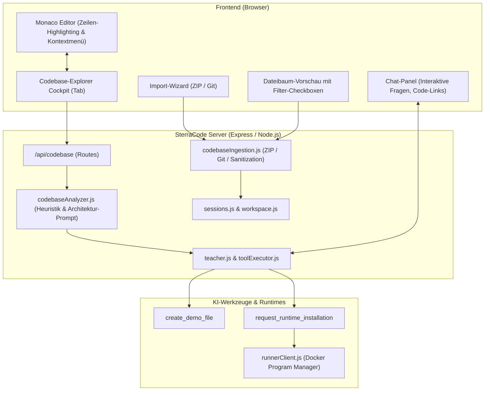
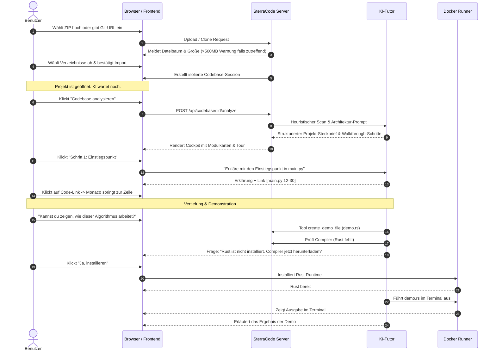

# Planungsdokument: Codebase-Explorer & Lernmodus ("Code Verstehen & Erklären")

> **Status:** Entwurf / Spezifikation nach `/grill-me` Designentscheidungen  
> **Projekt:** SterraCode  
> **Ziel:** Vollständiger Modus zum Importieren beliebiger Code-Projekte (ZIP-Upload / Git-Clone) und didaktisch geführtem Verstehen von Codebasen beliebiger Programmiersprachen.

---

## 1. Übersicht & Zielsetzung

Der neue **Codebase-Explorer** erweitert SterraCode um die Fähigkeit, bestehende Softwareprojekte jeder beliebigen Programmiersprache in eine eigene, isolierte Session zu importieren. Entwickler und Lernende können damit komplexe fremde oder eigene Codebasen schrittweise analysieren, verstehen und interaktiv erkunden.

### Kernanforderungen & Designentscheidungen (aus dem Grill-Me Interview):
1. **Didaktik:** Hybrides Modell aus strukturierter Architektur-Übersicht, geführter Modul-Tour und freiem Erkunden per Klick und Chat.
2. **Import-Quellen:** ZIP-Upload über die Weboberfläche und Git-Clone (HTTPS & SSH).
3. **Schrittweiser Import-Wizard:** Vor dem endgültigen Laden wird ein interaktiver Dateibaum mit Checkboxen angezeigt, um unwichtige Verzeichnisse/Dateien abzuwählen. Standardmäßige Ausschlussfilter für Build-Artefakte und Abhängigkeiten (`node_modules`, `.git`, `dist`, `__pycache__`, etc.).
4. **Größen- & Sicherheitsregeln:** Keine künstliche Obergrenze; bei über **500 MB** erscheint ein deutlicher Bestätigungsdialog mit Anzeige der tatsächlichen Größe. Schutz vor Zip-Bomben und Path-Traversal (`../`).
5. **Git-Konfiguration:** Volle Unterstützung von SSH-Keys und HTTPS Personal Access Tokens (PAT), konfigurierbar und geschützt gespeichert in den Einstellungen.
6. **Manuell getriggerte KI-Analyse:** Nach dem Importieren startet die KI-Analyse nicht ungefragt, sondern erst durch einen Klick auf **"Codebase analysieren"**, um unnötigen Tokenverbrauch und Verzögerungen zu vermeiden.
7. **Lern-Cockpit & Monaco-Integration:** Eigener Tab/Bereich für Architektur und Tour-Schritte; klickbare Code-Referenzen im Chat springen direkt zu den Zeilen in Monaco; Editor-Kontextaktionen ("Diesen Codeabschnitt erklären").
8. **Demonstrations-Dateien & dynamische Compiler-Installation:**
   - Der Fokus liegt primär auf statischer Code-Analyse (funktioniert für absolut jede Sprache).
   - Die KI kann zur Veranschaulichung separaten Demo-Code anlegen und ausführen.
   - Fehlt dafür ein Compiler/Interpreter, fragt die KI im Chat interaktiv nach ("Für diese Demo wird Rust benötigt. Möchtest du den Compiler jetzt installieren?"). Bei Zustimmung lädt der Server/Runner den Compiler automatisch herunter und die KI führt die Demonstration aus.
9. **Workspace-Lifecycle:** Jedes Projekt ist eine eigenständige Session mit isoliertem Workspace. Einzelne Unterordner oder die komplette Session können jederzeit rückstandsfrei gelöscht werden.

---

## 2. Architektur & Komponenten

---

## 3. Backend-Spezifikation

### 3.1 Neue & erweiterte Server-Module

#### `server/services/codebaseIngestion.js`
Zuständig für das sichere Empfangen, Entpacken und Klonen von Codebasen:
- **ZIP-Entpackung (`extractZipArchive`):**
  - Streaming-Extraktion mit Sicherheitschecks (Prüfung gegen Path-Traversal, absolute Pfade, unzulässige Sonderzeichen).
  - Decompression-Ratio-Schutz (Zip-Bomb-Prävention).
  - Dateigrößen-Zähler: Aggregierte Gesamtgröße wird vorab ermittelt. Liegt sie über 500 MB, wird ein Bestätigungs-Token verlangt.
- **Git-Klonen (`cloneGitRepository`):**
  - Ausführen von `git clone --depth 1` in einen temporären Quarantäne-Ordner.
  - Sichere Verwendung konfigurierter SSH-Keys (`GIT_SSH_COMMAND`) oder HTTPS Personal Access Tokens (Maskierung von Credentials in Logs/Fehlermeldungen).
- **Dateibaum-Scanner & Filter (`scanTree`):**
  - Rekursives Scannen und Kategorisieren in Quellcode-, Dokumentations- und Binärdateien.
  - Standardmäßige Markierung von Ausschlussmustern:
    `.git`, `node_modules`, `vendor`, `target`, `dist`, `build`, `__pycache__`, `.venv`, `.idea`, `.vscode`, `.DS_Store`, Binärdateien (`.exe`, `.dll`, `.so`, `.wasm`, `.zip`, `.jar`).
  - Rückgabe der Baumstruktur an den Frontend-Wizard zur manuellen An-/Abwahl.
- **Materialisierung in Session (`materializeSessionFromTree`):**
  - Übernimmt nur die vom Nutzer bestätigten Dateien in den Workspace der neuen Session.

#### `server/services/codebaseAnalyzer.js`
Führt die manuelle Struktur- und Voranalyse durch:
- **Heuristische Kennzahlen:**
  - Erkennung des Tech-Stacks anhand von Marker-Dateien (`package.json`, `Cargo.toml`, `go.mod`, `pom.xml`, `requirements.txt`, `CMakeLists.txt` etc.).
  - Auffinden primärer Einstiegspunkte (`main.*`, `index.*`, `app.*`, `server.*`, `cli.*`).
  - Berechnung der Dateistatistiken (Anzahl Quellcodedateien, Hauptsprachen).
- **KI-Architektur-Zusammenfassung (`generateArchitectureOverview`):**
  - Kompakte Anfrage an das LLM (unter Wahrung minimalen Token-Budgets) mit Tech-Stack, Dateibaum (bis Ebene 3) und README-Auszügen.
  - Ausgabe eines strukturierten Steckbriefs:
    1. **Projekt-Zweck & Kernidee** (1–2 Absätze).
    2. **Wichtigste Komponenten / Module** (z. B. API, Core-Logik, UI, Storage).
    3. **Einstiegspunkte & Datenfluss** (Wo startet das Programm? Wie fließen Daten durch?).
    4. **Empfohlene Lern-Tour** (Schritt 1: Einstiegspunkt, Schritt 2: Datenmodell, Schritt 3: Geschäftslogik, etc.).
- **Persistierung:** Speicherung des Analyseergebnisses in `session.project.codebaseAnalysis`.

#### `server/services/tools.js` & `server/services/toolExecutor.js`
Erweiterung um zwei neue KI-Werkzeuge für den Erklär-Modus:
1. `create_demo_file`:
   - *Parameter:* `path` (z. B. `demos/demo_workflow.py`), `code`, `description`.
   - Legt eine isolierte Demonstrationsdatei an, ohne bestehende Projektdateien zu überschreiben.
2. `request_runtime_installation`:
   - *Parameter:* `language` (z. B. `"rust"`), `reason` (z. B. "Ausführen des Demo-Skripts zur Berechnung von X").
   - Löst eine interaktive Systemfrage im Chat aus (Typ `runtime-install-request`).
   - Bei Benutzerzustimmung ruft der Server die bestehende Runner-Programmaktion auf (`POST /api/programs/:id/actions`, `action: "install"`), wartet auf Fertigstellung und übergibt die Erfolgsmeldung zurück an die KI.

### 3.2 Neue REST-Endpunkte (`server/routes/codebase.js`)

| Endpunkt | Methode | Beschreibung |
| :--- | :--- | :--- |
| `/api/codebase/scan-zip` | `POST (multipart)` | Lädt ein ZIP hoch, entpackt es in Quarantäne, ermittelt Größe/Dateibaum und meldet Warnung falls > 500 MB. |
| `/api/codebase/scan-git` | `POST (JSON)` | Clont ein Repository mit URL und hinterlegtem SSH/Token in Quarantäne und gibt den Dateibaum zurück. |
| `/api/codebase/confirm-import` | `POST (JSON)` | Erstellt die neue Session mit den ausgewählten Dateien und räumt die Quarantäne auf. |
| `/api/codebase/:id/analyze` | `POST` | Startet manuell die KI-Architektur-Analyse für die Session (SSE-Streaming für Fortschrittsanzeige). |
| `/api/codebase/:id/analysis` | `GET` | Liefert das gespeicherte Analyseergebnis (Cockpit-Daten). |

---

## 4. Frontend-Spezifikation

### 4.1 Import-Wizard (`public/js/importWizard.js`)
Ein responsiver modaler Dialog mit zwei Tabs:
1. **ZIP-Datei hochladen:**
   - Drag & Drop Bereich oder Dateiauswahl.
   - Sofortige Validierung und Upload-Fortschrittsbalken.
2. **Git Repository klonen:**
   - URL-Eingabe (HTTPS oder SSH).
   - Auswahl der Authentifizierung: "Öffentlich", "Gespeicherter HTTPS-Token" oder "Gespeicherter SSH-Key".
   - Optionaler Branch-Name (Standard: Default Branch des Repositories).
3. **Schritt 2: Dateivorschau & Filter-Auswahl:**
   - Interaktiver Baum (Dateien & Ordner).
   - Schnellauswahl-Aktionen: "Alles auswählen", "Nur Quellcode (empfohlen)", "Ausschlussfilter anwenden".
   - Checkboxen pro Knoten zum manuellen An-/Abwählen.
   - **500 MB Warnhinweis:** Falls die gewählte Gesamtgröße 500 MB übersteigt, erscheint ein prominentes Warnbanner mit genauer MB-Angabe und der Frage: *"Dieses Projekt ist sehr groß (X MB). Wirklich importieren?"*.
4. **Schritt 3: Import abschließen:**
   - Session-Name eingeben oder Vorschlag übernehmen.
   - Erstellt die Session und leitet automatisch zum neuen Codebase-Explorer weiter.

### 4.2 Codebase-Explorer Cockpit (`public/js/codebaseExplorer.js`)
Neues Panel im Hauptbereich (oder als umschaltbarer Tab neben Editor/Lernplan):
- **Status "Unanalysiert":**
  - Großer Button: **"Codebase analysieren"** mit Erläuterung (Token-transparent).
  - Schnelle Eckdaten: Gesamtzahl der Dateien, erkannte Hauptsprache, Projektstruktur.
- **Status "Analysiert" (Lern-Cockpit):**
  - **Architektur-Karte:** Zusammenfassung der Kernarchitektur mit Badges für Tech-Stack und Frameworks.
  - **Modul-Navigation:** Klickbare Karten für die Hauptmodule (z. B. `Backend API`, `Datenbank-Modelle`, `Frontend-Routing`). Klick filtert den Dateibaum oder öffnet die Hauptdatei.
  - **Geführte Walkthrough-Tour:** Schritt-für-Schritt-Leitfaden (1. Einstiegspunkt `main.rs` -> 2. Konfiguration -> 3. Request-Pipeline). Klick auf "Diesen Schritt ansehen" öffnet die Datei in Monaco und schickt dem Tutor den Kontext.
  - **Aktion "Neu analysieren":** Erlaubt das Auffrischen nach manuellen Änderungen.

### 4.3 Monaco-Editor & Chat-Verlinkung (`public/js/editor.js` & `public/js/chat.js`)
- **Klickbare Code-Referenzen:**
  - Erwähnt die KI im Chat oder im Cockpit Pfade und Zeilen (z. B. `src/server.js#L42-L65`), wird dies als anklickbarer Link gerendert.
  - Ein Klick öffnet automatisch die entsprechende Datei im Monaco-Editor, scrollt sanft zur Zeile und hebt den Bereich kurzzeitig farblich hervor.
- **Kontextmenü im Monaco-Editor:**
  - Markiert der Nutzer einen Codeabschnitt, erscheint im Editor-Rechtsklickmenü:
    - *"Diesen Codeabschnitt erklären"*
    - *"Wie hängt dieser Code mit dem Rest des Projekts zusammen?"*
  - Sendet den ausgewählten Code inklusive Dateipfad und Zeilennummern direkt an den Tutor.

### 4.4 Einstellungen (`public/js/settings.js`)
- Neuer Bereich **"Git-Zugangsdaten"**:
  - Verwaltung von HTTPS Personal Access Tokens (für GitHub, GitLab etc.).
  - Verwaltung von SSH Private Keys mit Public-Key-Generierung/Anzeige.
  - Sichere Speicherung im Backend (`DATA_DIR/credentials/git.json`) ohne Offenlegung des Klartextes an Dritte.

---

## 5. Didaktischer Ablauf & Interaktions-Workflow

---

## 6. Sicherheits-, Speicher- & Bereinigungs-Architektur

1. **Path-Traversal & Symlink-Schutz:**
   - Alle Archiv-Pfade werden vor dem Entpacken normalisiert (`path.normalize`).
   - Pfade mit `..`, Root-Schrägstrichen oder reservierten Windows-Zeichen (`:`, `*`, `?`) werden strikt abgewiesen.
   - Symlinks innerhalb von ZIPs oder Git-Repositories werden ignoriert und niemals dereferenziert.
2. **Zip-Bomb-Prävention:**
   - Maximale Entpackungs-Expansionsrate von 1:100.
   - Vorab-Prüfung der unkomprimierten Header-Größen.
3. **Session-Isolation & Löschung:**
   - Jede Codebase erhält ein eigenes Workspace-Verzeichnis `DATA_DIR/workspaces/{sessionId}`.
   - **Vollständiges Löschen:** Das Löschen der Session über die UI entfernt alle Dateien, Git-Metadaten, temporäre Quarantäne-Ordner und stoppt alle laufenden Prozesse im Runner.
   - **Teillöschung:** Im Workspace-Dateibaum können einzelne Unterordner oder Dateien jederzeit gelöscht werden (`DELETE /api/workspaces/:id/files?path=...`).
4. **Git-Sicherheit:**
   - Git-Befehle werden niemals mit unescaped Shell-Strings aufgerufen, sondern über `execFile` mit festen Argument-Arrays.
   - Tokens und Passwörter werden in Fehlerausgaben und Logdateien automatisch unkenntlich gemacht (`***`).

---

## 7. Phasenbasierter Implementierungsplan

### Phase 1: Backend Ingestion & Sicherheit
- Implementierung von `server/services/codebaseIngestion.js` (Streaming-ZIP-Extraktor, Zip-Bomb-Schutz, Sanitization).
- Git-Klon-Integration via `execFile` (`git clone --depth 1`) mit Unterstützung für SSH und Tokens.
- Scanner für Dateibäume, Dateigrößen-Aggregation und Standard-Ausschlussfilter.
- Unit-Tests für Entpackung, Schutz gegen Path-Traversal und Größen-Warnungen.

### Phase 2: Import-Wizard & Settings
- Dialog-Komponente `public/js/importWizard.js` mit Tabs für ZIP und Git.
- Interaktiver Dateibaum mit Checkboxen und 500 MB-Warnmodal.
- Erweiterung von `public/js/settings.js` und `server/routes/auth.js` / Provider-Speicher für Git-Keys und Tokens.
- Anbindung an `server/routes/codebase.js` für Scan und Import-Bestätigung.

### Phase 3: Manuelle KI-Analyse & Cockpit-UI
- Entwicklung von `server/services/codebaseAnalyzer.js` (Tech-Stack-Erkennung, Heuristiken, schlanker Architektur-Prompt).
- Endpunkt `POST /api/codebase/:id/analyze`.
- UI-Cockpit `public/js/codebaseExplorer.js` mit Button "Codebase analysieren", Modul-Karten und Tour-Schritten.
- Speicherung und Wiederherstellung des Analysezustands in der Session.

### Phase 4: Didaktische Interaktion, Editor-Linking & Demo-Tools
- Erweiterung von `public/js/editor.js` um klickbare Zeilenlinks und das Rechtsklick-Kontextmenü "Code erklären".
- Registrierung der neuen Tools in `server/services/tools.js` und `toolExecutor.js`:
  - `create_demo_file`
  - `request_runtime_installation`
- Frontend-Handler für interaktive Installations-Rückfragen im Chat (`answerQuestion`-Kompatibilität).
- Verknüpfung mit dem Runner (`POST /api/programs/:id/actions`).

### Phase 5: Internationalisierung (i18n), Tests & Abnahme
- Lokalisierung aller UI-Texte, Dialoge, Fehlermeldungen und Systemprompts in Deutsch, Englisch und Spanisch (`shared/i18n/locales/{de,en,es}/`).
- Vitest-Tests für Ingestion, Filterung und Analyzer.
- Playwright E2E-Tests:
  - ZIP-Upload -> Dateibaum-Abwahl -> Session-Erstellung.
  - Manuelle Analyse starten -> Cockpit-Anzeige prüfen.
  - Klick auf Code-Link springt in Monaco-Zeile.
  - Session-Löschung räumt Festplatte auf.
- Dokumentations-Update und Verifikation im Docker-Container.
