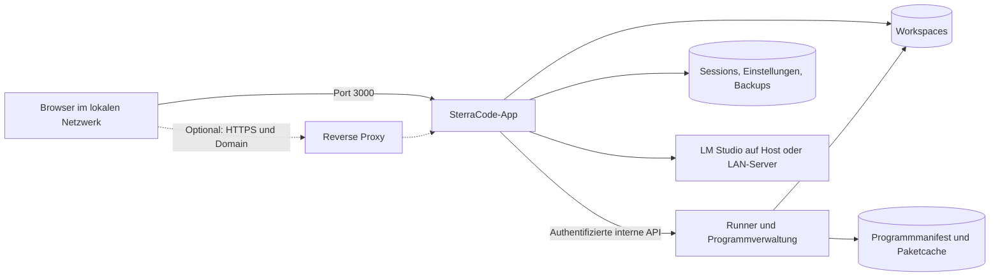

# SterraCode: Umbau für Docker und Serverbetrieb

Stand: 18.10.2026, vertieft nach Durchsicht von Serverstart, Prozessdienst, Routen, Datenpfaden und Oberfläche. Planungsbranch: `feature/docker-deployment`, ausgehend von `main` bei `d5d0f3d`.

Dieses Dokument beschreibt den geplanten Umbau. Die Docker-Funktionen sind noch nicht implementiert. `npm start`, `start.ps1` und `start.bat` bleiben der lokale Entwicklungsweg.

## 1. Gewünschtes Ergebnis

SterraCode soll sich mit Docker Compose auf Windows und Linux einrichten lassen. Auf dem Host werden Docker und Compose benötigt; Node.js, Java und die anderen Sprachlaufzeiten kommen in die Container.

Beim ersten Öffnen führt SterraCode durch die Einrichtung. Der Nutzer wählt zusätzliche Programme aus, beispielsweise Java und Python. Die ausgewählten Programme werden heruntergeladen und in der Docker-Umgebung installiert. Unter **Einstellungen → Programme** können sie später installiert, deaktiviert und tatsächlich deinstalliert werden.

Der Standardzugang ist `http://<LAN-IP-des-Servers>:3000`. Der Port ist vorgegeben und änderbar. Domains, HTTPS und ein vorhandener Reverse Proxy lassen sich über eine Konfigurationsdatei einrichten.

Für die erste Ausbaustufe gelten folgende Festlegungen:

- Windows: Docker Desktop im Modus für **Linux-Container**, vorzugsweise mit WSL 2. Linux: Docker Engine mit Compose. Dadurch verwenden beide Plattformen dieselben Images. Native Windows-Container wären eine eigene Portierung. Docker Desktop wird laut Hersteller nicht auf Windows Server unterstützt; dort wäre für diesen Aufbau eine Linux-VM mit Docker vorgesehen. [Docker-Dokumentation](https://docs.docker.com/desktop/setup/install/windows-install/)
- Eine gemeinsam verwendete SterraCode-Instanz mit einem Administratorzugang. Die bisherigen Lern-Sessions bleiben erhalten. Getrennte Benutzerkonten und gegeneinander abgeschottete Benutzerumgebungen benötigen eine spätere Erweiterung.
- Zuerst verbindliche Unterstützung für `linux/amd64`. `linux/arm64` erhält dieselben Funktionen, sobald alle Katalogprogramme auf dieser Architektur geprüft sind; die Freigabe erfolgt pro Architektur.
- Die vorhandene Oberfläche mit Express, Monaco und Vanilla JavaScript bleibt die Grundlage.

## 2. Ausgangslage im Repository

| Bereich                | Aktueller Stand                                                                                        | Nötige Änderung                                                                             |
| ---------------------- | ------------------------------------------------------------------------------------------------------ | ------------------------------------------------------------------------------------------- |
| Serverstart            | `server/index.js` bindet fest an `127.0.0.1`; Port über `PORT`, Standard 3000                          | Konfigurierbare Bind-Adresse; im Container `0.0.0.0`                                        |
| Netzwerkprüfung        | `server/app.js` erlaubt ausschließlich localhost-Hosts und prüft den Ursprung direkt gegen den Request | Konfigurierte Serveradressen und vertrauenswürdige Proxys berücksichtigen                   |
| Zugriff                | Keine Anmeldung; bisher Schutz durch lokalen Betrieb                                                   | Anmeldung und geschützte Ersteinrichtung vor der LAN-Freigabe                               |
| Programme              | `server/services/processes.js` sucht neun Laufzeiten im lokalen `PATH`                                 | Programmkatalog, Installation, Deinstallation und Runner-Anbindung                          |
| Codeausführung         | Kompilierung, Terminal und Nutzerprogramme laufen als Backend-Unterprozesse                            | In einen separaten Runner verschieben                                                       |
| Einstellungen          | `server/services/storage.js`, API in `server/routes/chat.js`, Dialog in `public/app.js`                | Serverkonfiguration, Programmzustand und Oberflächeneinstellungen getrennt verwalten        |
| Daten                  | Standard `server/data/`; `STERRACODE_DATA_DIR` existiert bereits                                       | Dauerhafte Volumes und eigener Workspace-Pfad                                               |
| Workspace-Lebenszyklus | `server/services/sessions.js` und `storage.js` setzen den Workspace-Pfad mehrfach direkt zusammen      | Einen gemeinsamen konfigurierbaren Pfad auch für Erstellen, Migration und Löschen verwenden |
| KI-Verbindung          | Standard `http://localhost:1234`; natives LM-Studio-SDK mit WebSocket-Verbindung                       | Docker-Host-/LAN-Adresse, optionale Authentifizierung und Verbindungstest                   |
| Installation           | Windows-Skripte prüfen Programme auf dem Host; Docker-Dateien fehlen                                   | Compose, Images und Installationsskripte für beide Plattformen                              |
| Prozesszustand         | `processes.js` hält Aufträge, Ausgabe und Kindprozesse in einer Map im App-Prozess                     | Der Runner wird Quelle des Zustands; die App vermittelt nur                                   |
| Compilergebnisse       | `runCode` schreibt nach `DATA_DIR/runs/<Auftrag>` und löscht das Verzeichnis danach                    | Gesamte Kompilierung in den Runner; Temp-Verzeichnis nur auf dessen Volume                   |
| Terminal               | Freie Befehle über `spawn` mit `shell: true`; Eingabe wird zeilenweise ergänzt; Ausgabe höchstens 1 MiB | Im Runner ausdrücklich `bash -c` mit bereinigter Umgebung; Grenzen bleiben                   |
| Laufzeitprüfung        | `getRuntimes` prüft den lokalen `PATH` und fasst „vorhanden“ und „aktiviert“ in `available` zusammen    | Prüfung im Runner; Installationsstand und Aktivierung getrennt melden                        |
| Frontend               | Abrufe und Monaco unter absoluten Pfaden `/api` und `/monaco`; ungespeicherte Entwürfe im `localStorage` | Betrieb nur an der URL-Wurzel; Monaco gehört ins Image; Browserentwürfe wandern nicht mit    |
| Kontext                | Zusammenfassungen unter `context/<Session-UUID>/` im Datenverzeichnis                                  | Bleibt im App-Volume                                                                          |
| Tests                  | Vitest und Playwright vorhanden                                                                        | Docker-, Netzwerk-, Programmverwaltungs- und Wiederherstellungstests ergänzen               |

Die historische Annahme einer ausschließlich lokalen Einzelplatzanwendung wird für diesen Umbau erweitert. Der vorhandene Desktopstart per npm kann als Entwicklungsweg erhalten bleiben.

## 3. Containeraufbau

Empfohlen werden zwei dauerhaft laufende Dienste und ein optionaler HTTPS-Proxy:



### App

- Enthält Weboberfläche, API, Lernplan, Chat, Kontextverwaltung und Datenhaltung.
- Läuft als unprivilegierter Benutzer; Anwendungsdateien bleiben schreibgeschützt.
- Veröffentlicht ausschließlich den konfigurierten Webport.
- Übergibt Ausführungsaufträge an den Runner. Im Docker-Modus werden Nutzer- und KI-Befehle ausschließlich dort gestartet; bei Runner-Ausfall gibt es keinen Rückfall auf das Backend.

### Runner mit Programmverwaltung

- Enthält die installierten Sprachlaufzeiten und übernimmt Kompilierung, Ausführung, Terminaleingaben, Ausgabe und Prozessabbruch.
- Besitzt keinen veröffentlichten Hostport. Seine Steuerung ist nur über das Compose-Netzwerk mit eigener Dienstauthentifizierung erreichbar.
- Ein begrenzter privilegierter Steuerprozess darf freigegebene Systempakete installieren und entfernen. Kompilierung und Nutzerbefehle starten ausdrücklich unter einer unprivilegierten UID, ohne Zusatzgruppen und mit einer bereinigten, ausdrücklich zusammengestellten Umgebung.
- Steuerdateien, Dienstschlüssel, Paketdatenbank und Programmmanifest gehören dem Steuerprozess. Dienstschlüssel und das Auftragsjournal sind für ausgeführten Code weder lesbar noch beschreibbar; die Paketdatenbank ist für ihn mindestens nicht beschreibbar. Dienstschlüssel werden nicht an Kindprozesse vererbt.
- Der Runner erhält nur das Workspace-Volume und seine eigenen Zustands-/Cache-Volumes. Sessions, Anmeldeinformationen und LM-Studio-Geheimnisse der App werden nicht hineingemountet.
- Installation und Deinstallation verwenden feste Paketzuordnungen und Argumentlisten. Freie Shellbefehle gehören ausschließlich zur unprivilegierten Codeausführung.
- Ressourcenlimits, Prozesslimits, Zeitlimits, Ausgabelimit und vollständiges Beenden von Prozessbäumen werden beibehalten beziehungsweise auf Containerebene ergänzt.

Der bestehende Prozessdienst erhält eine austauschbare Ausführungsanbindung: lokal für den bisherigen Entwicklungsstart, entfernt für Docker. Die öffentlichen Terminal- und Execute-APIs sowie die KI-Tools sollen möglichst ihre bisherigen Verträge behalten. Das interne Runner-Protokoll erhält eine Version und eindeutige, dauerhaft protokollierte Auftrags-IDs; Wiederholungen nach einem Verbindungsabbruch dürfen Befehle nicht doppelt starten. Nach einem Runner-Neustart werden unterbrochene Aufträge ausdrücklich als unterbrochen oder mit unbekanntem Ergebnis markiert, statt sie automatisch erneut auszuführen.

Dieser Aufbau trennt ausgeführten Code von der App. Alle Lern-Sessions teilen zunächst einen Runner; eine gegenseitige Sicherheitsisolation zwischen Sessions wird damit noch nicht zugesichert. Dieselbe unprivilegierte UID kann die Workspaces der anderen Sessions lesen und beschreiben, und freie Shellbefehle laufen in deren Netzwerk-Namespace. Docker-Socket, Hostverzeichnisse mit Systemdaten, `privileged: true` und ein abgeschaltetes Seccomp-Profil werden für diesen Aufbau nicht verwendet. Der App-Dienst setzt `cap_drop: [ALL]`. Der Runner behält den üblichen Capability-Satz eines Containers, erhält keine weiteren und wird beim Pakettest darauf geprüft. Beide Dienste setzen `no-new-privileges` und `init: true`, damit Kindprozesse Zombies nicht bei Node als PID 1 hinterlassen und ein Prozessgruppen-Signal den Container nicht mitbeendet.

`serial()`, die Auftragsliste, der LM-Studio-Clientcache, Abbruchsignale und die Anmeldebremse liegen im Speicher eines Node-Prozesses. Der App-Dienst bleibt deshalb auf genau eine Instanz festgelegt. Ein zweites Replikat würde Sessions, Terminal und Anmeldung auseinanderlaufen lassen.

### Ausführungsprotokoll

Die heutigen Verträge bleiben die Fassade der App:

- `POST /api/terminal` startet einen Auftrag und antwortet sofort.
- `GET /api/terminal/:id/output?offset=` liefert nur den neuen Auszug.
- `POST /api/terminal/:id/input` hängt eine Zeile an, höchstens 65.536 Zeichen.
- `DELETE /api/terminal/:id` beendet den Prozessbaum. Die Session-ID steht im JSON-Körper; ein Proxy muss DELETE-Körper weiterreichen.
- `POST /api/execute` hält die Verbindung bis zum Ende von Kompilierung und Lauf.
- Pro Session läuft höchstens ein Prozess. Die Grenze prüft der Runner, nicht nur die App.
- Chat-Abbruch und das Löschen einer Session beenden den zugehörigen Runner-Auftrag. Heute koppelt `toolExecutor.js` das Abbruchsignal an `stopProcess`, und `routes/sessions.js` ruft `stopSessionProcesses` auf. Beide Wege müssen die Runner-API erreichen.
- Das Terminal bleibt zeilenorientiert. Ein PTY wird in dieser Ausbaustufe nicht eingeführt.

Intern spricht die App den Runner über eine versionierte API an, erreichbar nur im Compose-Netz mit Dienstauthentifizierung. Jeder Aufruf verlangt das Geheimnis, auch von localhost, weil ausgeführter Code dieselbe Netzwerkschnittstelle sieht. Das Geheimnis liegt in einer Datei mit Modus `0400` des Steuerbenutzers, nie in der Befehlszeile und nie in der Umgebung der Kindprozesse.

Ablauf eines Auftrags:

1. Die App vergibt eine Idempotenz-ID und sendet Session, Art (`file` oder `command`), relative Pfade, Sprache, Befehl, Akteur und die Zeitlimits aus den Einstellungen.
2. Der Runner schreibt den Auftrag auf sein Zustandsvolume, bevor er einen Prozess startet.
3. Eine Wiederholung derselben ID liefert denselben Auftrag und startet keinen zweiten Prozess.
4. Endet der Runner nach dem Journal und vor dem Start, bleibt der Auftrag unterbrochen und wird nicht nachgeholt.
5. Nach dem Ende bleibt die Ausgabe fünf Minuten abfragbar, analog zum heutigen Aufräumen in `processes.js`. Die App hält keine zweite Ausgabequelle. Der dauerhafte Idempotenz-Nachweis bleibt unabhängig davon erhalten: Dieselbe ID darf auch nach Ablauf der Ausgabe keinen zweiten Prozess starten.
6. Nach einem Neustart der App fragt sie laufende Aufträge beim Runner nach. Die Auftrags-ID im Browser bleibt gültig, solange der Runner sie noch führt.
7. Ist der Runner nicht erreichbar, antwortet die App mit einem eigenen Fehlercode und startet nichts lokal.

`runCode` wandert vollständig in den Runner. Die App schickt relative Pfade und lässt den Runner Workspace, Quelllauf, erzeugte `.csproj`-Dateien und Klassenpfade selbst auflösen. Absolute Hostpfade würden im Container ins Leere zeigen. Die bestehenden Grenzen bleiben dort wirksam: Suchtiefe 20, höchstens 1.000 Quelldateien, Überspringen von Symlinks sowie von `node_modules`, `.git`, `bin`, `obj` und `target`, Ausgabegrenze 1 MiB, UTF-8-Decoder. Temporäre Compilergebnisse liegen auf dem Temp-Volume des Runners, nicht mehr unter `DATA_DIR/runs`. Dieses Volume muss Programmausführung erlauben. Beim Start räumt der Runner liegen gebliebene Auftragsverzeichnisse ab. Kindprozesse arbeiten mit dem Session-Workspace als Arbeitsverzeichnis. Schreiben sie Dateien dorthin, entsteht dadurch kein Eintrag in `changes/`; das entspricht dem heutigen Verhalten.

Zeitlimits übergibt die App aus `executionTimeout` und `compilationTimeout`. Der Runner erzwingt zusätzlich die heute schon gültige Obergrenze von 600.000 ms. Ein gespeichertes Ausführungslimit `0` lässt den App-Timer weiterhin weg, wie in der bestehenden Bedienung. Begrenzt bleibt der Auftrag dann durch Speicher, Prozesszahl und manuelles Stoppen. Kompilierung hat schon heute ein Mindestlimit.

`POST /api/execute` kann Kompilierung und Lauf nacheinander bis zu dieser Obergrenze offen halten. Die Zeitlimits von App, Runner und einem vorgeschalteten Proxy müssen dafür mindestens 20 Minuten betragen. Der Chat-Strom sendet bereits alle 15 Sekunden einen Herzschlag und setzt `X-Accel-Buffering: no`. Ein Proxy darf diesen Strom nicht puffern; bei Caddy ist das `flush_interval -1`. Zwischen Browser und App gibt es keine WebSocket-Verbindung. Die WebSocket-Verbindung zu LM Studio baut nur die App auf.

### Laufzeitumgebung

Im Container ist die Plattform immer Linux. Der Windows-Zweig mit `taskkill`, dem `py`-Starter und `program.exe` gilt nur für den lokalen Entwicklungsweg.

Freie Befehle starten als `bash --noprofile --norc -c`. Node mit `shell: true` würde `/bin/sh` verwenden, auf Debian also dash, und die Umgebung des Steuerprozesses erben. `BASH_ENV` bleibt leer. Die Umgebung der Kindprozesse wird ausdrücklich gesetzt und enthält mindestens:

- `PATH` nur mit den freigegebenen Werkzeugverzeichnissen
- `HOME` und `TMPDIR` auf dem Cache- beziehungsweise Temp-Volume, nicht im Home des Steuerprozesses
- `LANG` und `LC_ALL` als `C.UTF-8`
- `GOCACHE`, `GOPATH`, `GOMODCACHE`, `CARGO_HOME`, `RUSTUP_HOME`, `DOTNET_CLI_HOME`, `NUGET_PACKAGES`, den npm-Cache und `PIP_CACHE_DIR` auf dem Cache-Volume
- `DOTNET_CLI_TELEMETRY_OPTOUT=1`, `DOTNET_NOLOGO=1`, `DOTNET_SKIP_FIRST_TIME_EXPERIENCE=1`
- `GIT_TERMINAL_PROMPT=0` und ein enger `safe.directory`-Eintrag für das Workspace-Verzeichnis über `GIT_CONFIG_*`, damit ein gruppenbeschreibbares Volume Git nicht mit „dubious ownership“ abbricht
- `PYTHONUNBUFFERED=1` und `PYTHONDONTWRITEBYTECODE=1`

`DEBIAN_FRONTEND=noninteractive` gilt für den Steuerprozess, nicht für Nutzerbefehle. Eine Host-`.gitconfig` wird nicht eingehängt.

Dateirechte auf dem gemeinsamen Workspace:

- App-Benutzer `sterracode` mit UID/GID `10001`
- Ausführungsbenutzer `sterra-run` mit UID `10002` und Primärgruppe `10001`, ohne weitere Gruppen. Das erfüllt die Vorgabe „ohne Zusatzgruppen“ und erlaubt trotzdem das gemeinsame Workspace-Schreiben
- Workspace-Verzeichnisse gehören der Gruppe, tragen das Setgid-Bit und werden mit Umask `002` beschrieben, damit beide Seiten Dateien anlegen und löschen können
- das App-Datenvolume gehört UID `10001`, Modus `0700`, und ist im Runner nicht eingehängt
- Steuerdateien, Journal und Dienstgeheimnis gehören dem Steuerbenutzer und sind für `sterra-run` weder lesbar noch beschreibbar

Der Runner darf ausgehend ins Netz, weil `dotnet build`, `go run`, pip, cargo und npm Abhängigkeiten nachladen. Das ist keine Sandbox gegen die bedienende Person. Die App braucht ausgehend mindestens den Weg zu LM Studio und zum Runner. Eingehend veröffentlicht nur der vorgesehene Webport.

Gleichzeitige Kompilierungen über mehrere Sessions werden auf zwei begrenzt. Weitere Versuche erhalten eine verständliche Fehlermeldung. Die Paketsperre bleibt davon unabhängig. Als Startwerte für den Runner gelten 2 GiB Speicher und 256 Prozesse, für die App 1 GiB. Beide Werte stehen in der Compose-Datei und lassen sich dort anheben. Ein Speicher- oder Prozesslimit beendet den Runner-Auftrag nachvollziehbar; die App gilt dadurch nicht als ausgefallen.

### Was im App-Prozess bleibt

Sitzungen, `changes/`, Profile, Kontextcache, Einstellungen und die Lernlogik schreiben nur in der App. Der Runner liest und schreibt Workspace-Dateien sowie seine eigenen Volumes. Die bestehenden Migrationen beim Lesen einer Session und beim Kontextversionswechsel laufen weiterhin in der App und legen vorher eine Sicherung an. Der Import ergänzt diesen Weg und ersetzt ihn nicht.

## 4. Zusatzprogramme installieren und entfernen

### Programmkatalog

Die erste vollständige Version soll alle bereits angebotenen Sprachen abdecken:

| Programm         | Zweck                                         | Behandlung                                                                  |
| ---------------- | --------------------------------------------- | --------------------------------------------------------------------------- |
| Node.js und Bash | Steuerdienste, JavaScript und Terminal        | Feste Grundkomponenten; Sprachausführung kann deaktiviert werden            |
| Java JDK         | Java kompilieren und ausführen                | Optional; immer `java` und `javac` gemeinsam                                |
| Python           | Python ausführen                              | Optional                                                                    |
| Go               | Go-Projekte ausführen                         | Optional                                                                    |
| Rust mit Cargo   | Rust kompilieren und Abhängigkeiten verwalten | Optional, einschließlich benötigter Linker-Komponenten                      |
| C/C++-Werkzeuge  | C++ kompilieren                               | Optional; Compiler, Header und erforderliche Buildwerkzeuge als Paketgruppe |
| .NET SDK         | C# kompilieren und ausführen                  | Optional; SDK statt ausschließlich Runtime                                  |
| Lua              | Lua ausführen                                 | Optional                                                                    |
| Git              | Versionsverwaltung im Terminal                | Optional                                                                    |

Maven und Gradle können danach über denselben Katalog ergänzt werden; ihre Abhängigkeit vom JDK wird dabei ausdrücklich hinterlegt.

Jeder Katalogeintrag beschreibt ID, freigegebene Version, Architektur, Paketquelle, benötigte Pakete, Abhängigkeiten, geschätzten Speicherbedarf und Prüfkommandos. Die Einträge liegen in `runner/catalog/versions.lock` mit Paketname, Version, Architektur und Prüfsumme. Ein Eintrag für `linux/arm64` kann schon vorhanden, aber gesperrt sein. Der Runner installiert nur Einträge, deren Architektur zur eigenen passt. Konkrete Versionen und Image-Digests werden zu Beginn der Umsetzung geprüft und festgeschrieben. Freie Downloadadressen oder beliebige Installationsskripte werden nicht als Programmeingabe angeboten.

Die Prüfbefehle sind dieselben wie in `specs` von `processes.js`. Ein Rezept gilt erst als passend, wenn einer dieser Befehle erfolgreich ist:

| Sprache    | Akzeptierte Prüfung                                      |
| ---------- | -------------------------------------------------------- |
| Python     | `python --version`, sonst `python3 --version`           |
| JavaScript | `node --version`                                         |
| Bash       | `bash --version`                                         |
| Go         | `go version`                                             |
| Rust       | `rustc --version`                                        |
| C/C++      | `g++ --version`                                          |
| C#         | `dotnet --version`; die erste Zahl wird `sdkMajor`      |
| Lua        | `lua -v`, sonst `lua54 -v`, sonst `lua5.4 -v`           |
| Java       | `javac -version` und zusätzlich `java -version`         |

Der Windows-Starter `py` bleibt nur im lokalen Entwicklungsweg. Debian liefert häufig `python3` und `lua5.4` ohne die Kurznamen `python` und `lua`. Das Rezept muss einen der genannten Namen bereitstellen. Für C# muss das installierte SDK zur Heuristik `net<Hauptversion>.0` in `runCode` passen, und es muss mindestens Hauptversion 6 sein.

Quellen, sobald die Versionen feststehen:

- aus der festgeschriebenen Debian-Suite per apt: Python 3, ein OpenJDK mit `java` und `javac`, `g++` einschließlich Header und Linker, Lua 5.4, Git, Bash und CA-Zertifikate
- Node.js 24 aus dem gemeinsamen Basisimage, nicht aus einem zweiten Paket
- Go als signiertes, versionsfestes Upstream-Archiv mit Prüfsumme, weil die Debian-Fassung für den Unterricht schnell zu alt wird
- .NET SDK über die im Katalog genannte Microsoft-Quelle
- Rust als signierte, versionsfeste Upstream-Komponenten mit Prüfsumme, nicht als unpinned `rustup`-Shellskript und nicht als beliebiges Debian-`rustc`

`DEBIAN_FRONTEND` und ein Hinweis auf eine abweichende Containeruhr gehören in die Fehlermeldung, wenn apt an `valid-until` oder einer Signaturzeit scheitert. Das tritt mit falsch gehender WSL-Uhr unter Docker Desktop auf.

### Meldung an die Oberfläche

`available` bedeutet weiterhin „jetzt ausführbar“. Zusätzlich meldet die Laufzeitübersicht `installed` und `enabled`. Eine deaktivierte, aber installierte Sprache bleibt installiert und nennt den bisherigen Deaktivierungshinweis. Eine in den Einstellungen erlaubte, aber fehlende Sprache bleibt `installed: false`. Während eines Paketauftrags meldet die Übersicht dessen Zustand, nicht einen falschen Fehlbestand. `allowedLanguages` in `settings.json` bleibt nur der Schalter für die Deaktivierung und wird nicht in das Sollmanifest übernommen. Ein wiederhergestelltes Settings-Backup installiert deshalb keine entfernten Programme neu.

### Caches der Sprachwerkzeuge

Neben dem apt-Cache gibt es einen getrennten Werkzeugcache auf dem Runner-Volume: NuGet, Go-Module, Cargo-Registry, pip und npm. Er übersteht die Neuerstellung des Containers und wird von einer Deinstallation des Compilers nicht still mitgelöscht. Er ersetzt keine offline garantierte Wiederherstellung der Systempakete. Projektdateien wie `node_modules`, virtuelle Umgebungen oder `target` bleiben im Workspace.

### Installationsweg

Die Images basieren auf derselben festgelegten Debian-Suite mit einer passenden Node-24-Basis. Optionale Programme sind nicht bereits vollständig im Basisimage enthalten. Die Programmverwaltung verwendet signierte Paketquellen und feste Paketrezepte; zusätzliche Herstellerquellen etwa für .NET werden ausdrücklich im Katalog definiert und auf beiden Zielarchitekturen geprüft.

1. Die Oberfläche übermittelt Programm-ID und gewünschte Aktion.
2. Das Backend prüft Anmeldung, Katalogeintrag und laufende Vorgänge.
3. Die Programmverwaltung speichert einen Auftrag und sperrt parallele Paketänderungen.
4. Sie ermittelt die benötigten Pakete, lädt sie herunter, installiert und prüft Version und Funktion.
5. Erst nach erfolgreicher Prüfung meldet SterraCode das Programm als verfügbar. Die Laufzeitübersicht und der Ausführen-Button aktualisieren sich ohne App-Neustart.

Zustände wie `not-installed`, `queued`, `installing`, `installed`, `removing` und `error` werden mit Fortschritt und verständlichem Fehlertext angezeigt. Das bloße Deaktivieren einer Sprache bleibt eine getrennte Aktion.

### Deinstallation

- Entfernt die optional installierten Pakete tatsächlich aus dem Runner und setzt den gewünschten Programmzustand entsprechend zurück.
- Projektdateien, Lern-Sessions und Quellcode bleiben erhalten.
- Gemeinsam benötigte Pakete bleiben installiert, solange andere Programme sie benötigen. Grundkomponenten und Steuerdienste sind geschützt.
- Während einer Paketänderung werden neue Ausführungen gesperrt. Laufende Aufträge dürfen zu Ende laufen; ein ausdrücklich gewählter sofortiger Wechsel stoppt sie vorher. Das gilt auch für freie Terminalbefehle, deren tatsächliche Programmnutzung sich nicht zuverlässig vorhersagen lässt.
- Zugehörige Downloadcaches können zusätzlich gelöscht werden. Von Projekten selbst angelegte Dateien wie virtuelle Umgebungen oder Maven-/npm-Abhängigkeiten werden nicht still entfernt.

### Neustart und Containerupdates

Eine reine Paketinstallation in der beschreibbaren Containerschicht geht beim Ersetzen des Containers verloren. Deshalb speichert der Runner einen dauerhaften Sollzustand samt aufgelösten Paketversionen und Prüfsummen. [Docker: Lebenszyklus von Volumes und Containern](https://docs.docker.com/engine/storage/volumes/)

Bei normalem Neustart prüft er den vorhandenen Zustand. Nach Neuerstellung oder Update installiert er die gewählten Programme aus dem persistenten Paketcache beziehungsweise den freigegebenen Quellen erneut. Der Cache umfasst die benötigten optionalen Pakete einschließlich ihrer Abhängigkeiten; die Paketdatenbank selbst bleibt Teil des jeweiligen Runner-Containers. Komplette Systemverzeichnisse wie `/usr` werden nicht in ein Volume ausgelagert.

Während der Wiederherstellung bleibt die App für Datei- und Sessionarbeit erreichbar; die betroffenen Laufzeiten zeigen ihren tatsächlichen Zustand. Ein zwischenzeitlich deinstalliertes Programm wird nicht durch alte Installationsvorgaben erneut aktiviert. Fehlende Versionen, Netzwerkausfall oder beschädigte Pakete führen zu einem nachvollziehbaren Fehler und einer Wiederholungsaktion, nicht zu einem stillen Versionswechsel. Ein Basiswechsel benötigt eine ausdrücklich definierte Manifestmigration.

Paketänderungen sind nicht pauschal atomar. Das Auftragsjournal muss Unterbrechungen erkennen, den Paketmanager-Zustand prüfen und einen reparierbaren Zustand herstellen oder den Runner bis zur Reparatur für Ausführungen sperren.

## 5. Ersteinrichtung und Einstellungen

Geplanter Ablauf:

1. Repository beziehungsweise Release beziehen und `install.ps1` unter Windows oder `install.sh` unter Linux ausführen.
2. Das Skript prüft Docker, den laufenden Linux-Daemon, Compose und den Standardport 3000. Bei Portkonflikt wird ein anderer Port eingetragen.
3. Die LAN-Adresse wird auf dem Host ermittelt. Bei mehreren geeigneten Schnittstellen kann der Nutzer die richtige wählen. Virtuelle Docker-/WSL-Adressen werden nicht ungeprüft als Serveradresse verwendet.
4. Das Skript legt die Konfiguration an, startet die Basisdienste und zeigt Browseradresse und einmaligen Einrichtungsschlüssel an.
5. Im Browser wird mit diesem Schlüssel der Administratorzugang eingerichtet. Ein zufälliger erster Besucher kann die Instanz nicht übernehmen.
6. Danach folgt die Programmauswahl mit Größe und Zweck der einzelnen Extras. Anfangs sind nur die Grundkomponenten installiert; weitere Programme werden bewusst ausgewählt.
7. LM-Studio-Verbindung einrichten oder überspringen. Ohne Modell bleiben Datei-, Session- und Programmfunktionen nutzbar.

Nach abgeschlossener Einrichtung erscheint der Assistent bei Neustarts nicht erneut. **Einstellungen → Programme** verwendet denselben Programmkatalog und dieselbe Auftragsverwaltung. Ein Serverbereich zeigt Adresse, Port, Konfigurationsquelle und nötige Neustarts an. Netzwerk- und Sicherheitswerte bleiben dort schreibgeschützt. Der Fuß der Oberfläche nennt den erreichbaren Serverbetrieb; der heutige Text „Lokal auf deinem Rechner“ gilt nur noch für den npm-Start. Die allgemeine Netzwerkfehlermeldung in `public/js/api.js` spricht den erreichbaren Server an, nicht ausschließlich einen lokalen.

Für automatisierte Installationen sind eine optionale Liste initialer Programme und Zugangsdaten über Secret-Dateien vorgesehen. Diese initiale Programmliste wird nur bei der ersten Einrichtung übernommen; spätere UI-Änderungen sind maßgeblich. Die Installationsskripte benötigen keine zusätzliche Node-Installation auf dem Host; gemeinsame Validierung kann in einem einmalig gestarteten Hilfscontainer erfolgen.

### Anmeldung

Es gibt genau ein Administratorkonto. Die Anmeldedaten liegen in `auth.json` auf dem App-Volume, mit Version und Salt, gehasht über `crypto.scrypt`. Sie werden nicht in `settings.json` gemischt. `GET /api/chat/settings` liefert das Settings-Objekt wie heute, und `updateSettings` weist unbekannte Schlüssel weiter ab. Dadurch kann ein Passwort weder aus der Settings-API gelesen noch hineingeschrieben werden.

Der Einrichtungsschlüssel hat 32 zufällige Bytes, wird einmal angezeigt und nur als Hash gespeichert. Der Vergleich ist zeitkonstant. Er verfällt nach 30 Minuten und ist danach verbraucht. Er steht nicht in `.env`, nicht in Protokollen und nicht in `docker compose config`. Die Datei hat Modus `0600` und wird nach erfolgreicher Einrichtung gelöscht.

Die Sitzung ist ein zufälliger Wert im Cookie `sterracode.session`: `HttpOnly`, `SameSite=Lax`, Pfad `/`. `Secure` wird nur gesetzt, wenn `STERRACODE_PUBLIC_URL` mit `https:` beginnt. Im Standardbetrieb über HTTP im LAN würde ein erzwungenes `Secure` das Cookie verwerfen und die Anmeldung unsichtbar scheitern lassen. Gespeichert wird nur ein Hash. Die Sitzung gleitet 14 Tage mit der Nutzung und endet spätestens nach 90 Tagen. Login und abgeschlossene Einrichtung vergeben eine neue Sitzung. Ein Passwortwechsel widerruft bestehende Sitzungen.

Schreibende Zugriffe behalten die vorhandene JSON-Pflicht und die Origin-Prüfung. Zusammen mit `SameSite=Lax` trägt das die CSRF-Abwehr. Ein zweites CSRF-Token wird nicht eingeführt. Fehlversuche bei Einrichtung und Anmeldung werden im Speicher gebremst; das genügt, solange die App einprozessig bleibt.

Ohne Authentifizierung erreichbar sind nur `GET /api/health`, `GET /api/setup/status`, `POST /api/setup` und `POST /api/login`. Alle anderen `/api`-Pfade, einschließlich `/api/runtimes` und `/api/chat/settings`, verlangen eine Sitzung. Statische Dateien und `/monaco` bleiben ladbar, damit die Anmeldeseite erscheint. `public/app.js` fragt heute beim Start Modelle und Laufzeiten ab. Dieser Start muss bei `SETUP_REQUIRED` und `401` in Einrichtung oder Anmeldung verzweigen, bevor der übrige Ladeweg läuft. Der Healthcheck antwortet mit `{ "ok": true }` und nennt weder Hostnamen, Programmversionen noch den Einrichtungsstand, damit Compose die App auch vor dem Assistenten als lebendig sieht.

Ein vergessenes Passwort setzt ein einmaliger Hilfscontainer aus demselben App-Image zurück, während der reguläre App-Dienst gestoppt ist. Er mountet das App-Datenvolume, widerruft bestehende Sitzungen und erzeugt einen neuen Einrichtungsschlüssel zur erneuten Passwortvergabe. `docker compose exec` in einen gestoppten Container ist dafür kein gültiger Betriebsweg. Dafür gibt es keinen zweiten Zugang in der Oberfläche.

### Installer beim erneuten Aufruf

Ein zweiter Lauf von `install.ps1` oder `install.sh` erhält vorhandene Volumes, `.env` und ein bereits eingerichtetes Passwort. Einen neuen Einrichtungsschlüssel gibt es nur, solange die Einrichtung offen ist. Der Installer prüft `docker compose` als Plugin und `docker info` auf OSType `linux`. Ein Windows-Container-Modus endet mit einer verständlichen Meldung. Die Portprüfung bindet probeweise an die gewählte Adresse. Unter etwa 8 GiB freiem Speicher für Image und spätere SDKs erscheint eine Warnung, kein stiller Abbruch.

Firewall-Befehle für das gewählte Netz werden angezeigt. Ein optionaler Schalter richtet sie nach Bestätigung ein. Ohne Erhöhung der Rechte bleibt die Installation benutzbar und dokumentiert den fehlenden Schritt. Die LAN-Adresse wird bei DHCP als vergänglich behandelt. Eine Reservierung ist der vorgesehene Dauerbetrieb. Ein Diagnoseaufruf des Installers vergleicht die konfigurierte Adresse mit den aktuellen Schnittstellen und nennt den nötigen Neustart über die Startskripte.

`.env` enthält nur die nicht geheimen Werte aus Abschnitt 6. Zugangsdaten, LM-Studio-Token und der Einrichtungsschlüssel bleiben Dateien. Shellskripte und Dockerfiles werden mit LF gespeichert; eine `.gitattributes` hält `*.sh` und `Dockerfile*` darauf fest.

## 6. Netzwerk, Port und Domains

Als zentrale, vom Betreiber bearbeitbare Konfigurationsdatei dient `.env`, dokumentiert durch `.env.example`. Damit kann Compose insbesondere die Portfreigabe direkt aus derselben Datei beziehen. [Docker Compose: Variablen und Konfigurationsdatei](https://docs.docker.com/compose/how-tos/environment-variables/variable-interpolation)

Beispiel für eine vom Installer erzeugte LAN-Konfiguration; die IP ist durch die tatsächliche Hostadresse zu ersetzen:

```dotenv
STERRACODE_BIND_IP=192.168.178.50
STERRACODE_PORT=3000
STERRACODE_PUBLIC_URL=http://192.168.178.50:3000
STERRACODE_EXTRA_ALLOWED_HOSTS=localhost,127.0.0.1
STERRACODE_EXTRA_ALLOWED_ORIGINS=http://localhost:3000,http://127.0.0.1:3000
STERRACODE_TRUSTED_PROXIES=
STERRACODE_PROXY_MODE=off
STERRACODE_DOMAIN=
STERRACODE_LM_STUDIO_URL=http://host.docker.internal:1234
```

- Innerhalb des App-Containers bleibt die Bind-Adresse `0.0.0.0`, der interne Port 3000. Die Compose-Freigabe lautet sinngemäß `${STERRACODE_BIND_IP}:${STERRACODE_PORT}:3000`.
- Standardmäßig wird die gewählte LAN-IP veröffentlicht. Eine Freigabe auf allen Hostinterfaces kann ausdrücklich konfiguriert werden. Ohne konkrete Bind-IP veröffentlicht Docker Ports standardmäßig auf allen Hostadressen; das ist keine automatische Begrenzung auf das LAN. Hostfirewall und Routing gehören deshalb zum dokumentierten Zugriffskonzept. [Docker: Portfreigaben](https://docs.docker.com/engine/network/port-publishing/)
- Windows-Firewall und Linux-Firewall werden mit passenden Regeln für das gewünschte lokale Netz dokumentiert und durch einen Zugriffstest von einem zweiten Gerät geprüft. Es werden keine Routerfreigaben automatisch angelegt. Auch IPv6 muss in den Regeln berücksichtigt werden, wenn es freigegeben wird.
- `PUBLIC_URL` und zusätzliche ausdrücklich erlaubte Adressen bestimmen die Host-/Origin-Prüfung. Unbekannte Hosts und fremde Schreibursprünge bleiben gesperrt.
- Proxy-Header werden ausschließlich von konfigurierten Proxyadressen beziehungsweise Netzen vertraut. Ein pauschales `trust proxy = true` ist nicht vorgesehen. Schreibzugriffe behalten JSON-Prüfung und ergänzen CSRF-Schutz; der bestehende Same-Origin-Aufbau bleibt erhalten.
- Änderungen an Port, Bind-IP oder Proxyprofil werden nach Prüfung durch einen erneuten Start über die Docker-Startskripte beziehungsweise den dokumentierten Compose-Befehl angewendet. Die App steuert dafür nicht selbst den Docker-Daemon.
- Netzwerk- und Sicherheitsparameter aus der Serverkonfiguration sind in der Oberfläche schreibgeschützt. Normale UI-Einstellungen und der spätere Programm-Sollzustand liegen persistent in der App beziehungsweise Programmverwaltung. `STERRACODE_LM_STUDIO_URL` dient als Vorgabe für die erste Einrichtung; danach gilt die gespeicherte LM-Studio-Einstellung. Für administrative Overrides wird ein eigenes, ausdrücklich dokumentiertes Verhalten vorgesehen.
- Im Container liest die App den Hostport nicht aus `STERRACODE_PORT`. Sie lauscht auf `0.0.0.0:3000`. Ein abweichender Listen-Port würde die Compose-Zuordnung unterlaufen. Start mit ungültiger Konfiguration wird verweigert, statt auf einen offenen Standard zurückzufallen.
- `STERRACODE_PUBLIC_URL` hat Schema `http` oder `https`, keine Benutzerangaben und keinen Pfad außer leer oder `/`. Die Oberfläche ruft `/api` und `/monaco` absolut auf und hat kein `<base>`. Ein Unterpfad ist in dieser Stufe ein Konfigurationsfehler.
- Erlaubte Hosts werden mit `req.hostname` verglichen: ohne Port, IPv6 ohne Klammern. Die Origin-Prüfung verwendet weiterhin Protokoll, Host und Port.
- `trust proxy` steht auf der konkreten Proxy-Liste. Der Wert `true` und das Netz `0.0.0.0/0` sind ungültig. Nur dann wird `X-Forwarded-Proto` für `req.protocol` ausgewertet, damit eine HTTPS-Origin hinter Caddy zur Prüfung passt. Header von anderen Absendern ändern Protokoll und Host nicht.
- Der JSON-Körper bleibt auf 4 MiB begrenzt, die Editor-Datei auf 2 MiB. Ein Proxy muss mindestens 4 MiB durchlassen.
- Die erste LAN-Stufe veröffentlicht eine IPv4-Adresse. `0.0.0.0` und `::` sind die ausdrückliche Freigabe auf allen Schnittstellen und verlangen im Installer eine Bestätigung. Dual-Stack braucht zwei Publish-Einträge und entsteht nicht nebenbei aus einer IPv4-Adresse.

### Optionaler Domainbetrieb

Es werden zwei Konfigurationen vorbereitet: ein bereits vorhandener Reverse Proxy und ein mitgelieferter Caddy-Dienst als optionale Compose-Erweiterung. SterraCode wird zunächst unter der Wurzel einer eigenen Subdomain betrieben; Unterpfade würden zusätzliche Änderungen an den heute absoluten Frontend-URLs erfordern.

Die Compose-Basis veröffentlicht noch keinen App-Port. Getrennte Ergänzungsdateien für LAN, Caddy, externen Host-Proxy und externen Docker-Proxy legen die jeweilige Freigabe fest. Die Docker-Startskripte wählen anhand von `STERRACODE_PROXY_MODE` die passenden `-f`-Dateien; direkte Compose-Aufrufe werden entsprechend dokumentiert. So muss ein Proxyprofil keine bereits vorhandene LAN-Portfreigabe durch additive Compose-Merges rückgängig machen. Beim Moduswechsel werden alte, nicht mehr benötigte Dienste desselben Compose-Projekts entfernt.

Bei aktiviertem mitgeliefertem Proxy entfällt die direkte LAN-Portfreigabe der App; nur der Proxy veröffentlicht die vorgesehenen Ports. Bei einem Proxy auf demselben Host wird die App ausschließlich auf einer dafür geeigneten lokalen Adresse veröffentlicht, bei einem Proxy im Docker-Netz nur intern angebunden. So wird die Anmeldung und TLS-Konfiguration nicht durch einen zweiten ungeschützten Zugang umgangen. Chat-SSE, Abbruch und längere Modellantworten müssen auch über den Proxy funktionieren.

Die Konfiguration beschreibt Domain, öffentliche URL und TLS-Modus. Der Nutzer richtet dazu DNS beziehungsweise einen lokalen DNS-Eintrag ein. Öffentliche Zertifikate benötigen eine geeignete ACME-Validierung; interne Zertifikate erfordern Vertrauen auf den zugreifenden Geräten. Eine Domain allein erzeugt keine Erreichbarkeit oder gültige Vertrauenskette. [Caddy: Automatisches HTTPS](https://caddyserver.com/docs/automatic-https)

## 7. LM Studio im Dockerbetrieb

`localhost` bezeichnet im Container den Container selbst. Deshalb werden folgende Fälle getrennt dokumentiert:

| Standort von LM Studio             | Adresse aus der App                       |
| ---------------------------------- | ----------------------------------------- |
| Auf dem Docker-Host                | `http://host.docker.internal:1234`        |
| Auf einem anderen LAN-Gerät        | Zum Beispiel `http://192.168.178.20:1234` |
| Hinter einem passenden HTTPS-Proxy | Zum Beispiel `https://llm.example.org`    |

Unter Linux wird für den Hostzugriff `host.docker.internal:host-gateway` über Compose gesetzt. Die Namensauflösung ersetzt keine erreichbare Bind-Adresse des LM-Studio-Servers. [Docker: Hostzugriff aus Compose](https://docs.docker.com/compose/how-tos/networking/)

LM Studio muss auf einer vom Container erreichbaren Adresse lauschen; für andere LAN-Geräte ist dafür die Netzwerkfreigabe vorgesehen. Das Backend verwendet weiterhin das native SDK einschließlich Tokenisierung und Kontextprüfung, daher muss der Verbindungstest auch den tatsächlichen WebSocket-Zugriff prüfen. Ein erfolgreicher HTTP-Aufruf auf `/v1/models` reicht nicht aus. [LM Studio: Netzwerkfreigabe](https://lmstudio.ai/docs/developer/core/server/serve-on-network)

Ein wichtiger Versionspunkt: Das aktuell installierte `@lmstudio/sdk` 1.5.0 bietet in seinen Constructor-Typen noch kein `apiToken` an. Die aktuelle Herstellerdokumentation beschreibt diese Option. Für authentifiziertes LM Studio muss daher zuerst eine kompatible SDK-Version ausgewählt, festgeschrieben und gegen die vorhandenen Kontext-/Tool-Verträge geprüft werden. Der vorhandene `clientPasskey` wird dabei nicht mit einem API-Token gleichgesetzt. [LM Studio: SDK-Authentifizierung](https://lmstudio.ai/docs/typescript/authentication)

Tokens bleiben serverseitig in Secret-Dateien, erscheinen nicht in der allgemeinen Settings-API und gelangen nicht in den Runner. Der Clientcache in `lmStudio.js` ist nach der Basis-URL indiziert und würde nach einem Token- oder Adresswechsel denselben Client weiterverwenden. Jede Änderung von URL oder Token leert diesen Cache. Die bestehende Factory erhält die Settings bereits als zweites Argument; dort wird das Token eingesetzt, sobald die festgeschriebene SDK-Fassung es trägt. Es erscheint nicht in Protokollen.

Eine importierte Einstellung `http://localhost:1234` oder `http://127.0.0.1:1234` zeigt im Dockerbetrieb auf die App selbst. Der Import schreibt solche URLs nicht um. Einrichtung und Diagnose weisen darauf hin und führen den Verbindungstest erst nach einer erreichbaren Adresse aus.

LM Studio und Modelldownloads bleiben zunächst ein gesonderter Dienst; GPU-Treiber und eine vollständige Modellverwaltung sind nicht Voraussetzung für die Dockerisierung von SterraCode. Der öffentliche Proxy leitet diese WebSocket-Verbindung nicht weiter.

## 8. Daten, Migration und Betrieb

| Speicher                       | Inhalt                                                                        | Zugriff                                   |
| ------------------------------ | ----------------------------------------------------------------------------- | ----------------------------------------- |
| App-Datenvolume                | Sessions, Einstellungen, Profile, Kontext, Änderungen, Backups, Anmeldestatus | Nur App                                   |
| Workspace-Volume               | Quellcode je Session-UUID                                                     | App und unprivilegierte Runner-Ausführung |
| Programmzustand                | Sollmanifest, aufgelöste Versionen und Auftragsjournal                        | Runner-Steuerprozess                      |
| Paketcache                     | Geprüfte Paketdownloads für Wiederherstellung                                 | Runner-Programmverwaltung                 |
| Werkzeugcache                  | NuGet, Go-Module, Cargo, pip und npm                                          | Unprivilegierte Runner-Ausführung         |
| Temporärer Ausführungsspeicher | Compilergebnisse und vorübergehende Dateien; ausführbar, beim Start geleert | Runner                                    |

Named Volumes sind der Standard, damit Datenhaltung und Linux-Dateirechte nicht von Windows-Laufwerkspfaden abhängen. App und Runner verwenden denselben internen Workspace-Pfad. `STERRACODE_WORKSPACES_DIR` wird zentral in allen beteiligten Diensten verwendet. UID, GID und die gemeinsamen Schreibrechte stehen in Abschnitt 3.

Für bestehende Daten wird ein einmaliger Import bei gestopptem alten Server vorgesehen: vollständige Sicherung, Prüfung von Schema und Pfaden, Import der App-Daten und Workspaces in die passenden Volumes, anschließend Prüfung von Dateiversionen, Sessions, Kontext und Rückgängig-Historie. Das Original bleibt unangetastet. Angefangene bisherige Migrationsjournale müssen vor einer Pfadverlagerung abgeschlossen oder ausdrücklich übernommen werden.

Backups umfassen App-Daten, Workspaces und Programmmanifest aus einem konsistenten Wartungszustand. Ein Manifest ohne Pakete reicht nicht für garantierte Offline-Wiederherstellung; dafür werden auch Paketcache und benötigte Images archiviert. Für Updates werden Images mit festen Versionsangaben und Digest verwendet; vor Datenmigrationen wird gesichert. Ein Rollback muss den passenden Datenstand einschließen.

Compose erhält Neustartregeln, Healthchecks, kontrolliertes Herunterfahren und begrenzte Protokollgröße. App-Healthcheck und Runner-Verfügbarkeit werden getrennt: eine laufende Datei-/Sessionoberfläche darf nicht allein wegen eines Paketdownloads als defekt gelten. Der Healthcheck ruft `/api/health` mit Node auf, ohne curl im Image vorauszusetzen, und wartet nicht auf den Einrichtungsassistenten. Der Installer prüft die Compose-Funktionen tatsächlich, statt nur eine exakte Hauptversion zu verlangen. Shellskripte erhalten LF-Zeilenenden.

### Image und Compose

App und Runner verwenden dieselbe festgeschriebene Debian-Suite und dasselbe Node-24-Basisimage, jeweils mit Tag und Digest. Die Suite wird bei der Umsetzung benannt und nicht als gleitendes `stable` geführt. Der App-Build ist mehrstufig: `npm ci` läuft im Linux-Build. `node_modules` vom Windows-Host werden nicht kopiert. Das Laufimage enthält die Produktionsabhängigkeiten, darunter `monaco-editor`, und lässt Vitest, Playwright und Prettier weg. Es läuft mit `NODE_ENV=production` als UID `10001`.

`.dockerignore` schließt mindestens `node_modules`, `server/data`, `test-results`, `playwright-report`, `.env` und `.git` aus. Auf diesem Arbeitsstand liegen unter `server/data` echte Sessions; ohne diesen Ausschluss stünden sie im Image.

Die App setzt `read_only: true` und ein tmpfs für `/tmp`. Der Runner bleibt an der Wurzel beschreibbar, weil apt in die Containerschicht installiert. Sein Zustand liegt trotzdem auf Volumes. Beide Dienste verwenden den Standard-Seccomp-Filter, `init: true`, `no-new-privileges` und eine Protokollgrenze von 10 MiB mal drei Dateien. Protokolle enthalten keine Anfragekörper, Quelltexte, Terminalausgaben, Tokens oder Einrichtungsschlüssel. `stop_grace_period` beträgt 30 Sekunden. Beim SIGTERM beendet die App laufende Runner-Aufträge über die API und beendet sich danach. Die Stop-Reihenfolge von Compose allein gilt nicht als Garantie.

Das Compose-Projekt heißt `sterracode`, damit Volume-Namen nicht vom Ordnernamen abhängen. Eine zweite Arbeitskopie setzt ein anderes `COMPOSE_PROJECT_NAME`, sonst teilen sich beide dieselben Volumes. Updates sind `git pull`, `docker compose build` und `docker compose up -d`. Volumes bleiben dabei erhalten. Ein Rollback verwendet das vorherige Image-Digest und, sobald eine Migration gelaufen ist, den dazu gesicherten Datenstand.

Die Sicherung läuft bei gestopptem Stack als einmaliger Container, der die Volumes nach tar schreibt. Die virtuelle Platte von Docker Desktop ist keine Sicherung. Zurückgespielt wird nur bei gestopptem Stack, durch Ersetzen der Volumes. `runs/` ist flüchtig und gehört in keine Sicherung und keinen Import.

Der Import ist ein einmaliger Container des App-Images. Die Quelle wird nur lesend eingehängt, das Ziel ist leer oder wird nach einer Sicherung ausdrücklich ersetzt. Er benutzt dieselbe Symlink- und Junction-Ablehnung wie `copySafe`. Übernommen werden Sessions, UUID- und titelbenannte Workspace-Ordner, `changes/`, Profile, `backups/`, `context/` und vorhandene Migrationsmarker. Vor dem Öffnen der Oberfläche wird jede Session einmal geladen, damit die Schema-2-Migration sichtbar zu Ende läuft. Anschließend gehören die Dateien der gemeinsamen Gruppe. Der Import ändert eine gespeicherte `localhost`-Adresse von LM Studio nicht und meldet sie.

Playwright bleibt auf dem lokalen Testserver `tests/e2e/server.js` und Port 3107. Die Screenshot-Suite zieht nicht in den Container. `npm test` braucht kein Docker. Neue Tests für Konfiguration, Hostliste, Anmeldung und ein nachgebautes Runner-Protokoll laufen dort. `npm run test:docker` überspringt lokal mit klarer Meldung, wenn der Daemon fehlt, und schlägt in der Linux-CI fehl, wenn Docker erwartet wird und fehlt. Ein Compose-Smoke prüft Health und Anmeldung. Die Windows-LAN-Freigabe bleibt der gesonderte Rechnerlauf aus Abschnitt 10.

## 9. Umsetzung in prüfbaren Etappen

| Etappe                   | Änderungen und voraussichtliche Dateien                                                                                              | Abnahmekriterium                                                                                                                                                                            |
| ------------------------ | ------------------------------------------------------------------------------------------------------------------------------------ | ------------------------------------------------------------------------------------------------------------------------------------------------------------------------------------------- |
| 1. Servergrundlagen      | `server/config.js`, Konfigurationsschema, `.env.example`, `server/index.js`, Netzwerk-Middleware, Anmelde-/Setup-Routen              | Ersteinrichtung geschützt; konfigurierte LAN-Adresse akzeptiert; fremde Hosts und unautorisierte API-Zugriffe abgewiesen                                                                    |
| 2. Dockerbasis und Daten | App-Dockerfile, `.dockerignore`, `compose.yaml`, `storage.js`, `sessions.js`, Import-/Backup-Hilfen, Installationsskripte            | App startet auf Windows/Linux; Daten und Workspaces überstehen Neuerstellung; Import funktioniert                                                                                           |
| 3. Runner                | Runner-Dockerfile, `runner/`, Ausführungsanbindung unter `server/services/`, Anpassung von `processes.js` und nötigen Route-Aufrufen | Terminal und alle vorhandenen Ausführungsadapter laufen im Runner; Eingabe, Stop, Timeout und Wiederverbindung funktionieren                                                                |
| 4. Programmverwaltung    | `runner/catalog/`, Paketrezepte, Sollmanifest, Jobjournal, Programme-/Job-Routen und Backend-Dienst                                  | Zuerst Java und Python durchgängig installieren, ausführen, entfernen und nach Neuerstellung wiederherstellen; anschließend denselben Nachweis für alle weiteren Katalogprogramme erbringen |
| 5. Oberfläche            | Setup-Dialog, `public/js/setup.js`, `public/js/programs.js`, `public/app.js`, Runtime-Hinweise und Styles                            | Programmauswahl beim Erststart; Fortschritt, Fehler und echte Deinstallation in Einstellungen; Sprachdeaktivierung bleibt getrennt                                                          |
| 6. KI und Domains        | `lmStudio.js`, gegebenenfalls SDK-Update, Secret-Verarbeitung, Proxy-Compose-Datei, Caddy-Beispiel                                   | Host-/LAN-LM-Studio mit nativen Modellfunktionen erreichbar; Chat funktioniert über Domain und HTTPS                                                                                        |
| 7. Freigabe              | Docker-Integrationstests, Playwright-Erweiterungen, CI-Workflow, README und Betriebsdokumentation                                    | Sämtliche folgenden Abnahmetests auf Linux und Windows abgeschlossen                                                                                                                        |

Die Etappen sind lokale Entwicklungsschritte. Eine LAN-Version wird erst als benutzbar freigegeben, wenn Anmeldung, Datenhaltung und Ausführung im Runner gemeinsam geprüft sind. Image-Veröffentlichung oder Deployment gehören zur späteren Umsetzung, nicht zu dieser Planung.

Zur ersten Etappe gehören außerdem `auth.json`, die Cookie-Sitzung, der Healthcheck und die Verzweigung in `public/app.js` sowie `public/js/api.js`. Die zweite Etappe umfasst `.dockerignore`, `.gitattributes`, das mehrstufige Image und den einmaligen Importcontainer. Die dritte Etappe trägt `runCode`, die Prozessgrenzen und das versionierte Auftragprotokoll in den Runner. Die siebte Etappe trennt `npm test` von `npm run test:docker` und lässt die Playwright-Suite auf dem lokalen Testserver.

## 10. Verbindliche Abnahmetests

1. **Frische Installation:** Unter Windows mit Docker Desktop/Linux-Containern und unter Linux ohne vorinstallierte Sprachlaufzeiten starten. Standardport und alternativer Port funktionieren; Docker-Daemon-Fehler werden verständlich gemeldet.
2. **Zweiter Rechner:** Die Oberfläche auf einem anderen LAN-Gerät über die tatsächliche Host-IP öffnen. IPv4, gegebenenfalls IPv6, Firewall und Auswahl bei mehreren Netzwerkschnittstellen prüfen.
3. **Zugriffsschutz:** Setup ohne Schlüssel, fremde Hosts/Origins, nicht vertrauenswürdige Proxy-Header und APIs ohne Anmeldung abweisen. Geheimnisse fehlen in Settings-Antworten, UI und Runner-Kindprozessen.
4. **Programme:** Jede optionale Laufzeit wirklich installieren, ein kleines Programm kompilieren/ausführen und danach deinstallieren. Installierte Programme dürfen in dieser Suite nicht bloß wegen fehlender Laufzeit übersprungen werden. Grundkomponenten und gemeinsame Abhängigkeiten bleiben funktionsfähig.
5. **Paketfehler:** Netzwerkabbruch, wenig Speicher, falsche Prüfsumme, nicht verfügbare Version, parallele Aktionen und Neustart während Installation/Deinstallation prüfen. Das Journal ermöglicht nachvollziehbare Reparatur und Wiederholung.
6. **Persistenz:** Container neu starten, entfernen und mit erhaltenen Volumes neu erstellen. Sessions, Quellcode, Rückgängig-Historie und Programmauswahl stimmen weiterhin; zuvor entfernte Programme bleiben entfernt. Wiederherstellung aus warmem Cache sowie Verhalten ohne Cache und Internet prüfen.
7. **Ausführung:** stdin, UTF-8, lokale Imports, Java-Packages, .NET-Projekte, Compilerfehler, Prozessbäume, Stop, Timeout, Ausgabelimit und Runner-Ausfall prüfen. Wiederholte Auftrags-IDs führen keinen zweiten Prozess aus.
8. **Grenzen:** Nutzerprogramme verändern weder App-Daten noch Steuerdateien und können keine privilegierten Paketaktionen auslösen. Pfad-/Symlink-Prüfungen gelten auch an der Runner-Grenze. Ressourcenlimits werden mit echten Prozessen geprüft.
9. **Migration:** Einen bisherigen Datenbestand importieren, unter Windows und Linux öffnen und Backup/Wiederherstellung erproben; Dateiversionen und KI-Rückgängig bleiben gültig.
10. **Domain und KI:** Proxybetrieb einschließlich SSE, Anmeldung, CSRF-Schutz und HTTPS testen. LM Studio auf Host und anderem LAN-Gerät samt SDK-Authentifizierung, Tokenisierung und Offlinezustand prüfen.
11. **Bestehende Funktionen:** Vitest und relevante Playwright-Abläufe für Sessions, Editor, Lernplan, Kontext und Themes bleiben erfolgreich. Plattformabhängige Screenshots werden auf ihrer jeweiligen Plattform geprüft. Playwright bleibt auf Port 3107 und zieht nicht in den Container.
12. **Anmeldung im LAN:** Über HTTP wird das Sitzungscookie ohne `Secure` gespeichert und die Anmeldung funktioniert. Hinter HTTPS ist `Secure` gesetzt. Einrichtungsschlüssel lehnen Wiederholung und Ablauf ab. Ein zweiter Installer-Lauf setzt das Passwort nicht zurück. Geheimnisse fehlen in `GET /api/chat/settings`, in `.env` und in `docker compose config`.
13. **Runner-Vertrag:** Dieselbe Idempotenz-ID startet keinen zweiten Prozess. Ein Journal ohne erfolgten Start bleibt unterbrochen. Chat-Abbruch und Session-Löschen beenden den Runner-Prozess. Nach einem App-Neustart bleibt eine laufende Auftrags-ID abfragbar. `bash -c` führt ein Bash-Konstrukt aus, das unter dash scheitert. `python3` und `lua5.4` genügen der Laufzeitprüfung, wenn die Kurznamen fehlen.
14. **Dateirechte und Caches:** Eine von der App angelegte Datei kann der Runner beschreiben, und die App kann eine vom Runner angelegte Datei löschen. Nach Neuerstellung des Runner-Containers bleibt ein NuGet- oder Go-Cache erhalten, ohne das SDK neu zu installieren. Liegen gebliebene `runs`-Verzeichnisse sind nach dem Runner-Start weg. Ein Fork-Sturm trifft das Prozesslimit des Runners und lässt den App-Container weiterlaufen.
15. **Konfiguration:** Eine `PUBLIC_URL` mit Unterpfad verhindert den Start. Ein gefälschter `X-Forwarded-Proto` von außerhalb der Proxy-Liste ändert das Protokoll nicht. Das Image enthält weder `server/data` noch `.env`. Zwei Arbeitskopien mit unterschiedlichem Projektnamen teilen sich keine Volumes. Eine importierte `localhost`-Adresse von LM Studio wird gemeldet und nicht umgeschrieben.
16. **Proxy-Zeit:** Ein SSE-Herzschlag kommt während einer langen Modellantwort an. Ein Lauf innerhalb des Zeitlimits kehrt über `POST /api/execute` vollständig zurück. `DELETE` mit JSON-Körper stoppt den Prozess auch hinter Caddy.

Eine reine Linux-CI kann die Windows-LAN-Freigabe nicht belegen. Dafür ist ein Windows-Rechner mit laufendem Docker Desktop und ein zweites LAN-Gerät als eigener Freigabetest nötig.

## 11. Bei der Planung bereits geprüft

- Projektstruktur, Serverstart, Host-/Origin-Prüfung, Datenhaltung und Workspace-Migration untersucht.
- Alle neun vorhandenen Sprachadapter, Terminaldienst, Einstellungen und native LM-Studio-Anbindung berücksichtigt.
- Beim Vertiefen zusätzlich geprüft: Auftragszustand und `shell: true` in `processes.js`, die Terminal-, Execute- und Chat-Routen, Abbruch in `toolExecutor.js`, Session-Löschen, `runs/` unter dem Datenverzeichnis, absolute Frontend-Pfade, Monaco aus `node_modules`, Kontextpfad, `.gitignore` und der lokale Playwright-Server auf Port 3107.
- `npm test`: **16 Testdateien bestanden; 324 Tests bestanden, 4 übersprungen**. Dieser zweite Planungsschritt hat die Tests nicht erneut ausgeführt.
- Docker CLI und Compose sind auf diesem Rechner vorhanden. Der Linux-Docker-Daemon war bei der Prüfung nicht erreichbar. Ein Containerbuild oder Docker-Laufzeittest wurde daher nicht ausgeführt.
- In diesem Planungsschritt wurden der neue Branch und dieses Dokument angelegt und das Dokument anschließend vertieft. Anwendungscode, Paketversionen und Startverhalten wurden noch nicht geändert.

## 12. Ergänzende technische Festlegungen

Diese Ergänzungen präzisieren das Zielverhalten. Die genannten neuen Funktionen und Betriebsabläufe sind noch zu implementieren.

### Healthcheck und Betriebszustand

- Der lokale App-Healthcheck ruft `http://127.0.0.1:3000/api/health` auf. Dieser konkrete GET-Endpunkt wird vor der allgemeinen Host-/Origin- und Anmeldeprüfung mit der festgelegten Minimalantwort bedient. Sonst könnte eine korrekte LAN-Konfiguration ohne localhost-Freigabe den eigenen Healthcheck abweisen. Die Ausnahme öffnet keine weiteren APIs.
- Health prüft die Erreichbarkeit des App-Prozesses. Eine getrennte, angemeldete Diagnose meldet Schreibbarkeit der Volumes, Runner-Protokollversion, Programmwiederherstellung und LM-Studio-Verbindung. Ein ausgefallenes Modell löst keine Neustartschleife aus.
- Der Runner unterscheidet `starting`, `reconciling`, `ready`, `maintenance` und `error`. Während Paketwiederherstellung kann seine Steuerung erreichbar sein, ohne dass neue Ausführungen erlaubt sind. Dateiarbeit in der App bleibt möglich.
- App und Runner werden als zusammengehöriges Release aktualisiert. Ein inkompatibler Protokollstand verhindert neue Aufträge mit verständlichem Fehler, statt unvollständig interpretierte Anfragen auszuführen.

### Dauerhafte Auftragsidentität und Kapazität

- Der Runner speichert zur Idempotenz-ID Session, Auftragsart und den Hash der kanonischen Nutzdaten. Dieselbe ID mit anderen Nutzdaten ergibt `409 IDEMPOTENCY_CONFLICT`.
- Nach fünf Minuten darf die Ausgabe ablaufen; ein kompakter Nachweis mit Endzustand bleibt auf dem Zustandsvolume erhalten. Eine Abfrage meldet dann ausdrücklich abgelaufene Ausgabe. Eine spätere Bereinigung braucht ein versioniertes Gültigkeitsfenster, nach dessen Ablauf alte IDs abgewiesen werden. Sie darf alte Starts nicht wieder ausführbar machen.
- Zustandsfolge: `accepted → starting → running → succeeded|failed|cancelled|timed-out|interrupted`. Bestätigte Journaländerungen müssen dauerhaft gespeichert sein. Kann der Runner nicht sicher journalisieren, startet er keinen Prozess.
- Bei einem Netzwerkfehler zwischen Start und Antwort fragt die App unter derselben ID nach. Sie erzeugt keine Ersatz-ID. Statusabfrage und Stop erhalten begrenzte Wiederholungen und eigene kurze Netzwerkzeitlimits.
- Die Grenze von einem Auftrag je Session und zwei gleichzeitigen Kompilierungen wird atomar im Runner reserviert. Zusätzlich gilt zunächst eine Gesamtgrenze von vier aktiven Ausführungen einschließlich Terminal. Bei voller Kapazität folgt `429 RUNNER_BUSY`; es entsteht keine unbegrenzte Warteschlange.
- Terminalausgabe erhält einen monotonen Byte-Offset, `nextOffset`, Abschlusszustand und einen Hinweis auf abgeschnittene Ausgabe. Der Decoder gibt nur vollständige UTF-8-Zeichen weiter. Nach Erreichen von 1 MiB werden Prozesspipes weiter geleert und weitere Bytes verworfen, damit volle Pipes den Prozess nicht blockieren.
- Stop ist wiederholbar: SIGTERM, begrenzte Wartezeit, anschließend SIGKILL. Tests umfassen Enkelprozesse und Programme mit eigenen Prozessgruppen. Eine reine PID-Liste belegt noch kein vollständiges Aufräumen.

### Workspace-Rennen und Vertrauensgrenzen

- Der Runner prüft Session-UUID und relative Pfade selbst. Absolute Pfade, `..`, NUL-Zeichen und Symlinks werden abgewiesen; alle Zugriffe bleiben unter dem Workspace-Wurzelverzeichnis.
- Eine Pfadprüfung vor dem Öffnen schützt nicht gegen gleichzeitigen Austausch durch einen Nutzerprozess. Die Implementierung muss solche Wechsel beim Öffnen verhindern oder die betroffenen Zugriffe exklusiv sperren. Ein Test ersetzt Verzeichnisse während laufender Anfragen durch Symlinks.
- Session-Löschen markiert die Session zunächst als löschend, sperrt neue Aufträge, stoppt vorhandene Prozesse und wartet auf die Runner-Bestätigung. Erst danach werden Daten und Workspace gelöscht. Bei Runner-Ausfall bleibt der Vorgang sichtbar ausstehend und nach Neustart fortsetzbar.
- Verspätete Startanfragen dürfen einen gelöschten Workspace nicht neu anlegen. Dieselbe Sperre gilt während Import, Restore und Wartung.
- Nutzerprogramme können die App über das Container-Netz erreichen. Alle App-APIs brauchen deshalb weiterhin ihren Zugriffsschutz. Runner-Dienstschlüssel und Administratorsitzung sind verschiedene Zugangsdaten.
- Paketverwaltung und Nutzerprogramme teilen zunächst einen Container. Diese Grenze gilt nur für die gemeinsame Administratorinstanz. Vor Mehrbenutzerbetrieb oder Ausführung fremden Codes ist eine zusätzliche Ausführungsisolation je Auftrag einschließlich Netz- und Ressourcenregeln erforderlich.

### Paketaufträge, Updates und Speicher

- Paketwartung sperrt neue Starts, bevor sie auf laufende Aufträge wartet. Die Oberfläche zeigt blockierende Aufträge und bietet Abbruch der Paketaktion oder ausdrückliches Stoppen an. Ein endloses Terminal darf keinen unsichtbar hängenden Paketjob erzeugen.
- Sollmanifest, ermittelter Istzustand und Paketjournal bleiben getrennt. Nach einem Crash wird der Paketmanager geprüft, bevor ein Programm als installiert oder entfernt gilt.
- Programmzustand und Cache-Metadaten enthalten Architektur, Debian-Suite, Runner-Image-Digest, Katalogversion und genaue Paketabhängigkeiten. Bei Suite- oder Architekturwechsel werden alte Cachepakete nicht ungeprüft installiert.
- Prüfsummen belegen die heruntergeladenen Bytes; die Herkunft wird zusätzlich über freigegebene signierte Quellen beziehungsweise verifizierte Hersteller-Metadaten geprüft. Der Browser übergibt keine beliebigen Paket-URLs.
- Sicherheitsupdates erhalten einen festen Releaseweg: Basisimage-Digests und Katalogversionen aktualisieren, Laufzeit-Smokes ausführen, Manifestmigration prüfen und anschließend veröffentlichen. Versionsbindung braucht einen dauerhaften Updatepfad.
- Vor Download, Import und Backup wird der freie Platz am jeweiligen Ziel geprüft. Workspace, Paketcache, Werkzeugcache, Journal und Logs brauchen Größenanzeigen und definierte Grenzen oder Aufräumregeln. RAM-Limits begrenzen keine Dateischreibmenge.
- Cachebereinigung spart aktive Downloads und Builds aus. Quellcode und Backups gelten nie als Cache. Manifest und Einstellungen werden atomar ersetzt, damit ein voller Datenträger nicht den bisherigen gültigen Stand zerstört.
- Wird temporärer Ausführungsspeicher als tmpfs umgesetzt, erhält er ein ausdrückliches Größenlimit innerhalb des Speicherbudgets. Bei einem Named Volume wird dessen Platz überwacht. Die Wahl wird vor dem Compose-Smoke dokumentiert.

### Backup und kontrollierter Wiederanlauf

- Wartung verhindert neue Schreibaktionen und Aufträge. Bestehende Aufträge werden beendet oder kontrolliert gestoppt. Danach werden App und Runner gestoppt und erst dann die zusammengehörigen Daten gesichert. Der Backup-Hilfscontainer startet keine Dienste parallel.
- Eine Sicherung enthält Metadaten mit UTC-Zeitpunkt, Image-Digests, Daten-/Katalogschema, Architektur, enthaltenen Volumes und Prüfsummen. Secret-Werte stehen nicht im Metadatenmanifest.
- Secret-Dateien außerhalb der Volumes werden getrennt geschützt gesichert oder kontrolliert neu erzeugt. App und Runner müssen denselben Dienstschlüssel erhalten. LM-Studio-Tokens werden bei Bedarf neu bereitgestellt. App-Backups enthalten Anmeldeinformationen und erhalten entsprechend enge Dateirechte.
- Archive werden vor dem Entpacken auf absolute Pfade, `..`, Symlink-/Hardlink-Ausbrüche und übermäßige entpackte Größe geprüft. Ein Restore wird zunächst in neuen leeren Volumes mit isoliertem Projektnamen und anderem Port erprobt.
- Abnahme bedeutet eine tatsächlich geöffnete alte Session mit Versionshistorie und einen erfolgreichen Lauf mit rekonstruierter Laufzeit. Ein vorhandenes tar-Archiv genügt nicht.
- App-Neustart und Stack-Stopp sind getrennte Betriebsfälle: Beim App-Ausfall bleiben Runner-Aufträge auffindbar; beim kontrollierten Stack-Stopp werden sie beendet. Die interne Abbruchfrist bleibt kürzer als die 30 Sekunden Stopfrist. Ein unerreichbarer Runner führt zu begrenztem Warten und einem protokollierten ungeklärten Zustand.

## 13. Ubuntu-Testserver

| Eigenschaft | Festlegung |
| --- | --- |
| Rolle | Linux-Testserver für Docker, Persistenz, Wiederherstellung und LAN-Zugriff |
| Betriebssystem | Ubuntu; genaue Version bei erster Bestandsaufnahme erfassen |
| IP-Adresse | `192.168.178.104` |
| SSH-Nutzer | `zfzfg` |
| SSH-Verbindung | `ssh zfzfg@192.168.178.104` |
| Docker | Laut Nutzer vorhanden; Engine, Compose und Zugriffsrechte noch prüfen |
| Geplante Browseradresse | `http://192.168.178.104:3000` |
| Prüfstatus | Vom Nutzer benannt; bei dieser Planergänzung nicht per SSH geprüft und nicht verändert |

Dieser Server übernimmt die Linux-Abnahme. Docker Desktop unter Windows und Zugriff von einem zweiten Gerät bleiben eigene Freigabetests. Zugangsdaten und private Schlüssel werden nicht im Plan abgelegt.

### Bestandsaufnahme vor dem ersten Deployment

Den SSH-Hostschlüssel gegen einen vertrauenswürdigen Vergleichswert prüfen; die Hostprüfung nicht abschalten. Nach der Anmeldung zunächst ausschließlich lesend erfassen:

```sh
ssh zfzfg@192.168.178.104
cat /etc/os-release
uname -m
id
docker version
docker compose version
docker info --format '{{.OSType}} {{.Architecture}}'
docker ps
df -h
free -h
ss -ltn
```

Ubuntu-Version, Architektur, freie Ressourcen, Docker-/Compose-Version, vorhandene Dienste und Portbelegung dokumentieren. Bei fehlenden Docker-Rechten den bestehenden administrierten Zugangsweg klären; der Installer ändert keine Gruppenmitgliedschaften oder Socket-Rechte selbst. Vorhandene Container und Volumes bleiben unangetastet. Für dauerhafte Erreichbarkeit eine DHCP-Reservierung vorsehen.

### Isolierte Testkonfiguration

Geplanter Projektordner: `~/sterracode-test`. Tatsächlichen Pfad und Git-Commit im Testprotokoll erfassen. Die Werte ergänzen das Konfigurationsbeispiel aus Abschnitt 6:

```dotenv
COMPOSE_PROJECT_NAME=sterracode-test
STERRACODE_BIND_IP=192.168.178.104
STERRACODE_PORT=3000
STERRACODE_PUBLIC_URL=http://192.168.178.104:3000
STERRACODE_PROXY_MODE=off
```

Ist Port 3000 belegt, Hostport und öffentliche URL gemeinsam ändern, beispielsweise auf 3001. Projektvolumes dürfen keine global festgeschriebenen `name:`-Werte oder gemeinsam verwendeten externen Volumes haben; sonst isoliert ein anderer Compose-Projektname die Daten nicht.

LM Studio wird separat lokalisiert. `host.docker.internal` bezeichnet hier den Ubuntu-Docker-Host, nicht den Windows-Entwicklungsrechner. Läuft LM Studio unter Windows, wird dessen tatsächliche LAN-Adresse eingetragen. Seine Erreichbarkeit ist keine Folge einer funktionierenden SSH-Verbindung.

### Testfolge und Nachweise

1. Bestandsaufnahme, Commit, Katalogversion und Image-Digests protokollieren; Compose-Konfiguration prüfen und Images bauen.
2. Geschützten Erststart durchführen, vom zweiten LAN-Gerät anmelden und ohne Modell Sessions sowie Dateien bearbeiten.
3. Java und Python installieren, ausführen, deaktivieren, aktivieren und entfernen. Danach denselben Nachweis für die übrigen Katalogprogramme erbringen.
4. App und Runner einzeln neu starten, anschließend Container mit erhaltenen Volumes neu erstellen. Aufträge, Idempotenz und Programmwiederherstellung prüfen.
5. Runner-Ausfall, Paketunterbrechung und Ressourcenlimits im Testprojekt prüfen. Belastungstests auf die freien Hostressourcen begrenzen, damit andere Dienste weiterlaufen können.
6. Backup in ein zweites isoliertes Projekt mit anderem Port zurückspielen und Daten sowie Ausführung vergleichen.
7. Proxy/HTTPS und tatsächliche LM-Studio-Verbindung prüfen, sobald verfügbar. Fehlende Voraussetzungen als offen dokumentieren.
8. Für jeden Abnahmetest Datum, Commit, Plattform und Ergebnis festhalten. Nur eigene Testressourcen gezielt entfernen. `docker system prune` und `docker compose down -v` sind keine regulären Updatebefehle.

## 14. Zusätzliche verbindliche Abnahmetests

17. **Health:** LAN-Konfiguration ohne localhost-Freigabe bleibt gesund; Einrichtung und Paketwiederherstellung werden korrekt vom Ausführungszustand unterschieden.
18. **Auftragsidentität:** Wiederholung nach Ausgabeablauf und Runner-Neustart startet keinen zweiten Prozess. Geänderte Nutzdaten derselben ID ergeben einen Konflikt; Journalfehler verhindern den Start.
19. **Nebenläufigkeit:** Gleichzeitiger Start, Session-Löschen und Paketwartung hinterlassen weder Prozesse noch neu angelegte gelöschte Workspaces. Kapazitätsgrenzen gelten auch für parallele Anfragen.
20. **Speicher und Pfade:** Vollen Datenträger, übergroße Cachedateien und Symlink-Wechsel während eines Zugriffs prüfen. Bisherige Daten bleiben erhalten; kein Zugriff verlässt die zugelassenen Wurzeln.
21. **Restore:** Daten, Secrets, Dateirechte und Programme in einem zweiten Projekt wiederherstellen; ursprüngliche Volumes und andere Hostdienste bleiben unberührt.
22. **Ubuntu-Server:** Linux-Abnahme auf `zfzfg@192.168.178.104` mit dokumentiertem Commit und Image-Digests durchführen. Bis zur tatsächlichen Ausführung bleibt dieser Punkt offen.

Diese Planergänzung ändert ausschließlich das Dokument. Die historischen Testergebnisse aus Abschnitt 11 wurden dabei nicht erneut erhoben.
