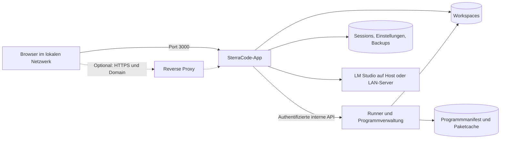

# SterraCode: Umbau für Docker und Serverbetrieb

Stand: 18.10.2026. Planungsbranch: `feature/docker-deployment`, ausgehend von `main` bei `d5d0f3d`.

Dieses Dokument beschreibt den geplanten Umbau. Die Docker-Funktionen sind noch nicht implementiert.

## 1. Gewünschtes Ergebnis

SterraCode soll sich mit Docker Compose auf Windows und Linux einrichten lassen. Auf dem Host werden Docker und Compose benötigt; Node.js, Java und die anderen Sprachlaufzeiten kommen in die Container.

Beim ersten Öffnen führt SterraCode durch die Einrichtung. Der Nutzer wählt zusätzliche Programme aus, beispielsweise Java und Python. Die ausgewählten Programme werden heruntergeladen und in der Docker-Umgebung installiert. Unter **Einstellungen → Programme** können sie später installiert, deaktiviert und tatsächlich deinstalliert werden.

Der Standardzugang ist `http://<LAN-IP-des-Servers>:3000`. Der Port ist vorgegeben und änderbar. Domains, HTTPS und ein vorhandener Reverse Proxy lassen sich über eine Konfigurationsdatei einrichten.

Für die erste Ausbaustufe gelten folgende Festlegungen:

- Windows: Docker Desktop im Modus für **Linux-Container**, vorzugsweise mit WSL 2. Linux: Docker Engine mit Compose. Dadurch verwenden beide Plattformen dieselben Images. Native Windows-Container wären eine eigene Portierung. Docker Desktop wird laut Hersteller nicht auf Windows Server unterstützt; dort wäre für diesen Aufbau eine Linux-VM mit Docker vorgesehen. [Docker-Dokumentation](https://docs.docker.com/desktop/setup/install/windows-install/)
- Eine gemeinsam verwendete SterraCode-Instanz mit einem Administratorzugang. Die bisherigen Lern-Sessions bleiben erhalten. Getrennte Benutzerkonten und gegeneinander abgeschottete Benutzerumgebungen benötigen eine spätere Erweiterung.
- Zuerst verbindliche Unterstützung für `linux/amd64`. `linux/arm64` erhält dieselben Funktionen, sobald alle Katalogprogramme auf dieser Architektur geprüft sind; die Freigabe erfolgt pro Architektur.
- Die vorhandene Oberfläche mit Express, Monaco und Vanilla JavaScript bleibt die Grundlage.

## 2. Ausgangslage im Repository

| Bereich                | Aktueller Stand                                                                                        | Nötige Änderung                                                                             |
| ---------------------- | ------------------------------------------------------------------------------------------------------ | ------------------------------------------------------------------------------------------- |
| Serverstart            | `server/index.js` bindet fest an `127.0.0.1`; Port über `PORT`, Standard 3000                          | Konfigurierbare Bind-Adresse; im Container `0.0.0.0`                                        |
| Netzwerkprüfung        | `server/app.js` erlaubt ausschließlich localhost-Hosts und prüft den Ursprung direkt gegen den Request | Konfigurierte Serveradressen und vertrauenswürdige Proxys berücksichtigen                   |
| Zugriff                | Keine Anmeldung; bisher Schutz durch lokalen Betrieb                                                   | Anmeldung und geschützte Ersteinrichtung vor der LAN-Freigabe                               |
| Programme              | `server/services/processes.js` sucht neun Laufzeiten im lokalen `PATH`                                 | Programmkatalog, Installation, Deinstallation und Runner-Anbindung                          |
| Codeausführung         | Kompilierung, Terminal und Nutzerprogramme laufen als Backend-Unterprozesse                            | In einen separaten Runner verschieben                                                       |
| Einstellungen          | `server/services/storage.js`, API in `server/routes/chat.js`, Dialog in `public/app.js`                | Serverkonfiguration, Programmzustand und Oberflächeneinstellungen getrennt verwalten        |
| Daten                  | Standard `server/data/`; `STERRACODE_DATA_DIR` existiert bereits                                       | Dauerhafte Volumes und eigener Workspace-Pfad                                               |
| Workspace-Lebenszyklus | `server/services/sessions.js` und `storage.js` setzen den Workspace-Pfad mehrfach direkt zusammen      | Einen gemeinsamen konfigurierbaren Pfad auch für Erstellen, Migration und Löschen verwenden |
| KI-Verbindung          | Standard `http://localhost:1234`; natives LM-Studio-SDK mit WebSocket-Verbindung                       | Docker-Host-/LAN-Adresse, optionale Authentifizierung und Verbindungstest                   |
| Installation           | Windows-Skripte prüfen Programme auf dem Host; Docker-Dateien fehlen                                   | Compose, Images und Installationsskripte für beide Plattformen                              |
| Tests                  | Vitest und Playwright vorhanden                                                                        | Docker-, Netzwerk-, Programmverwaltungs- und Wiederherstellungstests ergänzen               |

Die historische Annahme einer ausschließlich lokalen Einzelplatzanwendung wird für diesen Umbau erweitert. Der vorhandene Desktopstart per npm kann als Entwicklungsweg erhalten bleiben.

## 3. Containeraufbau

Empfohlen werden zwei dauerhaft laufende Dienste und ein optionaler HTTPS-Proxy:



### App

- Enthält Weboberfläche, API, Lernplan, Chat, Kontextverwaltung und Datenhaltung.
- Läuft als unprivilegierter Benutzer; Anwendungsdateien bleiben schreibgeschützt.
- Veröffentlicht ausschließlich den konfigurierten Webport.
- Übergibt Ausführungsaufträge an den Runner. Im Docker-Modus werden Nutzer- und KI-Befehle ausschließlich dort gestartet; bei Runner-Ausfall gibt es keinen Rückfall auf das Backend.

### Runner mit Programmverwaltung

- Enthält die installierten Sprachlaufzeiten und übernimmt Kompilierung, Ausführung, Terminaleingaben, Ausgabe und Prozessabbruch.
- Besitzt keinen veröffentlichten Hostport. Seine Steuerung ist nur über das Compose-Netzwerk mit eigener Dienstauthentifizierung erreichbar.
- Ein begrenzter privilegierter Steuerprozess darf freigegebene Systempakete installieren und entfernen. Kompilierung und Nutzerbefehle starten ausdrücklich unter einer unprivilegierten UID, ohne Zusatzgruppen und mit einer bereinigten, ausdrücklich zusammengestellten Umgebung.
- Steuerdateien, Dienstschlüssel, Paketdatenbank und Programmmanifest gehören dem Steuerprozess und sind für ausgeführten Code nicht schreibbar. Dienstschlüssel werden nicht an Kindprozesse vererbt.
- Der Runner erhält nur das Workspace-Volume und seine eigenen Zustands-/Cache-Volumes. Sessions, Anmeldeinformationen und LM-Studio-Geheimnisse der App werden nicht hineingemountet.
- Installation und Deinstallation verwenden feste Paketzuordnungen und Argumentlisten. Freie Shellbefehle gehören ausschließlich zur unprivilegierten Codeausführung.
- Ressourcenlimits, Prozesslimits, Zeitlimits, Ausgabelimit und vollständiges Beenden von Prozessbäumen werden beibehalten beziehungsweise auf Containerebene ergänzt.

Der bestehende Prozessdienst erhält eine austauschbare Ausführungsanbindung: lokal für den bisherigen Entwicklungsstart, entfernt für Docker. Die öffentlichen Terminal- und Execute-APIs sowie die KI-Tools sollen möglichst ihre bisherigen Verträge behalten. Das interne Runner-Protokoll erhält eine Version und eindeutige, dauerhaft protokollierte Auftrags-IDs; Wiederholungen nach einem Verbindungsabbruch dürfen Befehle nicht doppelt starten. Nach einem Runner-Neustart werden unterbrochene Aufträge ausdrücklich als unterbrochen oder mit unbekanntem Ergebnis markiert, statt sie automatisch erneut auszuführen.

Dieser Aufbau trennt ausgeführten Code von der App. Alle Lern-Sessions teilen zunächst einen Runner; eine gegenseitige Sicherheitsisolation zwischen Sessions wird damit noch nicht zugesichert. Docker-Socket, Hostverzeichnisse mit Systemdaten und `privileged: true` werden für diesen Aufbau nicht benötigt. Der App-Dienst erhält keine zusätzlichen Linux-Capabilities; für den Runner werden nur die für Paketverwaltung und Benutzerwechsel tatsächlich benötigten Rechte vorgesehen und geprüft.

## 4. Zusatzprogramme installieren und entfernen

### Programmkatalog

Die erste vollständige Version soll alle bereits angebotenen Sprachen abdecken:

| Programm         | Zweck                                         | Behandlung                                                                  |
| ---------------- | --------------------------------------------- | --------------------------------------------------------------------------- |
| Node.js und Bash | Steuerdienste, JavaScript und Terminal        | Feste Grundkomponenten; Sprachausführung kann deaktiviert werden            |
| Java JDK         | Java kompilieren und ausführen                | Optional; immer `java` und `javac` gemeinsam                                |
| Python           | Python ausführen                              | Optional                                                                    |
| Go               | Go-Projekte ausführen                         | Optional                                                                    |
| Rust mit Cargo   | Rust kompilieren und Abhängigkeiten verwalten | Optional, einschließlich benötigter Linker-Komponenten                      |
| C/C++-Werkzeuge  | C++ kompilieren                               | Optional; Compiler, Header und erforderliche Buildwerkzeuge als Paketgruppe |
| .NET SDK         | C# kompilieren und ausführen                  | Optional; SDK statt ausschließlich Runtime                                  |
| Lua              | Lua ausführen                                 | Optional                                                                    |
| Git              | Versionsverwaltung im Terminal                | Optional                                                                    |

Maven und Gradle können danach über denselben Katalog ergänzt werden; ihre Abhängigkeit vom JDK wird dabei ausdrücklich hinterlegt.

Jeder Katalogeintrag beschreibt ID, freigegebene Version, Architektur, Paketquelle, benötigte Pakete, Abhängigkeiten, geschätzten Speicherbedarf und Prüfkommandos. Konkrete Versionen und Image-Digests werden zu Beginn der Umsetzung geprüft und festgeschrieben. Freie Downloadadressen oder beliebige Installationsskripte werden nicht als Programmeingabe angeboten.

### Installationsweg

Die Images basieren auf derselben festgelegten Debian-Suite mit einer passenden Node-24-Basis. Optionale Programme sind nicht bereits vollständig im Basisimage enthalten. Die Programmverwaltung verwendet signierte Paketquellen und feste Paketrezepte; zusätzliche Herstellerquellen etwa für .NET werden ausdrücklich im Katalog definiert und auf beiden Zielarchitekturen geprüft.

1. Die Oberfläche übermittelt Programm-ID und gewünschte Aktion.
2. Das Backend prüft Anmeldung, Katalogeintrag und laufende Vorgänge.
3. Die Programmverwaltung speichert einen Auftrag und sperrt parallele Paketänderungen.
4. Sie ermittelt die benötigten Pakete, lädt sie herunter, installiert und prüft Version und Funktion.
5. Erst nach erfolgreicher Prüfung meldet SterraCode das Programm als verfügbar. Die Laufzeitübersicht und der Ausführen-Button aktualisieren sich ohne App-Neustart.

Zustände wie `not-installed`, `queued`, `installing`, `installed`, `removing` und `error` werden mit Fortschritt und verständlichem Fehlertext angezeigt. Das bloße Deaktivieren einer Sprache bleibt eine getrennte Aktion.

### Deinstallation

- Entfernt die optional installierten Pakete tatsächlich aus dem Runner und setzt den gewünschten Programmzustand entsprechend zurück.
- Projektdateien, Lern-Sessions und Quellcode bleiben erhalten.
- Gemeinsam benötigte Pakete bleiben installiert, solange andere Programme sie benötigen. Grundkomponenten und Steuerdienste sind geschützt.
- Während einer Paketänderung werden neue Ausführungen gesperrt. Laufende Aufträge dürfen zu Ende laufen; ein ausdrücklich gewählter sofortiger Wechsel stoppt sie vorher. Das gilt auch für freie Terminalbefehle, deren tatsächliche Programmnutzung sich nicht zuverlässig vorhersagen lässt.
- Zugehörige Downloadcaches können zusätzlich gelöscht werden. Von Projekten selbst angelegte Dateien wie virtuelle Umgebungen oder Maven-/npm-Abhängigkeiten werden nicht still entfernt.

### Neustart und Containerupdates

Eine reine Paketinstallation in der beschreibbaren Containerschicht geht beim Ersetzen des Containers verloren. Deshalb speichert der Runner einen dauerhaften Sollzustand samt aufgelösten Paketversionen und Prüfsummen. [Docker: Lebenszyklus von Volumes und Containern](https://docs.docker.com/engine/storage/volumes/)

Bei normalem Neustart prüft er den vorhandenen Zustand. Nach Neuerstellung oder Update installiert er die gewählten Programme aus dem persistenten Paketcache beziehungsweise den freigegebenen Quellen erneut. Der Cache umfasst die benötigten optionalen Pakete einschließlich ihrer Abhängigkeiten; die Paketdatenbank selbst bleibt Teil des jeweiligen Runner-Containers. Komplette Systemverzeichnisse wie `/usr` werden nicht in ein Volume ausgelagert.

Während der Wiederherstellung bleibt die App für Datei- und Sessionarbeit erreichbar; die betroffenen Laufzeiten zeigen ihren tatsächlichen Zustand. Ein zwischenzeitlich deinstalliertes Programm wird nicht durch alte Installationsvorgaben erneut aktiviert. Fehlende Versionen, Netzwerkausfall oder beschädigte Pakete führen zu einem nachvollziehbaren Fehler und einer Wiederholungsaktion, nicht zu einem stillen Versionswechsel. Ein Basiswechsel benötigt eine ausdrücklich definierte Manifestmigration.

Paketänderungen sind nicht pauschal atomar. Das Auftragsjournal muss Unterbrechungen erkennen, den Paketmanager-Zustand prüfen und einen reparierbaren Zustand herstellen oder den Runner bis zur Reparatur für Ausführungen sperren.

## 5. Ersteinrichtung und Einstellungen

Geplanter Ablauf:

1. Repository beziehungsweise Release beziehen und `install.ps1` unter Windows oder `install.sh` unter Linux ausführen.
2. Das Skript prüft Docker, den laufenden Linux-Daemon, Compose und den Standardport 3000. Bei Portkonflikt wird ein anderer Port eingetragen.
3. Die LAN-Adresse wird auf dem Host ermittelt. Bei mehreren geeigneten Schnittstellen kann der Nutzer die richtige wählen. Virtuelle Docker-/WSL-Adressen werden nicht ungeprüft als Serveradresse verwendet.
4. Das Skript legt die Konfiguration an, startet die Basisdienste und zeigt Browseradresse und einmaligen Einrichtungsschlüssel an.
5. Im Browser wird mit diesem Schlüssel der Administratorzugang eingerichtet. Ein zufälliger erster Besucher kann die Instanz nicht übernehmen.
6. Danach folgt die Programmauswahl mit Größe und Zweck der einzelnen Extras. Anfangs sind nur die Grundkomponenten installiert; weitere Programme werden bewusst ausgewählt.
7. LM-Studio-Verbindung einrichten oder überspringen. Ohne Modell bleiben Datei-, Session- und Programmfunktionen nutzbar.

Nach abgeschlossener Einrichtung erscheint der Assistent bei Neustarts nicht erneut. **Einstellungen → Programme** verwendet denselben Programmkatalog und dieselbe Auftragsverwaltung. Ein Serverbereich zeigt Adresse, Port, Konfigurationsquelle und nötige Neustarts an.

Für automatisierte Installationen sind eine optionale Liste initialer Programme und Zugangsdaten über Secret-Dateien vorgesehen. Diese initiale Programmliste wird nur bei der ersten Einrichtung übernommen; spätere UI-Änderungen sind maßgeblich. Die Installationsskripte benötigen keine zusätzliche Node-Installation auf dem Host; gemeinsame Validierung kann in einem einmalig gestarteten Hilfscontainer erfolgen.

## 6. Netzwerk, Port und Domains

Als zentrale, vom Betreiber bearbeitbare Konfigurationsdatei dient `.env`, dokumentiert durch `.env.example`. Damit kann Compose insbesondere die Portfreigabe direkt aus derselben Datei beziehen. [Docker Compose: Variablen und Konfigurationsdatei](https://docs.docker.com/compose/how-tos/environment-variables/variable-interpolation)

Beispiel für eine vom Installer erzeugte LAN-Konfiguration; die IP ist durch die tatsächliche Hostadresse zu ersetzen:

```dotenv
STERRACODE_BIND_IP=192.168.178.50
STERRACODE_PORT=3000
STERRACODE_PUBLIC_URL=http://192.168.178.50:3000
STERRACODE_EXTRA_ALLOWED_HOSTS=localhost,127.0.0.1
STERRACODE_EXTRA_ALLOWED_ORIGINS=http://localhost:3000,http://127.0.0.1:3000
STERRACODE_TRUSTED_PROXIES=
STERRACODE_PROXY_MODE=off
STERRACODE_DOMAIN=
STERRACODE_LM_STUDIO_URL=http://host.docker.internal:1234
```

- Innerhalb des App-Containers bleibt die Bind-Adresse `0.0.0.0`, der interne Port 3000. Die Compose-Freigabe lautet sinngemäß `${STERRACODE_BIND_IP}:${STERRACODE_PORT}:3000`.
- Standardmäßig wird die gewählte LAN-IP veröffentlicht. Eine Freigabe auf allen Hostinterfaces kann ausdrücklich konfiguriert werden. Ohne konkrete Bind-IP veröffentlicht Docker Ports standardmäßig auf allen Hostadressen; das ist keine automatische Begrenzung auf das LAN. Hostfirewall und Routing gehören deshalb zum dokumentierten Zugriffskonzept. [Docker: Portfreigaben](https://docs.docker.com/engine/network/port-publishing/)
- Windows-Firewall und Linux-Firewall werden mit passenden Regeln für das gewünschte lokale Netz dokumentiert und durch einen Zugriffstest von einem zweiten Gerät geprüft. Es werden keine Routerfreigaben automatisch angelegt. Auch IPv6 muss in den Regeln berücksichtigt werden, wenn es freigegeben wird.
- `PUBLIC_URL` und zusätzliche ausdrücklich erlaubte Adressen bestimmen die Host-/Origin-Prüfung. Unbekannte Hosts und fremde Schreibursprünge bleiben gesperrt.
- Proxy-Header werden ausschließlich von konfigurierten Proxyadressen beziehungsweise Netzen vertraut. Ein pauschales `trust proxy = true` ist nicht vorgesehen. Schreibzugriffe behalten JSON-Prüfung und ergänzen CSRF-Schutz; der bestehende Same-Origin-Aufbau bleibt erhalten.
- Änderungen an Port, Bind-IP oder Proxyprofil werden nach Prüfung durch einen erneuten Start über die Docker-Startskripte beziehungsweise den dokumentierten Compose-Befehl angewendet. Die App steuert dafür nicht selbst den Docker-Daemon.
- Netzwerk- und Sicherheitsparameter aus der Serverkonfiguration sind in der Oberfläche schreibgeschützt. Normale UI-Einstellungen und der spätere Programm-Sollzustand liegen persistent in der App beziehungsweise Programmverwaltung. `STERRACODE_LM_STUDIO_URL` dient als Vorgabe für die erste Einrichtung; danach gilt die gespeicherte LM-Studio-Einstellung. Für administrative Overrides wird ein eigenes, ausdrücklich dokumentiertes Verhalten vorgesehen.

### Optionaler Domainbetrieb

Es werden zwei Konfigurationen vorbereitet: ein bereits vorhandener Reverse Proxy und ein mitgelieferter Caddy-Dienst als optionale Compose-Erweiterung. SterraCode wird zunächst unter der Wurzel einer eigenen Subdomain betrieben; Unterpfade würden zusätzliche Änderungen an den heute absoluten Frontend-URLs erfordern.

Die Compose-Basis veröffentlicht noch keinen App-Port. Getrennte Ergänzungsdateien für LAN, Caddy, externen Host-Proxy und externen Docker-Proxy legen die jeweilige Freigabe fest. Die Docker-Startskripte wählen anhand von `STERRACODE_PROXY_MODE` die passenden `-f`-Dateien; direkte Compose-Aufrufe werden entsprechend dokumentiert. So muss ein Proxyprofil keine bereits vorhandene LAN-Portfreigabe durch additive Compose-Merges rückgängig machen. Beim Moduswechsel werden alte, nicht mehr benötigte Dienste desselben Compose-Projekts entfernt.

Bei aktiviertem mitgeliefertem Proxy entfällt die direkte LAN-Portfreigabe der App; nur der Proxy veröffentlicht die vorgesehenen Ports. Bei einem Proxy auf demselben Host wird die App ausschließlich auf einer dafür geeigneten lokalen Adresse veröffentlicht, bei einem Proxy im Docker-Netz nur intern angebunden. So wird die Anmeldung und TLS-Konfiguration nicht durch einen zweiten ungeschützten Zugang umgangen. Chat-SSE, Abbruch und längere Modellantworten müssen auch über den Proxy funktionieren.

Die Konfiguration beschreibt Domain, öffentliche URL und TLS-Modus. Der Nutzer richtet dazu DNS beziehungsweise einen lokalen DNS-Eintrag ein. Öffentliche Zertifikate benötigen eine geeignete ACME-Validierung; interne Zertifikate erfordern Vertrauen auf den zugreifenden Geräten. Eine Domain allein erzeugt keine Erreichbarkeit oder gültige Vertrauenskette. [Caddy: Automatisches HTTPS](https://caddyserver.com/docs/automatic-https)

## 7. LM Studio im Dockerbetrieb

`localhost` bezeichnet im Container den Container selbst. Deshalb werden folgende Fälle getrennt dokumentiert:

| Standort von LM Studio             | Adresse aus der App                       |
| ---------------------------------- | ----------------------------------------- |
| Auf dem Docker-Host                | `http://host.docker.internal:1234`        |
| Auf einem anderen LAN-Gerät        | Zum Beispiel `http://192.168.178.20:1234` |
| Hinter einem passenden HTTPS-Proxy | Zum Beispiel `https://llm.example.org`    |

Unter Linux wird für den Hostzugriff `host.docker.internal:host-gateway` über Compose gesetzt. Die Namensauflösung ersetzt keine erreichbare Bind-Adresse des LM-Studio-Servers. [Docker: Hostzugriff aus Compose](https://docs.docker.com/compose/how-tos/networking/)

LM Studio muss auf einer vom Container erreichbaren Adresse lauschen; für andere LAN-Geräte ist dafür die Netzwerkfreigabe vorgesehen. Das Backend verwendet weiterhin das native SDK einschließlich Tokenisierung und Kontextprüfung, daher muss der Verbindungstest auch den tatsächlichen WebSocket-Zugriff prüfen. Ein erfolgreicher HTTP-Aufruf auf `/v1/models` reicht nicht aus. [LM Studio: Netzwerkfreigabe](https://lmstudio.ai/docs/developer/core/server/serve-on-network)

Ein wichtiger Versionspunkt: Das aktuell installierte `@lmstudio/sdk` 1.5.0 bietet in seinen Constructor-Typen noch kein `apiToken` an. Die aktuelle Herstellerdokumentation beschreibt diese Option. Für authentifiziertes LM Studio muss daher zuerst eine kompatible SDK-Version ausgewählt, festgeschrieben und gegen die vorhandenen Kontext-/Tool-Verträge geprüft werden. Der vorhandene `clientPasskey` wird dabei nicht mit einem API-Token gleichgesetzt. [LM Studio: SDK-Authentifizierung](https://lmstudio.ai/docs/typescript/authentication)

Tokens bleiben serverseitig in Secret-Dateien, erscheinen nicht in der allgemeinen Settings-API und gelangen nicht in den Runner. LM Studio und Modelldownloads bleiben zunächst ein gesonderter Dienst; GPU-Treiber und eine vollständige Modellverwaltung sind nicht Voraussetzung für die Dockerisierung von SterraCode.

## 8. Daten, Migration und Betrieb

| Speicher                       | Inhalt                                                                        | Zugriff                                   |
| ------------------------------ | ----------------------------------------------------------------------------- | ----------------------------------------- |
| App-Datenvolume                | Sessions, Einstellungen, Profile, Kontext, Änderungen, Backups, Anmeldestatus | Nur App                                   |
| Workspace-Volume               | Quellcode je Session-UUID                                                     | App und unprivilegierte Runner-Ausführung |
| Programmzustand                | Sollmanifest, aufgelöste Versionen und Auftragsjournal                        | Runner-Steuerprozess                      |
| Paketcache                     | Geprüfte Downloads für Wiederherstellung                                      | Runner-Programmverwaltung                 |
| Temporärer Ausführungsspeicher | Compilergebnisse und vorübergehende Dateien                                   | Runner; begrenzt und aufräumbar           |

Named Volumes sind der Standard, damit Datenhaltung und Linux-Dateirechte nicht von Windows-Laufwerkspfaden abhängen. App und Runner verwenden denselben internen Workspace-Pfad. Ein neuer Parameter wie `STERRACODE_WORKSPACES_DIR` wird zentral in allen beteiligten Diensten verwendet; UID/GID und gemeinsame Schreibrechte werden ausdrücklich festgelegt.

Für bestehende Daten wird ein einmaliger Import bei gestopptem alten Server vorgesehen: vollständige Sicherung, Prüfung von Schema und Pfaden, Import der App-Daten und Workspaces in die passenden Volumes, anschließend Prüfung von Dateiversionen, Sessions, Kontext und Rückgängig-Historie. Das Original bleibt unangetastet. Angefangene bisherige Migrationsjournale müssen vor einer Pfadverlagerung abgeschlossen oder ausdrücklich übernommen werden.

Backups umfassen App-Daten, Workspaces und Programmmanifest aus einem konsistenten Wartungszustand. Ein Manifest ohne Pakete reicht nicht für garantierte Offline-Wiederherstellung; dafür werden auch Paketcache und benötigte Images archiviert. Für Updates werden Images mit festen Versionsangaben und Digest verwendet; vor Datenmigrationen wird gesichert. Ein Rollback muss den passenden Datenstand einschließen.

Compose erhält Neustartregeln, Healthchecks, kontrolliertes Herunterfahren und begrenzte Protokollgröße. App-Healthcheck und Runner-Verfügbarkeit werden getrennt: eine laufende Datei-/Sessionoberfläche darf nicht allein wegen eines Paketdownloads als defekt gelten. Der Installer prüft die Compose-Funktionen tatsächlich, statt nur eine exakte Hauptversion zu verlangen. Shellskripte erhalten LF-Zeilenenden.

## 9. Umsetzung in prüfbaren Etappen

| Etappe                   | Änderungen und voraussichtliche Dateien                                                                                              | Abnahmekriterium                                                                                                                                                                            |
| ------------------------ | ------------------------------------------------------------------------------------------------------------------------------------ | ------------------------------------------------------------------------------------------------------------------------------------------------------------------------------------------- |
| 1. Servergrundlagen      | `server/config.js`, Konfigurationsschema, `.env.example`, `server/index.js`, Netzwerk-Middleware, Anmelde-/Setup-Routen              | Ersteinrichtung geschützt; konfigurierte LAN-Adresse akzeptiert; fremde Hosts und unautorisierte API-Zugriffe abgewiesen                                                                    |
| 2. Dockerbasis und Daten | App-Dockerfile, `.dockerignore`, `compose.yaml`, `storage.js`, `sessions.js`, Import-/Backup-Hilfen, Installationsskripte            | App startet auf Windows/Linux; Daten und Workspaces überstehen Neuerstellung; Import funktioniert                                                                                           |
| 3. Runner                | Runner-Dockerfile, `runner/`, Ausführungsanbindung unter `server/services/`, Anpassung von `processes.js` und nötigen Route-Aufrufen | Terminal und alle vorhandenen Ausführungsadapter laufen im Runner; Eingabe, Stop, Timeout und Wiederverbindung funktionieren                                                                |
| 4. Programmverwaltung    | `runner/catalog/`, Paketrezepte, Sollmanifest, Jobjournal, Programme-/Job-Routen und Backend-Dienst                                  | Zuerst Java und Python durchgängig installieren, ausführen, entfernen und nach Neuerstellung wiederherstellen; anschließend denselben Nachweis für alle weiteren Katalogprogramme erbringen |
| 5. Oberfläche            | Setup-Dialog, `public/js/setup.js`, `public/js/programs.js`, `public/app.js`, Runtime-Hinweise und Styles                            | Programmauswahl beim Erststart; Fortschritt, Fehler und echte Deinstallation in Einstellungen; Sprachdeaktivierung bleibt getrennt                                                          |
| 6. KI und Domains        | `lmStudio.js`, gegebenenfalls SDK-Update, Secret-Verarbeitung, Proxy-Compose-Datei, Caddy-Beispiel                                   | Host-/LAN-LM-Studio mit nativen Modellfunktionen erreichbar; Chat funktioniert über Domain und HTTPS                                                                                        |
| 7. Freigabe              | Docker-Integrationstests, Playwright-Erweiterungen, CI-Workflow, README und Betriebsdokumentation                                    | Sämtliche folgenden Abnahmetests auf Linux und Windows abgeschlossen                                                                                                                        |

Die Etappen sind lokale Entwicklungsschritte. Eine LAN-Version wird erst als benutzbar freigegeben, wenn Anmeldung, Datenhaltung und Ausführung im Runner gemeinsam geprüft sind. Image-Veröffentlichung oder Deployment gehören zur späteren Umsetzung, nicht zu dieser Planung.

## 10. Verbindliche Abnahmetests

1. **Frische Installation:** Unter Windows mit Docker Desktop/Linux-Containern und unter Linux ohne vorinstallierte Sprachlaufzeiten starten. Standardport und alternativer Port funktionieren; Docker-Daemon-Fehler werden verständlich gemeldet.
2. **Zweiter Rechner:** Die Oberfläche auf einem anderen LAN-Gerät über die tatsächliche Host-IP öffnen. IPv4, gegebenenfalls IPv6, Firewall und Auswahl bei mehreren Netzwerkschnittstellen prüfen.
3. **Zugriffsschutz:** Setup ohne Schlüssel, fremde Hosts/Origins, nicht vertrauenswürdige Proxy-Header und APIs ohne Anmeldung abweisen. Geheimnisse fehlen in Settings-Antworten, UI und Runner-Kindprozessen.
4. **Programme:** Jede optionale Laufzeit wirklich installieren, ein kleines Programm kompilieren/ausführen und danach deinstallieren. Installierte Programme dürfen in dieser Suite nicht bloß wegen fehlender Laufzeit übersprungen werden. Grundkomponenten und gemeinsame Abhängigkeiten bleiben funktionsfähig.
5. **Paketfehler:** Netzwerkabbruch, wenig Speicher, falsche Prüfsumme, nicht verfügbare Version, parallele Aktionen und Neustart während Installation/Deinstallation prüfen. Das Journal ermöglicht nachvollziehbare Reparatur und Wiederholung.
6. **Persistenz:** Container neu starten, entfernen und mit erhaltenen Volumes neu erstellen. Sessions, Quellcode, Rückgängig-Historie und Programmauswahl stimmen weiterhin; zuvor entfernte Programme bleiben entfernt. Wiederherstellung aus warmem Cache sowie Verhalten ohne Cache und Internet prüfen.
7. **Ausführung:** stdin, UTF-8, lokale Imports, Java-Packages, .NET-Projekte, Compilerfehler, Prozessbäume, Stop, Timeout, Ausgabelimit und Runner-Ausfall prüfen. Wiederholte Auftrags-IDs führen keinen zweiten Prozess aus.
8. **Grenzen:** Nutzerprogramme verändern weder App-Daten noch Steuerdateien und können keine privilegierten Paketaktionen auslösen. Pfad-/Symlink-Prüfungen gelten auch an der Runner-Grenze. Ressourcenlimits werden mit echten Prozessen geprüft.
9. **Migration:** Einen bisherigen Datenbestand importieren, unter Windows und Linux öffnen und Backup/Wiederherstellung erproben; Dateiversionen und KI-Rückgängig bleiben gültig.
10. **Domain und KI:** Proxybetrieb einschließlich SSE, Anmeldung, CSRF-Schutz und HTTPS testen. LM Studio auf Host und anderem LAN-Gerät samt SDK-Authentifizierung, Tokenisierung und Offlinezustand prüfen.
11. **Bestehende Funktionen:** Vitest und relevante Playwright-Abläufe für Sessions, Editor, Lernplan, Kontext und Themes bleiben erfolgreich. Plattformabhängige Screenshots werden auf ihrer jeweiligen Plattform geprüft.

Eine reine Linux-CI kann die Windows-LAN-Freigabe nicht belegen. Dafür ist ein Windows-Rechner mit laufendem Docker Desktop und ein zweites LAN-Gerät als eigener Freigabetest nötig.

## 11. Bei der Planung bereits geprüft

- Projektstruktur, Serverstart, Host-/Origin-Prüfung, Datenhaltung und Workspace-Migration untersucht.
- Alle neun vorhandenen Sprachadapter, Terminaldienst, Einstellungen und native LM-Studio-Anbindung berücksichtigt.
- `npm test`: **16 Testdateien bestanden; 324 Tests bestanden, 4 übersprungen**.
- Docker CLI und Compose sind auf diesem Rechner vorhanden. Der Linux-Docker-Daemon war bei der Prüfung nicht erreichbar. Ein Containerbuild oder Docker-Laufzeittest wurde daher nicht ausgeführt.
- In diesem Planungsschritt wurden der neue Branch und dieses Dokument angelegt. Anwendungscode, Paketversionen und Startverhalten wurden noch nicht geändert.
