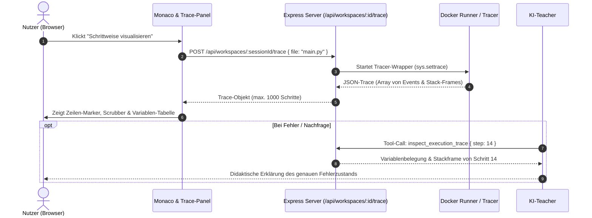
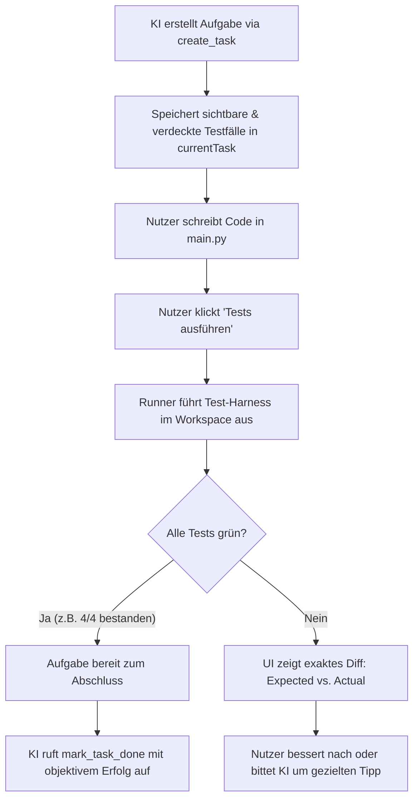
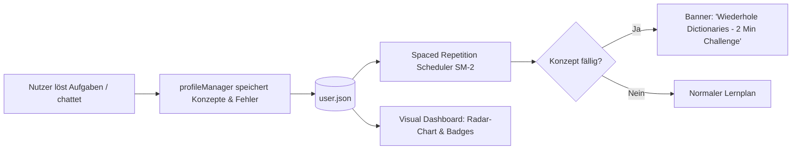
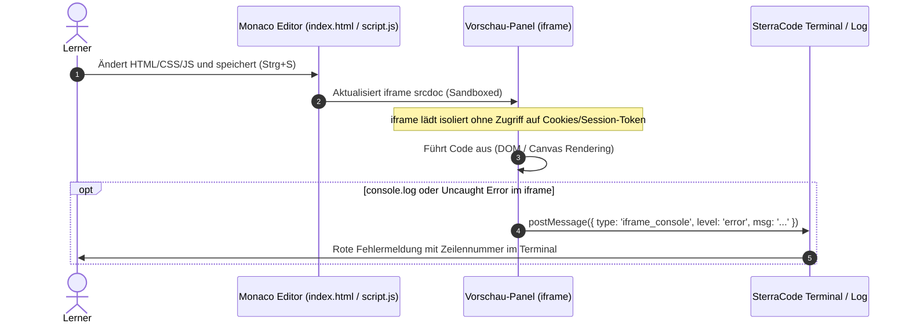
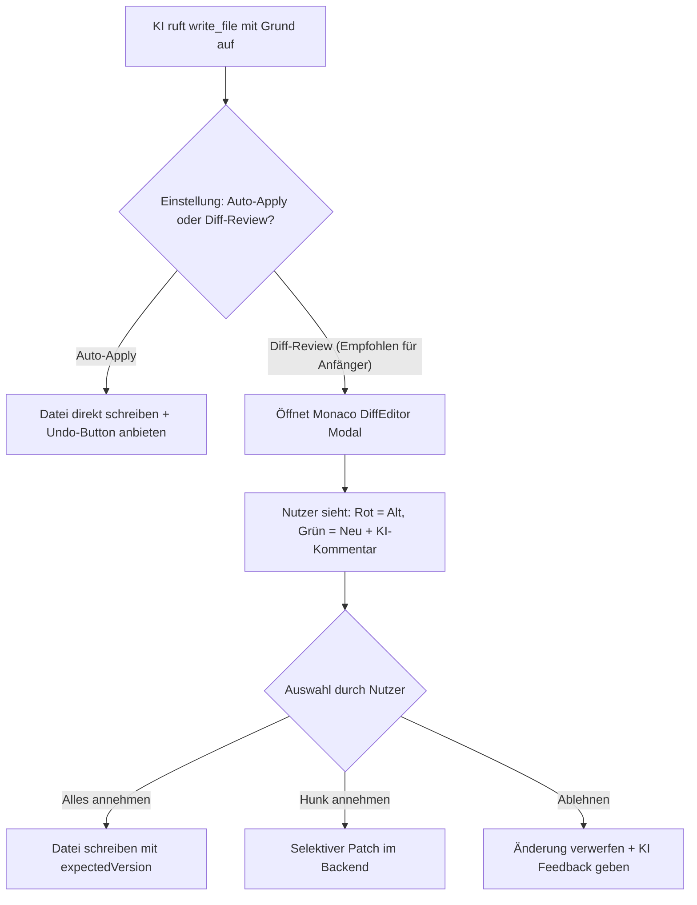
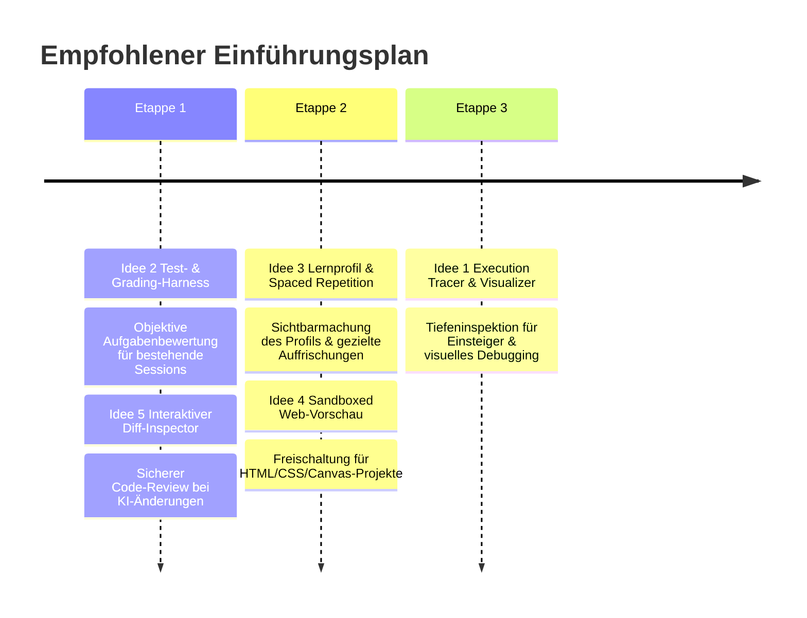

# SterraCode — 5 Strategische & Technische Verbesserungsideen

## Detaillierte Architektur-, Didaktik- und Implementierungskonzepte für den zuverlässigen Lernarbeitsplatz

Dieses Dokument beschreibt fünf fundierte, detaillierte Verbesserungsideen für **SterraCode**. Jede Idee ist exakt auf die bestehende Architektur (Node.js/Express, Docker-Runner, Monaco-Editor, Vanilla JavaScript, LM Studio SDK / OpenAI, context-compressor, `profileManager.js`) abgestimmt.

---

## Inhaltsverzeichnis

1. [Status Quo & Ausgangsanalyse](#1-status-quo--ausgangsanalyse)
2. [Verbesserungsidee 1: Interaktiver Code-Visualizer & Step-by-Step Execution Tracer](#2-verbesserungsidee-1-interaktiver-code-visualizer--step-by-step-execution-tracer)
3. [Verbesserungsidee 2: Integriertes Test- & Grading-Harness für Aufgaben](#3-verbesserungsidee-2-integriertes-test---grading-harness-f%C3%BCr-aufgaben)
4. [Verbesserungsidee 3: Visuelles Lernprofil-Dashboard & Spaced-Repetition-Wissensgraph](#4-verbesserungsidee-3-visuelles-lernprofil-dashboard--spaced-repetition-wissensgraph)
5. [Verbesserungsidee 4: Sandboxed Live-Vorschau für Web, Canvas & SVG](#5-verbesserungsidee-4-sandboxed-live-vorschau-f%C3%BCr-web-canvas--svg)
6. [Verbesserungsidee 5: Interaktiver Diff-Inspector & Granulare Hunk-Freigabe für KI-Änderungen](#6-verbesserungsidee-5-interaktiver-diff-inspector--granulare-hunk-freigabe-f%C3%BCr-ki-%C3%A4nderungen)
7. [Vergleich, Synergien & Empfohlene Implementierungsreihenfolge](#7-vergleich-synergien--empfohlene-implementierungsreihenfolge)

---

## 1. Status Quo & Ausgangsanalyse

SterraCode hat mit dem Docker-Umbau, der Workspace-Isolation via UUIDs, der optimistischen Sperre (`expectedVersion` mit HTTP 409) und dem integrierten Kontext-Kompressor ein robustes Fundament erhalten.

Allerdings existieren funktionale und didaktische Lücken, die Programmieranfängern das Lernen erschweren:

- **Reine Blackbox-Ausführung:** Code wird im Runner gestartet; Anfänger sehen nur die Konsolenausgabe (stdout/stderr). Was im Speicher, auf dem Callstack oder bei Schleifendurchläufen passiert, bleibt unsichtbar.
- **Subjektives Aufgaben-Grading:** Der KI-Tutor erstellt Aufgaben (`create_task`) und hakt sie ab (`mark_task_done`), verlässt sich dabei jedoch auf LLM-Beurteilungen ohne deterministische Unit-Tests.
- **Versteckter Lernstand:** Das in `server/services/profileManager.js` gepflegte Sprachprofil (`knownConcepts`, `strengths`, `weaknesses`, `level`) wird dem Nutzer nirgendwo visuell angezeigt; zudem fehlen Mechanismen zur systematischen Wissensauffrischung (Spaced Repetition).
- **Keine visuelle Web-Entwicklung:** HTML-, CSS- und clientseitige JavaScript-Dateien können editiert, aber im Browser nicht interaktiv dargestellt werden.
- **Großflächiges KI-Überschreiben:** KI-Code-Änderungen werden direkt in die Datei geschrieben. Zwar existiert ein Undo-Button, aber Einsteiger verlieren leicht den Überblick darüber, _was_ die KI genau geändert hat und _warum_.

---

## 2. Verbesserungsidee 1: Interaktiver Code-Visualizer & Step-by-Step Execution Tracer

### 2.1 Warum es für SterraCode besser wäre

1. **Mentale Modelle für Anfänger schaffen:** Programmieranfänger scheitern selten an der Syntax, sondern an der mentalen Vorstellung des Programmablaufs: _Wie ändern sich Variablenwerte in jedem Schleifendurchlauf? Welche Daten liegen auf dem Callstack bei einer Rekursion? Was ist der Unterschied zwischen Call-by-Value und Referenzen?_
2. **Überwindung des "Print-Debugging":** Anfänger neigen dazu, wahllos `print()`-Befehle einzufügen. Ein visueller Tracer (analog zu _Python Tutor_ oder _Thonny_) zeigt den gesamten Variablen- und Stackverlauf Zeile für Zeile.
3. **Präzise KI-Erklärungen durch Trace-Events:** Tritt ein Laufzeitfehler auf (z. B. `IndexError: list index out of range`), muss die KI nicht raten. Sie kann über das Tool `read_execution_trace` exakt sehen, bei welchem Index der Fehler auftrat: _„In Schritt 14 hatte deine Zählvariable `i` den Wert 5 erreicht, aber deine Liste hat nur 5 Elemente (Indizes 0 bis 4).“_

### 2.2 Wie es konkret umgesetzt wird



#### A. Backend-Tracer im Runner (`runner/tracer/python_tracer.py`)

Für Python wird ein leichtgewichtiger Wrapper genutzt, der `sys.settrace` verwendet und nach jedem Schritt den aktuellen Frame serialisiert:

```python
# runner/tracer/python_tracer.py
import sys
import json
import inspect

MAX_STEPS = 1000
MAX_STRING_LEN = 250
trace_log = []

def format_val(val):
    if isinstance(val, (int, float, bool, type(None))):
        return val
    if isinstance(val, (str, bytes)):
        s = repr(val)
        return s[:MAX_STRING_LEN] + ("..." if len(s) > MAX_STRING_LEN else "")
    if isinstance(val, (list, tuple, set)):
        return [format_val(x) for x in list(val)[:20]]
    if isinstance(val, dict):
        return {str(k)[:30]: format_val(v) for k, v in list(val.items())[:20]}
    return f"<{val.__class__.__name__}>"

def tracer(frame, event, arg):
    if len(trace_log) >= MAX_STEPS:
        return None
    # Nur Benutzerdateien im Workspace tracken, keine internen Standardbibliotheken
    if not frame.f_code.co_filename.endswith(target_filename):
        return tracer
    if event in ("line", "call", "return", "exception"):
        locals_copy = {k: format_val(v) for k, v in frame.f_locals.items() if not k.startswith("__")}
        trace_log.append({
            "step": len(trace_log) + 1,
            "event": event,
            "line": frame.f_lineno,
            "func": frame.f_code.co_name,
            "locals": locals_copy,
            "exception": repr(arg) if event == "exception" else None
        })
    return tracer

if __name__ == "__main__":
    target_filename = sys.argv[1]
    sys.settrace(tracer)
    try:
        with open(target_filename, "r", encoding="utf-8") as f:
            code = compile(f.read(), target_filename, "exec")
            exec(code, {"__name__": "__main__"})
    except Exception as e:
        trace_log.append({"step": len(trace_log) + 1, "event": "crash", "error": str(e)})
    finally:
        sys.settrace(None)
        with open("trace.json", "w", encoding="utf-8") as out:
            json.dump(trace_log, out)
```

#### B. API-Endpunkt (`server/routes/execute.js`)

```javascript
// POST /api/workspaces/:sessionId/trace
router.post(
  "/:sessionId/trace",
  route(async (req, res) => {
    const { file } = req.body;
    const result = await runProcessWithTracer(req.params.sessionId, file);
    res.json(result);
  }),
);
```

#### C. Frontend-Integration (`public/js/tracer.js`)

- Im Editor wird ein neuer Button `Visualisieren (Debug)` neben `Ausführen` ergänzt.
- Nach Klick öffnet sich unter dem Editor ein Trace-Steuerungs-Panel:
  - **Scrubber / Zeitleiste:** Schritt $X$ von $Y$.
  - **Buttons:** `⏮ Anfang`, `◀ Schritt zurück`, `▶ Schritt vor`, `⏭ Ende`, `Auto-Play`.
  - **Monaco-Dekoration:** Die aktuelle Zeile wird mit einer pulsierenden Pfeil-Glyphe markiert.
  - **Speicher-Inspektor:** Tabelle mit aktuellen lokalen Variablen, Typen und Werten. Änderungen gegenüber dem vorherigen Schritt werden gelb hervorgehoben.

#### D. Neues KI-Tool (`server/services/tools.js`)

```javascript
tool(
  "inspect_execution_trace",
  "Liest Trace-Schritte der letzten Ausführung (Variablenbelegungen, Callstack, Fehler)",
  {
    step: { type: "integer", description: "Schrittnummer (1-basiert)" },
    detail: { type: "string", enum: ["locals", "stack", "full"] },
  },
);
```

---

## 3. Verbesserungsidee 2: Integriertes Test- & Grading-Harness für Aufgaben

### 3.1 Warum es für SterraCode besser wäre

1. **Beseitigung von LLM-Bewertungsunsicherheiten:** Aktuell prüft der KI-Teacher Aufgaben oft nach Gefühl. Bei subtilen Logikfehlern (z. B. Randwertprobleme bei leeren Listen oder negativen Zahlen) behauptet das LLM manchmal fälschlicherweise, die Aufgabe sei gelöst, oder es bemerkt Fehler nicht.
2. **Echte Programmierpraxis (TDD):** Schüler lernen den professionellen Umgang mit Anforderungen und Tests: _"Schreibe eine Funktion `is_prime(n)`, die folgende 5 Testfälle besteht."_
3. **Objektives Erfolgserlebnis:** Grüne Testbalken vermitteln ein direktes, motivierendes Feedback ("5/5 Tests bestanden"), noch bevor die KI konsultiert wird.
4. **Präzise Daten für das Sprachprofil:** Das Attribut `taskSucceeded` in `profileManager.js` spiegelt echte Testergebnisse wider, statt ungeprüfter Schätzungen.

### 3.2 Wie es konkret umgesetzt wird



#### A. Erweitertes Task-Schema in `server/services/tools.js`

Das Tool `create_task` wird um Testfall-Definitionen erweitert:

```javascript
tool(
  "create_task",
  "Erstellt eine Übungsaufgabe mit automatisierten Testfällen.",
  {
    title: string,
    description: string,
    difficulty: {
      type: "string",
      enum: ["beginner", "intermediate", "advanced"],
    },
    hints: { type: "array", items: string },
    testSuite: {
      type: "object",
      properties: {
        entryFunction: string, // z. B. "reverse_string"
        cases: {
          type: "array",
          items: {
            type: "object",
            properties: {
              name: string,
              input: { type: "array" }, // z. B. ["hello"]
              expected: {}, // z. B. "olleh"
              hidden: { type: "boolean" }, // Verdeckte Randfall-Prüfung
            },
            required: ["name", "input", "expected"],
          },
        },
      },
      required: ["entryFunction", "cases"],
    },
  },
  ["title", "description", "difficulty"],
);
```

#### B. Generisches Runner-Test-Harness (`server/services/testRunner.js`)

Das Backend generiert im Runner eine flüchtige Test-Ausführung (z. B. `_sterracode_test.py`):

```python
# Automatisch generiertes Testskript
import json, sys
from solution import reverse_string

cases = [
    {"name": "Einfaches Wort", "input": ["hello"], "expected": "olleh"},
    {"name": "Palindrom", "input": ["radar"], "expected": "radar"},
    {"name": "Leerer String", "input": [""], "expected": ""}
]

results = []
for c in cases:
    try:
        actual = reverse_string(*c["input"])
        passed = actual == c["expected"]
        results.append({
            "name": c["name"],
            "passed": passed,
            "expected": c["expected"],
            "actual": actual
        })
    except Exception as e:
        results.append({"name": c["name"], "passed": False, "error": str(e)})

print(json.dumps(results))
```

#### C. UI-Komponente im Aufgaben-Panel

- In der Aufgabenkarte der Seitenleiste (`#plan-view` oder `#current-task-card`) erscheint ein Button **„Lösung prüfen“**.
- Die Ausführung zeigt:
  - 🟢 `Einfaches Wort: OK`
  - 🔴 `Leerer String: Erwartet '', erhalten None` (Differenz farblich hervorgehoben)
- Ein Fortschrittsbalken visualisiert die Quote ($3/4$ bestanden).
- Erst wenn alle nicht-verdeckten Tests bestanden sind, wird der Button „Aufgabe einreichen“ aktiviert, der den Teacher informiert.

---

## 4. Verbesserungsidee 3: Visuelles Lernprofil-Dashboard & Spaced-Repetition-Wissensgraph

### 4.1 Warum es für SterraCode besser wäre

1. **Den existierenden `profileManager.js` sichtbar machen:** SterraCode berechnet bereits im Hintergrund `knownConcepts`, `strengths`, `weaknesses`, `level` und `taskSuccessRate`. Doch dieser Datenschatz liegt ungenutzt in `server/data/profiles/user.json`.
2. **Langzeit-Behalten durch Spaced Repetition (Vergessenskurve nach Ebbinghaus):** Programmieranfänger vergessen Konzepte (z. B. Schleifen-Indexierung oder String-Slicing), wenn sie zwei Wochen lang nicht angewendet wurden. Ein integrierter Leitner-/SM-2-Auffrischungsmechanismus schlägt bei Session-Start gezielte 2-Minuten-Aufgaben für fällige Konzepte vor.
3. **Didaktische Gamification ohne Gimmicks:** Ein klares Skill-Radar pro Sprache zeigt Lernenden ihren tatsächlichen Kompetenzzuwachs und motiviert zum Schließen von Wissenslücken.

### 4.2 Wie es konkret umgesetzt wird



#### A. Spaced-Repetition-Datenmodell in `server/services/profileManager.js`

Die Konzepte werden um Wiederholungsintervalle und Repetition-Fälligkeit ergänzt:

```javascript
// Datenstruktur pro Konzept in user.json:
{
  "concept": "list_comprehensions",
  "repetitionLevel": 3,          // Stufe 1 bis 5 (Leitner-Box)
  "lastReviewed": "2026-10-10",
  "nextReviewDue": "2026-10-24", // Automatisch nach Intervall (1, 3, 7, 14, 30 Tage)
  "easeFactor": 2.5,
  "history": [
    { "date": "2026-10-10", "success": true }
  ]
}
```

#### B. Neuer REST-Endpunkt (`server/routes/profile.js`)

```javascript
// GET /api/profile
router.get(
  "/",
  route(async (req, res) => {
    const profile = await getProfile();
    const dueReviews = calculateDueReviews(profile);
    res.json({ ...profile, dueReviews });
  }),
);

// POST /api/profile/concepts/review
router.post(
  "/concepts/review",
  route(async (req, res) => {
    const { language, concept, success } = req.body;
    const updated = await updateConceptRepetition(language, concept, success);
    res.json(updated);
  }),
);
```

#### C. Frontend: „Mein Lernprofil“-Ansicht (`public/js/profile.js`)

- **Zugang:** Neues Symbol in der Kopfleiste (Schul-Absolventen-Hut oder Medaille) neben den Einstellungen.
- **Inhalt:**
  - **Skill-Radar (SVG):** Visualisiert die 6 Kernbereiche (Syntax & Typen, Kontrollstrukturen, Datenstrukturen, Funktionen & Modularität, OOP / Klassen, Fehlerbehandlung).
  - **Konzept-Katalog mit Status:** Grüne Badges für gemeisterte Konzepte, gelbe für „Wiederholung fällig“, graue für noch nicht gelernt.
  - **Lern-Streak & Aktivitäts-Kalender:** Anzeige der aktiven Lerntage.
  - **Schnellstart-Auffrischung:** Button „Wiederholungs-Challenge starten“ übergibt dem KI-Teacher den Prompt: _„Stelle mir eine kurze Auffrischungsfrage zu Rekursion.“_

---

## 5. Verbesserungsidee 4: Sandboxed Live-Vorschau für Web, Canvas & SVG

### 5.1 Warum es für SterraCode besser wäre

1. **Visuelle Sofort-Erfolge:** Nichts motiviert Einsteiger mehr als zu sehen, wie eigener Code eine sichtbare Oberfläche erzeugt. Ob eine interaktive Schaltfläche, eine formatierte Visitenkarte oder ein kleines Canvas-Spiel (Pong, Snake) — reine Terminalausgaben wirken auf viele Anfänger trocken.
2. **Volle Web-Grundlagenausbildung:** SterraCode unterstützt im Editor bereits HTML, CSS und JavaScript. Ohne visuelle Vorschau ist das Lernen moderner Frontend-Grundlagen jedoch unvollständig.
3. **Virtuelle Fehlerausgabe:** JavaScript-Fehler im Browser (z. B. `Uncaught TypeError`) werden im SterraCode-Terminal oder in einem Vorschau-Log abgefangen und können vom KI-Teacher direkt analysiert werden.

### 5.2 Wie es konkret umgesetzt wird



#### A. Sichere `iframe`-Architektur

Um jegliches Sicherheitsrisiko für das SterraCode-Dashboard auszuschließen (z. B. Auslesen des Administrations-Tokens oder Session-Diebstahl), wird der Inhalt in einem strikt isolierten `iframe` gerendert:

```html
<!-- public/index.html - Vorschau-Panel neben/unter dem Editor -->
<div id="preview-panel" class="preview-panel" hidden>
  <div class="preview-toolbar">
    <span class="preview-title">Live-Vorschau</span>
    <button id="preview-reload" class="icon-only" title="Neu laden">
      <svg class="icon"><use href="/assets/icons.svg#reload"></use></svg>
    </button>
    <button id="preview-open-ext" class="icon-only" title="In neuem Tab öffnen">
      <svg class="icon"><use href="/assets/icons.svg#external-link"></use></svg>
    </button>
  </div>
  <iframe
    id="preview-frame"
    sandbox="allow-scripts"
    csp="default-src 'self' 'unsafe-inline' data: blob:;"
    src="about:blank"
  >
  </iframe>
</div>
```

#### B. PostMessage-Console-Bridge (`public/js/preview.js`)

Ein kleiner Injizierungs-Code leitet alle Log- und Fehlerausgaben des `iframe` sicher an das Hauptfenster weiter:

```javascript
// public/js/preview.js
export function renderPreview(sessionId, htmlContent, cssContent, jsContent) {
  const frame = document.getElementById("preview-frame");
  const bridgeScript = `
    <script>
      (function() {
        const send = (level, args) => {
          try {
            window.parent.postMessage({
              type: 'sterracode:preview_log',
              level: level,
              args: Array.from(args).map(x => typeof x === 'object' ? JSON.stringify(x) : String(x))
            }, '*');
          } catch(e) {}
        };
        console.log = (...args) => send('log', args);
        console.warn = (...args) => send('warn', args);
        console.error = (...args) => send('error', args);
        window.onerror = (msg, url, line) => {
          send('error', ['Fehler (Zeile ' + line + '): ' + msg]);
        };
      })();
    <\/script>
  `;

  // Kombiniertes HTML mit injiziertem Bridge-Skript
  const fullHtml = `
    <!DOCTYPE html>
    <html>
      <head>
        <meta charset="utf-8">
        <style>${cssContent || ""}</style>
      </head>
      <body>
        ${htmlContent || ""}
        ${bridgeScript}
        <script>${jsContent || ""}<\/script>
      </body>
    </html>
  `;

  frame.srcdoc = fullHtml;
}

// Empfang der Logs im Hauptfenster
window.addEventListener("message", (e) => {
  if (e.data?.type === "sterracode:preview_log") {
    const { level, args } = e.data;
    appendTerminalLine(
      `[Vorschau ${level.toUpperCase()}] ${args.join(" ")}`,
      level,
    );
  }
});
```

---

## 6. Verbesserungsidee 5: Interaktiver Diff-Inspector & Granulare Hunk-Freigabe für KI-Änderungen

### 6.1 Warum es für SterraCode besser wäre

1. **Aktives Lernen statt passives Überrollen:** Wenn die KI eine fehlerhafte Funktion korrigiert, überschreibt `write_file` aktuell die Datei. Anfänger sind oft verwirrt, welcher Teil des Codes neu ist und welcher gelöscht wurde.
2. **Begründete Nachvollziehbarkeit:** Monaco bietet einen vollwertigen `DiffEditor`. Zeigt man dem Nutzer vor oder direkt bei der Änderung ein Side-by-Side-Diff mit Begründungen der KI (`reason`), lernt der Nutzer die Denkweise des Tutors kennen.
3. **Selektives Merging (Hunk-für-Hunk):** Der Nutzer behält die Kontrolle und kann entscheiden: _„Den Vorschlag für die Fehlerprüfung übernehme ich, aber meine Variablenbezeichnungen behalte ich bei.“_

### 6.2 Wie es konkret umgesetzt wird



#### A. Monaco Diff-Editor Initialisierung (`public/js/diffViewer.js`)

```javascript
// public/js/diffViewer.js
let diffEditorInstance = null;

export function showDiffModal({
  filePath,
  originalContent,
  modifiedContent,
  reason,
  onApply,
  onReject,
}) {
  const container = document.getElementById("diff-modal-container");
  container.hidden = false;
  document.getElementById("diff-reason-text").textContent =
    reason || "KI-Vorschlag zur Codeverbesserung";

  if (!diffEditorInstance) {
    diffEditorInstance = monaco.editor.createDiffEditor(
      document.getElementById("monaco-diff-container"),
      {
        originalEditable: false,
        readOnly: true,
        renderSideBySide: true,
        automaticLayout: true,
      },
    );
  }

  const origModel = monaco.editor.createModel(
    originalContent,
    fileLanguage(filePath),
  );
  const modModel = monaco.editor.createModel(
    modifiedContent,
    fileLanguage(filePath),
  );

  diffEditorInstance.setModel({
    original: origModel,
    modified: modModel,
  });

  document.getElementById("diff-apply-btn").onclick = () => {
    container.hidden = true;
    onApply(modifiedContent);
  };

  document.getElementById("diff-reject-btn").onclick = () => {
    container.hidden = true;
    onReject();
  };
}
```

#### B. Feingranulare Hunk-Applikation im Backend (`server/services/workspace.js`)

Neben dem vollständigen Überschreiben wird eine Patch-Methode ergänzt:

```javascript
// POST /api/workspaces/:sessionId/files/patch
export async function patchFile(sessionId, filePath, hunks, expectedVersion) {
  return await serial(`workspace:${sessionId}`, async () => {
    const current = await readFile(sessionId, filePath);
    if (current.version !== expectedVersion) {
      throw new AppError("Datei wurde zwischenzeitlich verändert.", 409);
    }
    // Sichere Hunk-Applikation über diff-match-patch
    const updatedContent = applySelectedHunks(current.content, hunks);
    return await writeFile(
      sessionId,
      filePath,
      updatedContent,
      expectedVersion,
      {
        actor: "user_accepted_diff",
        reason: "Partielle Übernahme von KI-Vorschlägen",
      },
    );
  });
}
```

---

## 7. Vergleich, Synergien & Empfohlene Implementierungsreihenfolge

### 7.1 Übersicht & Matrix

| Idee                                  | Didaktischer Nutzen                                           | Technischer Aufwand | Betroffene Komponenten                                | Risiko / Herausforderung                                                     |
| :------------------------------------ | :------------------------------------------------------------ | :------------------ | :---------------------------------------------------- | :--------------------------------------------------------------------------- |
| **1. Execution Tracer & Visualizer**  | **Sehr hoch:** Macht Variablen & Callstack begreifbar         | Mittel – Hoch       | Runner, `execute.js`, neues UI-Panel                  | Laufzeitaufwand bei großen Schleifen; Schritt-Begrenzung erforderlich        |
| **2. Test- & Grading-Harness**        | **Sehr hoch:** Verhindert falsche KI-Lobe, echtes TDD         | Mittel              | `tools.js`, `toolExecutor.js`, Runner-Test-Runner, UI | Saubere Isolierung von Testskripten gegen Manipulation                       |
| **3. Lernprofil & Spaced Repetition** | **Hoch:** Verhindert Wissensverlust, visualisiert Fortschritt | Gering – Mittel     | `profileManager.js`, neue Profil-Route & Dashboard-UI | Algorithmus-Tuning (Intervalle weder zu aufdringlich noch zu selten)         |
| **4. Sandboxed Web-Vorschau**         | **Hoch:** Ermöglicht visuelles Web- & Game-Coding             | Gering – Mittel     | `public/js/preview.js`, `index.html`, PostMessage     | Sichere iframe-Isolierung gegen Cookie-/Token-Leakage                        |
| **5. Interaktiver Diff-Inspector**    | **Hoch:** Transformiert passives Schauen in aktives Verstehen | Gering – Mittel     | Monaco DiffEditor, `workspace.js`, Chat-Flow          | Darf den Schreibfluss bei geübten Nutzern nicht verlangsamen (Toggle-Option) |

### 7.2 Synergien zwischen den Ideen

- **Idee 1 (Tracer) + Idee 2 (Test-Harness):** Schlägt ein automatisierter Testfall fehl, kann der Tracer direkt auf den fehlgeschlagenen Testfall angesetzt werden. Der Schüler sieht sofort, mit welcher Belegung die Funktion das falsche Ergebnis lieferte.
- **Idee 2 (Test-Harness) + Idee 3 (Lernprofil):** Nur echt bestandene Test-Suites erhöhen die `taskSuccessRate` im `profileManager.js`. Das verhindert gefälschte Level-Aufstiege.
- **Idee 5 (Diff-Inspector) + Idee 2 (Test-Harness):** Nach Annahme eines Diffs können sofort die Tests ausgeführt werden, um zu verifizieren, ob der KI-Code die Lösung tatsächlich repariert hat.

### 7.3 Empfohlene Einführungs-Roadmap



Mit diesen 5 Erweiterungen entwickelt sich SterraCode von einem reinen KI-gestützten Editor zu einer vollständigen, interaktiven und didaktisch führenden Coding-Akademie für den lokalen Betrieb.
