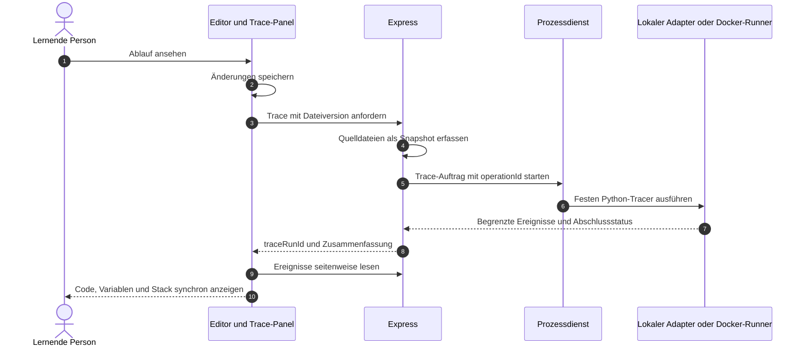
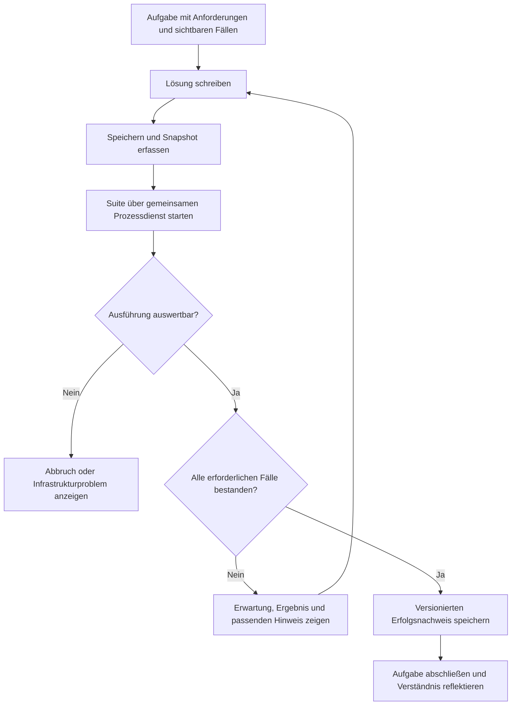
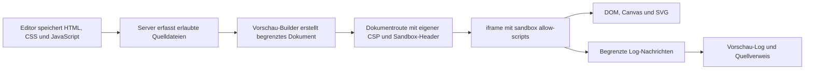
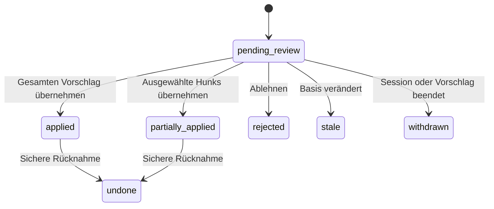
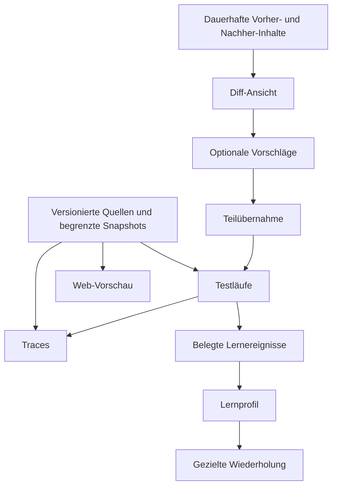

# SterraCode — Strategische und technische Verbesserungsplanung

## Fünf Kernideen mit Lernzielen, MVPs, Architektur und Abnahmekriterien

**Planungsstand: 19. Oktober 2026.** Dieser Plan erweitert die ursprünglichen fünf Ideen und gleicht sie mit dem aktuellen Repository ab. Er beschreibt vorgeschlagene Erweiterungen; die hier neu genannten Endpunkte, Datenfelder und Module sind noch nicht implementiert.

SterraCode soll Lernenden helfen, drei Fragen selbstständig zu beantworten: **Was macht mein Code? Woran erkenne ich, ob er die Aufgabe erfüllt? Was sollte ich als Nächstes üben?** Die fünf Kernideen bilden dafür einen zusammenhängenden Lernablauf: Code verstehen, Lösung prüfen, Änderungen nachvollziehen, Ergebnisse sehen und Wissen festigen.

Express, Monaco, Vanilla JavaScript, der gemeinsame Prozessdienst und die vorhandene Kontextkomprimierung bleiben die Grundlage. Die Erweiterungen sollen schrittweise nutzbar werden, auch wenn kein KI-Modell erreichbar ist.

---

## Inhaltsverzeichnis

1. [Ausgangslage und Produktziele](#ausgangslage)
2. [Idee 1: Code-Visualizer und Execution Tracer](#tracer)
3. [Idee 2: Test- und Grading-Harness](#grading)
4. [Idee 3: Lernprofil und gezielte Wiederholung](#lernprofil)
5. [Idee 4: Isolierte Web-Vorschau](#webvorschau)
6. [Idee 5: Diff-Inspector und selektive KI-Vorschläge](#diff-inspector)
7. [Gemeinsame technische Grundlagen](#grundlagen)
8. [Ergänzende Ideen für den Lernalltag](#ergaenzungen)
9. [Priorisierung, Synergien und Roadmap](#roadmap)
10. [Prüfstrategie und Erfolgskriterien](#pruefstrategie)
11. [Umsetzbares Ticket-Backlog](#backlog)
12. [Offene Entscheidungen mit vorgeschlagenen Defaults](#entscheidungen)
13. [Quellen und technische Bezugspunkte](#quellen)

---

<a id="ausgangslage"></a>

## 1. Ausgangslage und Produktziele

### 1.1 Was der aktuelle Code bereits mitbringt

| Bereich                         | Nachweis im Repository                                                                                               | Bedeutung für den Ausbau                                                                                                                        |
| ------------------------------- | -------------------------------------------------------------------------------------------------------------------- | ----------------------------------------------------------------------------------------------------------------------------------------------- |
| Versionierte Dateien            | `server/services/workspace.js`: SHA-256-Versionen, `expectedVersion`, HTTP `409`, serialisierte Schreibvorgänge      | Tests, Traces und Änderungsvorschläge müssen sich auf konkrete Dateistände beziehen.                                                            |
| Dauerhafte KI-Änderungshistorie | `writeFile`, `listChanges`, `undoChange`; Chatkarte und unabhängige Historie in `public/js/chat.js`                  | Der Diff-Inspector erweitert diese Historie, statt eine zweite Rückgängig-Verwaltung aufzubauen.                                                |
| Aufgaben und Lernplan           | `create_task`, `mark_task_done`, `currentTask`, `learningPlan`                                                       | Ein Aufgabenmodell und eine Aufgabenanzeige existieren bereits. Automatisierte Testfälle und Ergebnisnachweise fehlen.                          |
| Sprachprofil                    | `server/services/profileManager.js` und `profiles/user.json` relativ zum konfigurierten Datenverzeichnis             | `knownConcepts`, Stärken, Schwächen und Zähler existieren; ein Dashboard und ein Wiederholungsplan fehlen.                                      |
| Profilaktualisierung            | `toolExecutor.js` übergibt beim Aufgabenabschluss aktuell `taskSucceeded: true` und leere Konzeptlisten              | Ein sichtbares Dashboard allein erzeugt noch keine verlässlichen Kompetenzdaten. Zuerst müssen Herkunft und Bedeutung der Daten geklärt werden. |
| Gemeinsame Ausführung           | `processes.js` vermittelt an `localProcesses.js` oder `runnerClient.js`; der Runner kennt Datei- und Befehlsaufträge | Test- und Trace-Modi benötigen einen ausdrücklichen Vertrag in beiden Ausführungswegen. Ein neuer Express-Endpunkt allein genügt nicht.         |
| Runner-Grenzen                  | Ein aktiver Auftrag je Session; im Docker-Runner insgesamt vier Aufträge und höchstens zwei kompilierende Aufträge   | Tests und Traces teilen die bestehende Kapazität mit normaler Ausführung und Terminal.                                                          |
| Kontext und Wiederaufnahme      | `teacher.js`, `context/workflow.js`, `context/results.js`                                                            | Neue Vorgänge müssen nach Komprimierung, Neuladen und Wiederholung eines Turns korrekt erkennbar bleiben.                                       |
| Text- und Binärdateien          | `TEXT_REQUIRED` mit HTTP `415`, verständlicher Editor-Dialog, Browser-Test `binary-files.spec.js`                    | Vorschau-Assets benötigen gegebenenfalls einen eigenen Leseweg. Der Quelltexteditor bleibt auf UTF-8-Text begrenzt.                             |
| Schutz der Oberfläche           | `server/app.js`: Authentifizierung, Host-/Origin-Prüfung und Content Security Policy                                 | Neue Routen müssen diese Grenzen erhalten. Die Web-Vorschau benötigt eine gezielt eigene Dokument-Policy.                                       |

**Wichtige Grenze:** UUID-Workspaces ordnen Dateien zu und schützen die API-Pfadgrenzen. Sie bilden keine vollständige Isolation gegeneinander ausgeführter Programme. Lokal laufen Programme mit den Rechten des Benutzers; im Docker-Runner teilen sich Nutzerprogramme eine Ausführungs-UID. Das steht auch in `README.md` und `runner/README.md`. Der Ausbau darf daraus keine prüfungssichere oder mandantenfähige Ausführungsumgebung ableiten.

### 1.2 Die fünf Lernprobleme

1. **Abläufe bleiben unsichtbar.** Terminalausgaben erklären weder Variablenänderungen noch Funktionsaufrufe oder Referenzen.
2. **Aufgabenerfolg ist bisher wenig belegt.** Eine Tutorbeurteilung kann hilfreich sein, ersetzt aber keine Prüfung konkreter Anforderungen.
3. **Lernfortschritt ist nicht nachvollziehbar.** Ein grobes Level erklärt nicht, welche Fähigkeiten anhand welcher Beobachtungen eingeschätzt wurden.
4. **Webcode hat kein sichtbares Ergebnis.** HTML, CSS und JavaScript lassen sich bearbeiten, aber eine integrierte Browser-Vorschau fehlt.
5. **KI-Änderungen sind rückgängig, aber schwer zu verstehen.** Ein Vorher-/Nachher-Vergleich und begründete Teilvorschläge fehlen.

### 1.3 Leitlinien für alle Erweiterungen

- **Lernen bleibt aktiv:** Vorhersagen, selbst ausprobieren und erklären ergänzen automatische Hilfe.
- **Ergebnisse bleiben überprüfbar:** Ein Testergebnis oder Trace nennt den zugehörigen Code- und Aufgabenstand.
- **Offline bleibt nützlich:** Gespeicherte Aufgaben, Tests, Diff-Ansicht, Vorschau und Trace-Wiedergabe benötigen keine laufende KI.
- **Die Oberfläche wächst bei Bedarf:** Editor und Chat bleiben im Mittelpunkt; zusätzliche Ansichten öffnen sich auf Anforderung.
- **Altdaten bleiben ehrlich:** Frühere Tutorabschlüsse werden nicht nachträglich als testgeprüfte Erfolge ausgegeben.
- **Einzelplatz und geschützter LAN-Betrieb bleiben der Rahmen:** Mehrbenutzerbetrieb mit echten Prüfungsnoten wäre ein eigener Architekturauftrag.

---

<a id="tracer"></a>

## 2. Idee 1: Interaktiver Code-Visualizer und Execution Tracer

### 2.1 Lernziel und typische Nutzung

Eine lernende Person schreibt eine Schleife, die einen Index zu weit läuft. Sie startet **„Ablauf ansehen“**, geht zum Fehler und sieht gleichzeitig die betroffene Zeile, den Index und die Länge der Liste. Bei einer Rekursion erkennt sie, dass jeder Funktionsaufruf eigene lokale Variablen besitzt.

Der Visualizer soll zunächst **einen aufgezeichneten Lauf wiedergeben**. „Schritt zurück“ springt zu einem gespeicherten Zustand; es führt keine rückwärts laufende Programmausführung aus und macht keine Dateischreibvorgänge rückgängig. Ein echter interaktiver Debugger mit Breakpoints ist eine spätere Erweiterung.

### 2.2 MVP und spätere Ausbaustufen

| MVP: Python                                                                         | Später                                                       |
| ----------------------------------------------------------------------------------- | ------------------------------------------------------------ |
| Einzelner Hauptthread, Funktionen, Schleifen, grundlegende Container und Exceptions | JavaScript über eine gesonderte Debugger-Anbindung           |
| Unveränderlicher Snapshot der ausgewählten Quelldateien                             | Bedingte Breakpoints, Step-over und Step-out                 |
| Zeilenereignisse, Aufrufstack und begrenzte Variablenansicht                        | Anschaulicher Objekt- und Referenzgraph                      |
| Vorwärts-/Rückwärtsschritt, Zeitleiste, Sprung zum Fehler                           | Vergleich zweier Läufe oder eines fehlgeschlagenen Testfalls |
| Optional vorab festgelegte stdin-Eingabe                                            | Interaktive Eingabe während eines angehaltenen Laufs         |
| Eindeutige Anzeige von Abbruch und unvollständigen Daten                            | Threads, asynchrone Abläufe und externe Bibliotheksdetails   |

Ein Funktionsaufruf in einer nativen Bibliothek wird im MVP nicht intern visualisiert. Bei nicht unterstützten Ausführungsformen zeigt die Oberfläche die Einschränkung, statt vollständige Beobachtung zu suggerieren.

### 2.3 Architektur und Ablauf



Der geplante Wrapper `runner/tracer/python_tracer.py` wird außerhalb des bearbeitbaren Projektcodes verwaltet. Im lokalen Modus benötigt derselbe fachliche Auftrag einen passenden lokalen Adapter. Nutzercode wird weiterhin ausschließlich über den Prozessdienst gestartet.

**Vorgeschlagene öffentliche Schnittstellen:**

| Methode und Pfad                                                               | Aufgabe                                                                                                          |
| ------------------------------------------------------------------------------ | ---------------------------------------------------------------------------------------------------------------- |
| `POST /api/workspaces/:sessionId/traces`                                       | Mit `operationId`, Einstiegspfad und erwarteten Dateiversionen einen Lauf anlegen; asynchron mit `202` antworten |
| `GET /api/workspaces/:sessionId/traces/:traceRunId`                            | Status, Quelldateistand, Grenzen und Abschlussgrund liefern                                                      |
| `GET /api/workspaces/:sessionId/traces/:traceRunId/events?fromStep=1&limit=50` | Ereignisse mit begrenzter Seitengröße abrufen                                                                    |
| `POST /api/workspaces/:sessionId/traces/:traceRunId/cancel`                    | Zugehörigen Prozessbaum stoppen; wiederholter Abbruch bleibt wirkungsgleich                                      |

Die Routen sind neu zu planen. `server/routes/execute.js` bietet aktuell `POST /api/execute`; ein dort eingetragenes `/:sessionId/trace` würde nicht automatisch unter `/api/workspaces` erreichbar.

### 2.4 Ereignismodell und korrekte Darstellung

Beispiel eines geplanten Ereignisses; Platzhalter wie `<uuid>` stehen für serverseitig erzeugte IDs:

```json
{
  "schemaVersion": 1,
  "traceRunId": "<uuid>",
  "step": 14,
  "event": "line",
  "phase": "before",
  "file": "main.py",
  "line": 8,
  "frameId": "frame-3",
  "parentFrameId": "frame-1",
  "function": "find_item",
  "locals": {
    "i": { "type": "int", "value": 5 },
    "items": { "type": "list", "length": 5, "ref": "object-2" }
  },
  "objects": {
    "object-2": { "type": "list", "items": [10, 20, 30, 40, 50] }
  }
}
```

Ein Python-`line`-Ereignis entsteht **vor** der Ausführung der markierten Zeile. Die UI muss deshalb „Als Nächstes: Zeile 8“ und den dazugehörigen Zustand anzeigen. Änderungen durch diese Zeile werden erst beim folgenden geeigneten Ereignis sichtbar. `exception` bedeutet zunächst eine aufgetretene Ausnahme; erst das Gesamtergebnis zeigt, ob sie unbehandelt blieb. Diese Semantik richtet sich nach der [Python-Dokumentation zu `sys.settrace`](https://docs.python.org/3/library/sys.html#sys.settrace).

Aufruf- und Rückkehrereignisse erhalten stabile Frame-IDs. Gemeinsam referenzierte Listen dürfen nicht als zwei unabhängige Kopien erscheinen. Gekürzte Werte bekommen eine sichtbare Kennzeichnung.

### 2.5 Grenzen und robuste Serialisierung

Die folgenden Werte sind **vorgeschlagene Startwerte**, noch keine gemessenen Leistungszusagen:

| Grenze      | Vorschlag                                                     | Verhalten bei Erreichen                                                                   |
| ----------- | ------------------------------------------------------------- | ----------------------------------------------------------------------------------------- |
| Ereignisse  | 1.000                                                         | Aufzeichnung als unvollständig markieren und Beendigung des Laufs anfordern               |
| Trace-Daten | 2 MiB je Lauf                                                 | Weitere Daten verwerfen; `trace_size_limit` melden                                        |
| Laufzeit    | Eigenes, endliches Limit von zunächst 10 Sekunden             | Prozessdienst beendet den Prozessbaum, auch wenn normale Ausführung auf Timeout `0` steht |
| Werte       | Tiefe 4, höchstens 20 Einträge je Container, Text 250 Zeichen | Platzhalter mit ursprünglicher Größe beziehungsweise Kürzungsgrund                        |
| Stack       | Höchstens 30 sichtbare Frames                                 | Tiefere Frames zusammenfassen                                                             |

Das Ereignislimit allein beendet keine Endlosschleife. Ein externer Zeitwächter bleibt erforderlich, auch wenn Nutzercode Tracing deaktiviert, in nativen Code wechselt oder die Aufzeichnung fehlschlägt.

Weitere Anforderungen:

- Nur zum Snapshot gehörende, normalisierte Quellpfade erfassen. Ein bloßer `endswith(dateiname)`-Vergleich kann gleichnamige fremde Dateien verwechseln.
- Nur fest unterstützte eingebaute Datentypen auslesen; kein beliebiges `repr()`, keine Properties und keine benutzerdefinierten Iteratoren zur Darstellung aufrufen.
- Zyklen und gemeinsame Referenzen über Objekt-IDs behandeln; große Container nicht erst vollständig kopieren.
- Programm-stdout und Trace-Daten getrennt transportieren. Ausgabe des Nutzercodes darf nicht als Trace-Protokoll interpretiert werden.
- Ereignisse laufend begrenzt sichern. Bei hartem Stop reicht ein alleiniger Export im Python-`finally`-Block nicht aus.
- Teilweise geschriebene oder ungültige Datensätze erkennen und als unvollständigen Trace behandeln.
- Rückgabewerte, Fehlermeldungen und Metadaten ebenfalls begrenzen. Der Tracer ist ein Diagnosewerkzeug und keine zusätzliche Sandbox.

### 2.6 Bedienung und didaktische Ergänzungen

Das Panel in einem geplanten `public/js/tracer.js` enthält Zeitleiste, Wiedergabe, Schrittsteuerung, Stack und Variablentabelle. Eine ruhige Monaco-Markierung ersetzt eine dauerhaft pulsierende Animation. Farben werden durch Beschriftungen wie „neu“, „geändert“ und „entfernt“ ergänzt.

Vor dem Aufdecken eines Schritts kann die Person freiwillig eine **Vorhersage** abgeben: „Welchen Wert hat `summe` nach dem nächsten Durchlauf?“ Die Auswertung zeigt den tatsächlichen Wert und eine kurze Erklärung. Diese Lerninteraktion darf unabhängig von einer KI funktionieren.

Bei inzwischen verändertem Editorcode zeigt das Panel den ursprünglichen Snapshot oder einen deutlichen Hinweis auf den älteren Stand. Ein alter Trace darf keine aktuellen Editorzeilen fälschlich markieren.

### 2.7 KI-Anbindung

Ein einheitlich benanntes Tool `inspect_execution_trace` erhält `traceRunId`, `fromStep`, `limit` und einen begrenzten Detailgrad. Es startet keinen neuen Lauf. Der Tutor erhält zunächst nur eine Zusammenfassung und liest bei Bedarf wenige Ereignisse nach.

Eine Erklärung kann damit auf konkrete Belege verweisen: „Im Trace des gespeicherten Stands war `i = 5`, bevor Zeile 8 ausgeführt wurde.“ Trace-Inhalte bleiben Daten; enthaltene Zeichenketten erteilen der KI keine neuen Anweisungen.

### 2.8 Abnahme

- [ ] Eine Schleife, eine Rekursion und eine gemeinsam referenzierte Liste werden mit korrekter Zeilen- und Frame-Zuordnung dargestellt.
- [ ] Eine abgefangene Ausnahme wird von einem endgültigen Programmfehler unterschieden.
- [ ] Endlosschleifen, große Container, zyklische Listen und ein fehlerhaftes `__repr__` blockieren den Dienst nicht dauerhaft.
- [ ] Stoppen, Sessionwechsel und Browser-Neuladen starten den Lauf nicht erneut.
- [ ] Der vollständige Ablauf funktioniert ohne KI und mit ausdrücklich angezeigter fehlender Python-Laufzeit.

---

<a id="grading"></a>

## 3. Idee 2: Integriertes Test- und Grading-Harness für Aufgaben

### 3.1 Lernziel und Grenzen der Bewertung

Aufgaben sollen überprüfbare Anforderungen enthalten. Statt eines bloßen „Sieht richtig aus“ erhält die Person beispielsweise: **„3 von 4 Prüfungen bestanden; beim leeren String liefert deine Funktion `None`.“**

Das Harness prüft das Verhalten innerhalb einer definierten Testsuite. Es beweist weder allgemeine Fehlerfreiheit noch selbstständiges Verständnis. Lesbarkeit, Lösungsweg und Erklärung bleiben eigene Rückmeldungen. Wegen der bestehenden Ausführungsrechte ist es zunächst ein Werkzeug für Lernfeedback, kein manipulationssicheres Prüfungssystem.

### 3.2 MVP: Sichtbare Funktionstests für Python

Der erste vollständige Ausbau unterstützt JSON-kompatible Ein- und Ausgaben einer klar benannten Python-Funktion. Jede Aufgabe nennt Einstiegspfad, Funktionsnamen, Beispiele und Randfälle. Interaktives `input()` beim Modulimport ist in diesem Aufgabenformat nicht vorgesehen; dafür folgt später ein gesondertes stdin-/stdout-Format.

| MVP                                                            | Nach dem MVP                                                |
| -------------------------------------------------------------- | ----------------------------------------------------------- |
| Sichtbare Testfälle für eine Funktion in einer Python-Datei    | JavaScript und danach weitere Sprachadapter                 |
| Strenger, dokumentierter Vergleich von Rückgabewerten          | stdin-/stdout-Aufgaben und dateibasierte Ergebnisse         |
| Ein eigener Prozess je Testfall innerhalb eines Suite-Auftrags | Eigenschaftsbasierte und deterministisch erzeugte Testfälle |
| Tests offline starten und Ergebnisse erneut öffnen             | Zusätzliche verdeckte Randfälle                             |
| Unterscheidung von Lösungsfehlern und Infrastrukturfehlern     | Rubriken für Stil, Erklärung und Effizienz                  |
| Bindung an Aufgaben- und Quelldateiversion                     | Optionaler Trace des fehlgeschlagenen Falls                 |

Nicht jede Aufgabe benötigt Tests. Konzeptfragen und offene Projekte behalten einen ausdrücklich als manuell oder durch den Tutor beurteilten Abschluss.

### 3.3 Aufgabenmodell

`create_task` wird um ein optionales, serverseitig validiertes Testformat erweitert. Alte Aufgaben ohne Suite bleiben lesbar und bedienbar. Die Aufgabe bekommt eine eigene `taskVersion`, die sich bei geänderten Anforderungen erhöht.

```json
{
  "id": "<task-uuid>",
  "taskVersion": 1,
  "title": "Strings umkehren",
  "difficulty": "beginner",
  "conceptIds": ["python.strings", "python.functions"],
  "assessmentMode": "tests",
  "testSuite": {
    "schemaVersion": 1,
    "version": 1,
    "language": "python",
    "entry": {
      "path": "solution.py",
      "function": "reverse_string"
    },
    "comparison": {
      "kind": "strict-json"
    },
    "cases": [
      {
        "id": "simple-word",
        "name": "Einfaches Wort",
        "args": ["hello"],
        "expected": "olleh",
        "visibility": "public",
        "required": true
      },
      {
        "id": "empty",
        "name": "Leerer String",
        "args": [""],
        "expected": "",
        "visibility": "public",
        "required": true
      }
    ]
  }
}
```

Die KI darf dieses Datenformat vorschlagen. Ausführbare Testskripte, Shell-Kommandos und Installationsanweisungen gehören nicht in die Testfalldefinition. Der Server prüft unter anderem Schema, Sprachadapter, relative Pfade, erlaubte Funktionsnamen, eindeutige Fall-IDs, Datentypen, Anzahl und Gesamtgröße.

**Vergleichsregeln:** Strings werden exakt verglichen; eine tolerante Zeilenendungsbehandlung ist nur in einem später ausdrücklich definierten stdout-Modus erlaubt. Boolesche Werte und Zahlen bleiben verschieden. Arrays berücksichtigen Reihenfolge; Objekte verwenden Stringschlüssel. Nicht endliche Zahlen, zyklische Rückgaben und Werte außerhalb des unterstützten Zahlenbereichs erzeugen ein verständliches Serialisierungsproblem. Eine Gleitkommatoleranz muss als eigener Vergleichsmodus mit absoluter und relativer Toleranz angegeben werden.

### 3.4 Ablauf und Ergebnisnachweis



Ein geplantes `server/services/testRunner.js` koordiniert Suite, Snapshot und Vergleich. Feste Harness-Adapter führen ausschließlich die definierte Funktion mit strukturierten Argumenten aus. Nutzerausgaben werden getrennt vom Ergebnisprotokoll erfasst; ein gedrucktes JSON mit `passed: true` ist kein Erfolgsnachweis.

Pro Testfall startet ein frischer Prozess, damit globale Variablen und Importzustände nicht unbemerkt zwischen Fällen weiterwirken. Ein Suite-Auftrag reserviert dabei **einen** Session-Slot und führt Fälle nacheinander aus. Das darf weder parallele Starts außerhalb des Prozessdienstes noch verschachtelte Reservierungen desselben Slots erzeugen.

Vorgeschlagene Startgrenzen für den Python-MVP:

| Grenze                        | Startwert                                             | Rückmeldung                                                               |
| ----------------------------- | ----------------------------------------------------- | ------------------------------------------------------------------------- |
| Fälle je Suite                | Höchstens 20                                          | Größere Definition vor dem Start ablehnen                                 |
| Definition und JSON-Testdaten | Zusammen höchstens 256 KiB                            | Verständlicher Validierungsfehler                                         |
| Laufzeit                      | Höchstens 2 Sekunden je Fall und 30 Sekunden je Suite | Aktiven Fall abbrechen; verbleibende Fälle als nicht ausgeführt markieren |
| Ausgabe und Ergebnis          | Höchstens 64 KiB je Fall                              | Kürzung beziehungsweise ungültiges Ergebnis ausdrücklich melden           |

Diese endlichen Testlimits gelten unabhängig von einem unbegrenzten normalen Terminal-Timeout. Sie werden im Adapter geprüft und anhand erster Messungen angepasst; die Aufgaben-KI darf sie nicht beliebig erhöhen.

Der serverseitige Ergebnisnachweis enthält mindestens:

```json
{
  "schemaVersion": 1,
  "testRunId": "<uuid>",
  "taskId": "<task-uuid>",
  "taskVersion": 1,
  "suiteVersion": 1,
  "snapshotId": "<snapshot-uuid>",
  "sourceFiles": [{ "path": "solution.py", "version": "<sha256>" }],
  "harnessVersion": "python-functions-v1",
  "runtime": { "language": "python", "version": "<ermittelte-version>" },
  "status": "finished",
  "assessment": "failed",
  "summary": { "passed": 1, "failed": 1, "total": 2 },
  "startedAt": "2026-10-19T10:00:00.000Z",
  "finishedAt": "2026-10-19T10:00:01.000Z"
}
```

Die konkreten Fallausgaben liegen als begrenztes Artefakt vor. Der Tutor und die Aufgabenkarte referenzieren denselben `testRunId`. Ein Browser oder LLM darf den Erfolgsstatus nicht selbst setzen.

### 3.5 Vorgeschlagene API und Werkzeuge

| Schnittstelle                                                 | Zweck                                                                                                    |
| ------------------------------------------------------------- | -------------------------------------------------------------------------------------------------------- |
| `POST /api/workspaces/:sessionId/tasks/:taskId/test-runs`     | Mit `operationId`, `taskVersion` und erwarteten Quellversionen eine Suite starten; `202` mit `testRunId` |
| `GET /api/workspaces/:sessionId/test-runs/:testRunId`         | Status und begrenzte, freigegebene Ergebnisansicht lesen                                                 |
| `POST /api/workspaces/:sessionId/test-runs/:testRunId/cancel` | Suite einschließlich aktivem Kindprozess beenden                                                         |
| Geplantes Tool `run_task_tests`                               | Über denselben Dienst eine freigegebene Suite starten                                                    |
| Geplantes Tool `read_task_test_results`                       | Vorliegende Ergebnisse nachlesen; keine erneute Ausführung                                               |

Die bisherigen Aufgabenwerkzeuge bleiben erhalten. `mark_task_done` bekommt eine eindeutige Bindung an Aufgabe und Version. Bei testbasierten Aufgaben benötigt der Abschluss einen passenden serverseitigen Erfolgsnachweis.

KI-gestartete Ausführungen respektieren zunächst die bestehende Sperre für KI-Terminalausführung. Falls später eine eng begrenzte, davon unabhängige Testberechtigung gewünscht ist, muss sie ausdrücklich als eigene Einstellung und serverseitige Regel eingeführt werden.

### 3.6 Abschlussregeln und Profilanbindung

- Alle als erforderlich markierten Fälle müssen bestanden sein. Das schließt später vorhandene verdeckte Fälle ein.
- Ein Ergebnis für eine ältere Aufgaben-, Suite- oder Quelldateiversion bleibt historisch sichtbar, berechtigt aber nicht zum Abschluss des aktuellen Stands.
- Eine neue Ausführung ersetzt nicht die Historie; sie erzeugt einen neuen Lauf. Wiederholen desselben HTTP-Auftrags mit gleicher `operationId` erzeugt dagegen keinen weiteren Lauf.
- Ein technischer Fehler, Abbruch oder fehlender Interpreter zählt nicht als fehlende Kompetenz.
- Wiederholte Testversuche bleiben Versuche derselben Aufgabe. Sie werden nicht pauschal als mehrere neue Aufgaben gezählt.
- Der Abschluss erzeugt ein einmaliges Ereignis, aus dem das Profil abgeleitet wird. Ein wiederholter `mark_task_done`-Aufruf darf die Statistik nicht erneut erhöhen.
- Die Eindeutigkeit gilt für die Kombination aus Session und Aufgabe. Eine neue Version derselben Aufgabe aktualisiert den Beleg; sie erzeugt keinen zusätzlichen gelösten Aufgabenpunkt.
- Ein späterer manueller Abschluss wird als `manual` dokumentiert. Er wird nicht als bestandene Testsuite etikettiert.

Zwischen Testprüfung und Abschluss kann sich Code ändern. Daher muss der Dienst den Abschluss mit der aktuellen Aufgaben- und Quellversion geordnet prüfen und den belegten Stand speichern. Ein bloßer früherer grüner UI-Balken reicht nicht.

### 3.7 Verdeckte Tests erst als eigener Ausbau

Verdeckte Tests können zusätzliche Randfälle prüfen. Sie sind für den ersten nutzbaren Lernablauf nicht erforderlich und erhöhen den Aufwand für Datenabgrenzung deutlich:

1. Vollständige Definitionen werden serverseitig außerhalb von `currentTask` gespeichert. Die öffentliche Session-JSON, Chat-Ereignisse und Exporte erhalten nur freigegebene Metadaten.
2. Der ausführende Adapter erhält möglichst nur Eingaben; erwartete Ergebnisse bleiben beim auswertenden Dienst.
3. Ausgaben, Fehlermeldungen und herunterladbare Artefakte verdeckter Fälle werden vor jeder öffentlichen Darstellung gefiltert. Auch `read_tool_result` darf keine ungefilterten versteckten Erwartungen zurückliefern.
4. Sichtbares Feedback nennt beispielsweise „Ein zusätzlicher Randfall ist fehlgeschlagen“, sofern der konkrete Fall verborgen bleiben soll.
5. Echte Geheimhaltung gegenüber absichtlich manipuliertem Nutzercode wird im bestehenden lokalen beziehungsweise gemeinsamen Runner nicht zugesagt.

### 3.8 Qualität der Aufgaben und Tests

Von einem Modell vorgeschlagene Tests können selbst falsch oder unvollständig sein. Deshalb gehören zur Aufgabe ein kurzer Verhaltensvertrag und erkennbare Beispiele. Bearbeitbare Testsuiten bekommen eine Versionshistorie; ein geänderter Erwartungswert entwertet alte Erfolgsnachweise.

Für einen späteren kuratierten Aufgabenkatalog ist eine nützliche Qualitätsprüfung: **Besteht eine Referenzlösung, während typische fehlerhafte Lösungen durchfallen?** Beispiele sind ein falscher Schleifenrand, ein vergessenes `return` und eine leere Eingabe. Dafür sind keine umfassenden automatischen Mutationsframeworks im MVP erforderlich.

### 3.9 UI und verständliche Fehler

Die vorhandene Aufgabenkarte `#task-panel` in `public/js/chat.js` erhält „Lösung prüfen“, Fallliste, Zusammenfassung und Zeitpunkt des Laufs. Jeder Fehler bietet einen passenden nächsten Schritt:

| Ergebnis                         | Rückmeldung                                                                    |
| -------------------------------- | ------------------------------------------------------------------------------ |
| Abweichender Wert                | Erwartet / erhalten, Typunterschied und optional ein gestufter Hinweis         |
| Syntax- oder Importfehler        | Datei und Zeile öffnen                                                         |
| Timeout                          | Erklären, welcher Fall abgebrochen wurde; Schleifen und Eingaben prüfen        |
| Nicht unterstützter Rückgabewert | Erlaubte Typen und tatsächlichen Typ nennen                                    |
| Laufzeit fehlt                   | Vorhandene Laufzeitverwaltung öffnen                                           |
| Runner belegt oder in Wartung    | Laufenden Auftrag anzeigen beziehungsweise späteren erneuten Start ermöglichen |
| Quelldatei inzwischen geändert   | Ergebnis als älteren Stand markieren und erneutes Prüfen anbieten              |

Tests bleiben ohne Modellverbindung nutzbar. Eine zusätzliche Tutorfrage ist freiwillig und beginnt mit der Zusammenfassung des betreffenden Laufs.

### 3.10 Abnahme

- [ ] Eine korrekte Lösung besteht; typische Randwertfehler werden mit konkretem Feedback erkannt.
- [ ] stdout-Inhalte, ungültiges Ergebnis-JSON und zusätzliche Ausgaben erzeugen keinen falschen Erfolg.
- [ ] Aufgabenänderung oder Codeänderung entwertet die Abschlussberechtigung eines alten Laufs.
- [ ] Wiederholter Abschluss, HTTP-Retry und Neustart erzeugen keine doppelten Profilereignisse.
- [ ] Abbruch beendet die gesamte Suite; Infrastrukturfehler verändern den Lernstand nicht.
- [ ] Der MVP funktioniert lokal und im Docker-Runner mit jeweils geprüfter Adapterunterstützung.

---

<a id="lernprofil"></a>

## 4. Idee 3: Sichtbares Lernprofil und gezielte Wiederholung

### 4.1 Lernziel und belastbare Grundlage

„Du bist fortgeschritten“ ist wenig hilfreich, wenn die Person nicht erkennen kann, warum. Das Dashboard soll zeigen: **Welche Konzepte wurden geübt? Welche Beobachtungen sprechen für Sicherheit? Wo lohnt sich Wiederholung?**

Die vorhandenen Profilfelder sind ein Ausgangspunkt, aber keine präzise Kompetenzmessung. Im aktuellen Code wird die Erfolgsquote aus `tasksSucceeded / tasksAttempted` berechnet; ein gespeichertes Feld `taskSuccessRate` existiert nicht. Außerdem steigt `sessionCount` derzeit bei jedem `updateProfile`-Aufruf. Ein echter Sessionzähler muss künftig aus eindeutigen Session-IDs abgeleitet oder klar anders benannt werden.

### 4.2 MVP: Konzeptliste mit Belegen

Die erste Ansicht enthält Sprache, Konzepte, letzte Übung, Quellen der Einschätzung und nächste passende Übung. Ein Balken oder eine gut beschriftete Liste ist dafür ausreichend. Ein Radar-Chart und ein Wissensgraph folgen nur, wenn die Daten eine sinnvolle Aggregation erlauben.

Jede Einschätzung unterscheidet mindestens:

| Herkunft                 | Was sie aussagt                                                      |
| ------------------------ | -------------------------------------------------------------------- |
| Bestandener Test         | Bestimmtes Verhalten funktionierte für die betreffende Aufgabe       |
| Tutorbeurteilung         | Das Modell hat eine qualitative Einschätzung abgegeben               |
| Selbsteinschätzung       | Die lernende Person bewertet ihre Sicherheit                         |
| Aufgabe mit Lösungshilfe | Der Lösungsstand war erfolgreich; Selbstständigkeit bleibt gesondert |
| Übernommener Altbestand  | Historischer Eintrag ohne nachträglich erfundenen Testnachweis       |

„Unbekannt“ oder „wenig Belege“ ist ein erlaubter Zustand. Aus wenigen Klicks entstehen keine scheinbar exakten Prozentwerte.

### 4.3 Konzeptkatalog und Ereignisse

Freie Konzeptnamen wie „Loops“, „Schleifen“ und „for-Schleifen“ werden über stabile IDs mit Aliasen zusammengeführt. Ein kleiner versionierter Katalog genügt zunächst:

- `python.variables`, `python.conditions`, `python.loops`, `python.lists`, `python.functions`.
- Sprachübergreifende Zuordnung beispielsweise von `python.loops` und `javascript.loops` zur Obergruppe `control-flow`.
- Voraussetzungen als kuratierte Beziehungen; ein bestandener Unterpunkt beweist nicht automatisch alle Voraussetzungen.

Ein geplantes Ereignismodell:

```json
{
  "schemaVersion": 1,
  "eventId": "<uuid>",
  "type": "task_completed",
  "sessionId": "<session-uuid>",
  "taskId": "<task-uuid>",
  "taskVersion": 1,
  "language": "python",
  "conceptIds": ["python.functions", "python.strings"],
  "evidence": {
    "kind": "test_run",
    "testRunId": "<test-run-uuid>",
    "outcome": "passed",
    "assistance": "not_recorded"
  },
  "occurredAt": "2026-10-19T10:00:01.000Z"
}
```

Die Zuordnung einer Aufgabe zu Konzepten wird validiert und bleibt sichtbar. Ein LLM darf nicht ohne nachvollziehbare Beobachtung „gemeistert“ setzen. Das Profil wird aus eindeutigen Ereignissen abgeleitet; beschädigte oder doppelte Ereignisse dürfen nicht still Zähler verfälschen.

### 4.4 Wiederholung: Ein klarer Algorithmus für den Einstieg

Im ersten Ausbau wird **eine einfache Leitner-Variante** verwendet. Leitner-Stufen und SM-2-`easeFactor` werden nicht zu einem unbegründeten Mischmodell kombiniert.

Vorgeschlagene, konfigurierbare Intervalle sind 1, 3, 7, 14 und 30 Tage. Dies sind Produktdefaults für einen ersten Versuch, keine individuell gemessene Vergessenskurve.

```json
{
  "conceptId": "python.loops",
  "reviewStage": 2,
  "lastReviewedAt": "2026-10-19T10:10:00.000Z",
  "nextReviewAt": "2026-10-26T10:10:00.000Z",
  "lastEvidenceEventId": "<uuid>",
  "status": "practicing"
}
```

**Vorgeschlagene Regeln:**

- Nach einer eigenständig gelösten Wiederholungsaufgabe steigt die Stufe höchstens um eins.
- Ein Fehlversuch plant eine frühe Wiederholung; ein Timeout oder Runnerausfall verändert die Stufe nicht.
- Eine gemeinsam mit der KI erarbeitete Lösung kann als Übung zählen, verschiebt die nächste selbstständige Kontrolle aber nur begrenzt.
- Mehrfaches Ausführen derselben unveränderten Aufgabe am selben Tag vervielfacht keinen Lernfortschritt.
- „Heute überspringen“ und „Später erinnern“ bleiben folgenlos für die Kompetenzbewertung.
- Ereignisse werden als UTC-Zeitpunkte gespeichert; Fälligkeit und Aktivitätstage richten sich nach der gewählten Nutzerzeitzone.
- Eine feste Obergrenze, zunächst höchstens drei Vorschläge je Einstieg, verhindert eine wachsende Pflichtliste.

Ein späterer Wechsel zu einem anderen Scheduler erhält eine eigene Versionskennung und eine nachvollziehbare Migration.

### 4.5 Dashboard und Wissensgraph

Eine geplante Ansicht `public/js/profile.js` bietet:

1. **Konzeptübersicht:** Status wie „noch nicht geübt“, „in Übung“ und „zuletzt sicher gelöst“ mit Zeitpunkt und Beleg.
2. **Fällige Wiederholungen:** Kurze, ausdrücklich freiwillige Aufgaben mit erklärtem Grund.
3. **Verlauf:** Welche Aufgabe oder Selbsteinschätzung eine Änderung ausgelöst hat.
4. **Eigene Korrektur:** „Das beherrsche ich noch nicht“ und ein persönliches Lernziel.
5. **Sprachvergleich:** Bereits bekannte Konzepte als mögliche Analogien, ohne automatische Gleichsetzung.

Ein späterer Wissensgraph zeigt Voraussetzungen und Verbindungen. Er braucht eine gleichwertige Listenansicht für Tastatur und Screenreader. Aktivitätskalender und Streak sind optional; eine Lernpause wird nicht als Kompetenzverlust oder persönliches Scheitern inszeniert.

### 4.6 API, Datenschutz und Migration

| Geplante Schnittstelle                                   | Verhalten                                                                 |
| -------------------------------------------------------- | ------------------------------------------------------------------------- |
| `GET /api/profile`                                       | Nur das freigegebene Profil mit abgeleiteten Übersichten lesen            |
| `GET /api/profile/reviews`                               | Begrenzte Liste fälliger Wiederholungen liefern                           |
| `POST /api/profile/reviews/:reviewId/results`            | Ein eindeutiges Review-Ergebnis mit Herkunft aufnehmen                    |
| `POST /api/profile/concepts/:conceptId/self-assessments` | Selbsteinschätzung als solche speichern                                   |
| Export-/Reset-Funktion                                   | Profil und Wiederholungsdaten bewusst exportieren beziehungsweise löschen |

Das bestehende Opt-in `crossChatProfileEnabled` bleibt maßgeblich. Bei deaktiviertem Profil funktionieren Aufgaben und Tests weiter; die Anwendung sammelt daraus keinen neuen sessionübergreifenden Kompetenzverlauf. Beim Aktivieren wird eine rückwirkende Auswertung alter Sessions gesondert angeboten.

Die Migration von `profileVersion: 1` bewahrt alte Konzeptlisten und Zähler als historische Angaben. Sie erfindet weder genaue Übungsdaten noch fällige Wiederholungen. Nicht zuordenbare Begriffe bleiben als Altbezeichnung sichtbar. Profilbeschädigungen führen wie bisher zu einem erkennbaren Fehler und nicht zu einem stillen leeren Ersatzprofil.

### 4.7 Verbindung zum Tutor

Der Tutor erhält eine knappe, begrenzte Übersicht mit Belegen und fälligen Konzepten. Eine Wiederholungsaufgabe wird nach Möglichkeit aus einem geprüften kleinen Katalog erstellt; falls die KI sie formuliert, prüft der Aufgabenvalidator das Ergebnis.

Profilinhalt wird nur im freigegebenen Umfang an den ausgewählten KI-Anbieter übermittelt. Die Oberfläche erklärt, welche Angaben für die nächste Tutorantwort verwendet werden. Rohereignisse und vollständige Testläufe landen nicht automatisch im Prompt.

### 4.8 Abnahme

- [ ] Ein mehrfach abgesendeter Aufgabenabschluss erzeugt genau einen Lernbeleg.
- [ ] Alte Tutorabschlüsse bleiben von testgestützten Nachweisen unterscheidbar.
- [ ] Deaktiviertes Profil verhindert neue profilübergreifende Ableitungen.
- [ ] Fälligkeit funktioniert über Tagesgrenzen und Sommerzeitwechsel in der Nutzerzeitzone.
- [ ] Ein Wiederholungsfehler, eine Selbsteinschätzung und ein Runnerausfall haben unterschiedliche Folgen.
- [ ] Die gesamte Ansicht ist auch ohne Diagramm verständlich und bedienbar.

<a id="webvorschau"></a>

## 5. Idee 4: Isolierte Live-Vorschau für Web, Canvas und SVG

### 5.1 Lernziel und bewusst begrenzter Einstieg

Eine Person ändert eine CSS-Regel und sieht deren Wirkung sofort. Sie baut eine Schaltfläche, zeichnet auf ein Canvas oder verändert eine SVG-Grafik. Der Weg vom Quelltext zum sichtbaren Ergebnis bleibt innerhalb des Lernarbeitsplatzes.

Der MVP unterstützt ein kleines statisches Projekt mit einer ausgewählten HTML-Einstiegsdatei, lokalen CSS-Dateien und klassischen JavaScript-Dateien. Framework-Bundler, npm-Installationen, TypeScript-Kompilierung, externe CDNs und Netzwerkzugriffe gehören zunächst nicht dazu.

**Wichtig:** Eine neue Session erfordert derzeit eine der vorhandenen ausführbaren Sprachen; ein eigener Web-Projekttyp existiert nicht. Der erste Vorschauzugang kann deshalb in bestehenden Sessions über HTML-Dateien erfolgen. Eine Web-Projektvorlage oder ein zusätzlicher Projekttyp wird ausdrücklich als Folgeschritt geplant.

### 5.2 Warum das ursprüngliche iframe-Beispiel erweitert werden muss

Die Hauptoberfläche liefert bereits eine Content Security Policy aus, die Inline-JavaScript nicht erlaubt. `srcdoc`-Dokumente übernehmen CSP-Regeln des erzeugenden Dokuments; eine zusätzliche Meta-Policy im iframe kann diese Regeln nicht lockern. Ein einfaches Zusammenfügen von HTML, CSS und Inline-JavaScript reicht daher nicht als Integration. Die Vererbung beschreibt die [CSP-Spezifikation](https://www.w3.org/TR/CSP3/#csp-inheriting-to-avoid-bypasses).

Der geplante Ansatz verwendet stattdessen ein **serverseitig erzeugtes Vorschau-Dokument mit eigener restriktiver HTTP-Policy**. Die Schutzregeln der Hauptoberfläche werden dafür nicht pauschal geöffnet.

### 5.3 Dokumentaufbereitung und Einbettung



**Vorgeschlagene Routen:**

| Methode und Pfad                                                     | Aufgabe                                                                                 |
| -------------------------------------------------------------------- | --------------------------------------------------------------------------------------- |
| `POST /api/workspaces/:sessionId/preview-runs`                       | Einstiegspfad und erwartete Dateiversionen prüfen; Snapshot und `previewRunId` erzeugen |
| `GET /api/workspaces/:sessionId/preview-runs/:previewRunId`          | Dateimanifest, Gültigkeit und Aufbereitungsfehler lesen                                 |
| `GET /api/workspaces/:sessionId/preview-runs/:previewRunId/document` | Generiertes HTML mit eigener Policy, Authentifizierung und `no-store` liefern           |

Ein erstes iframe braucht lediglich einen verständlichen `title`, `sandbox="allow-scripts"`, eine kontrollierte `src`-Adresse und eine restriktive Referrer-Policy. `allow-same-origin`, Popups, Formulare, Downloads und Top-Navigation werden nicht freigegeben. Ohne `allow-same-origin` erhält das Dokument einen opaken Ursprung; der [HTML-Standard](https://html.spec.whatwg.org/multipage/iframe-embed-object.html#attr-iframe-sandbox) erläutert diese Trennung.

Der Response-Header des Vorschau-Dokuments ergänzt `sandbox allow-scripts`. Dadurch hängt der Schutz nicht ausschließlich davon ab, ob das Dokument noch innerhalb des vorgesehenen iframe angezeigt wird.

### 5.4 Policy und bestehende Servergrenzen

Die endgültige Policy wird in einem kleinen Browser-Prototyp geprüft. Ihr geplanter Rahmen:

| Bereich                  | Vorgabe für den MVP                                                                                  |
| ------------------------ | ---------------------------------------------------------------------------------------------------- |
| Skripte                  | Nur aufbereitete lokale beziehungsweise eingebettete Skripte; keine externen Quellen und kein `eval` |
| Styles                   | Eingebettete Styles und aufbereitete lokale Stylesheets                                              |
| Bilder                   | Eingebettete Daten und kontrolliert erzeugte Ressourcen                                              |
| Verbindungen             | `connect-src 'none'`: kein `fetch`, WebSocket oder externer API-Zugriff                              |
| Einbettungen             | Keine weiteren Frames, Objekte oder Plugins                                                          |
| Formulare und Basis-URLs | `form-action 'none'`, `base-uri 'none'`                                                              |
| Einbettender Ursprung    | `frame-ancestors` erlaubt genau den konfigurierten App-Ursprung                                      |
| Gerätefunktionen         | Kamera, Mikrofon und weitere nicht benötigte Funktionen per Permissions Policy sperren               |
| Zwischenspeicherung      | `Cache-Control: no-store`; begrenzte Lebensdauer des Snapshots                                       |

`server/app.js` setzt derzeit unter anderem `frame-ancestors 'none'`. Die Vorschau-Dokumentroute benötigt deshalb einen gezielten abweichenden Header; sonst wird auch das gewünschte Einbetten blockiert. Host-, Authentifizierungs- und API-Origin-Prüfungen bleiben wirksam. Insbesondere wird kein allgemeiner API-Zugriff für `Origin: null` freigegeben.

Ein experimentelles iframe-`csp`-Attribut dient nicht als alleinige Schutzmaßnahme. Entscheidend sind der vom Server ausgelieferte Header, die Sandbox und die tatsächlich getestete Browserwirkung.

### 5.5 Dateien und lokale Ressourcen

Der Vorschau-Builder löst ausschließlich freigegebene relative Pfade innerhalb des Snapshots auf. Er verwirft Traversal, Symlinks, fremde Sessions und externe URLs mit einer verständlichen Fehlermeldung.

Ein Parser beziehungsweise eine klar definierte Aufbereitung ersetzt naive Zeichenkettenkonkatenation. Zu prüfen sind unter anderem `</script>` in Texten, mehrere Stylesheets, CSS-`url()`, Zeichencodierung und Quellverweise. Ein nicht auflösbares Modulimport wird im MVP als nicht unterstützt gemeldet.

**Binärdateien bleiben getrennt:** Die bestehende Text-API darf nicht aufgeweicht werden, um PNG-Dateien oder andere Assets durch den Editor zu schleusen. Zunächst genügen eingebettetes SVG und Daten-URLs. Später kann ein eigener begrenzter Asset-Leseweg mit geprüften Medientypen und Größen ergänzt werden.

### 5.6 Console-Bridge ohne Vertrauen in Nutzercode

Ein frühes Bridge-Skript erfasst `console.log`, Warnungen, `error` und `unhandledrejection`. Die Darstellung erhält `previewRunId`, `renderId`, Schweregrad, begrenzten Text und soweit möglich Originaldatei sowie Zeile.

Die Empfangsseite prüft mindestens:

1. `event.source === previewFrame.contentWindow`.
2. Passende Lauf- und Render-ID; nach Neuladen werden alte Nachrichten verworfen.
3. Ein strikt begrenztes Schema mit erlaubten Meldungstypen und Schweregraden.
4. Maximale Nachrichtenlänge, Anzahl und Rate.
5. Darstellung ausschließlich als Text, ohne Ausführung oder HTML-Interpretation.

Ein opaker Ursprung kann als `"null"` erscheinen. Dieser Wert allein identifiziert die richtige Vorschau nicht. Die [Dokumentation zu `postMessage`](https://developer.mozilla.org/en-US/docs/Web/API/Window/postMessage) beschreibt die Prüfung von Absender und Nachrichtendaten.

Ein Render-Token dient nur der Zuordnung, nicht als Berechtigung: Vorschaucode kann seine eigene Umgebung beeinflussen. Bridge-Meldungen sind daher Diagnoseausgaben und dürfen niemals Aufgaben abschließen, Dateien schreiben oder Tool-Aufrufe auslösen.

Vorgeschlagene Startgrenzen sind 200 sichtbare Logeinträge und ein begrenzter Puffer von 256 KiB. Bei einer Logflut erscheint „Weitere Meldungen zusammengefasst“.

### 5.7 Bedienung und Fehlerfälle

- Vorschau wahlweise neben dem Editor oder als umschaltbare Ansicht auf schmalen Fenstern.
- Aktualisierung nach erfolgreichem Speichern mit kurzer Verzögerung; ein Schalter pausiert automatische Aktualisierung.
- „Neu laden“ beginnt einen neuen Renderlauf und leert auf Wunsch das Log.
- Fehler öffnen die zugehörige Quelldatei; Quellzuordnung und Verschiebungen durch die Bridge werden berücksichtigt.
- Eine veraltete oder abgelaufene Vorschau zeigt ihren Stand ausdrücklich an.
- „In neuem Tab öffnen“ folgt erst, wenn dieselben Dokument-Header auch dort geprüft sind.
- Entfernen beziehungsweise Neuladen des iframe ist ein Bedienungsabbruch. Es ist kein garantiertes CPU-Hardlimit für beliebigen Browsercode; eine Endlosschleife kann den Browser weiterhin beeinträchtigen.

### 5.8 Abnahme

- [ ] Lokales HTML, CSS, DOM-Ereignisse, Canvas und eingebettetes SVG funktionieren mit der produktiven App-CSP.
- [ ] Vorschaucode kann weder das App-DOM noch Cookies oder lokalen Speicher der Hauptoberfläche lesen.
- [ ] Netzwerkzugriffe, unerlaubte Navigationen und nicht unterstützte Ressourcen erhalten überprüfte Grenzen.
- [ ] Fremde Fenster, alte Renderläufe und übergroße Lognachrichten beeinflussen die UI nicht.
- [ ] Ein direkter Aufruf der Dokument-URL verliert den Sandbox-Header nicht.
- [ ] UTF-8-Editorverhalten und Binärdatei-Dialog bleiben erhalten.

---

<a id="diff-inspector"></a>

## 6. Idee 5: Diff-Inspector und selektive Übernahme von KI-Vorschlägen

### 6.1 Lernziel und Verhältnis zum bestehenden Workflow

Die Person soll sehen können, **welche Zeilen die KI verändert hat und welche Anforderung damit erfüllt werden soll**. Der erste Nutzen entsteht bereits durch einen lesbaren Vergleich in der vorhandenen Änderungshistorie.

Der bisherige direkte Schreibfluss bleibt der Standard: Die KI schreibt, die Person kann rückgängig machen. Ein optionaler Review-Modus ergänzt Vorschläge vor der Übernahme. Er wird nicht ungefragt zur Pflicht bei jeder Dateiänderung.

### 6.2 Drei getrennte Ausbaustufen

| Stufe                        | Funktion                                                         | Vorteil                                               |
| ---------------------------- | ---------------------------------------------------------------- | ----------------------------------------------------- |
| A: Änderung ansehen          | Dauerhafter Vorher-/Nachher-Diff bereits angewendeter Änderungen | Schneller Nutzen ohne Unterbrechung von Tool-Aufrufen |
| B: Gesamten Vorschlag prüfen | Optionalen Entwurf vollständig übernehmen oder ablehnen          | Bewusste Entscheidung bei größeren Änderungen         |
| C: Teiländerungen auswählen  | Serverseitig definierte Hunks auswählen und gemeinsam übernehmen | Einzelne Aspekte eines Vorschlags gezielt nutzen      |

Mehrdatei-Transaktionen, semantische Refactorings und automatisch aufgelöste Merge-Konflikte folgen frühestens nach diesen Stufen.

### 6.3 Historische Inhalte wirklich aufbewahren

Die vorhandenen Änderungsdatensätze enthalten den Vorher-Inhalt und `afterVersion`, aber keinen eigenen dauerhaft gespeicherten Nachher-Inhalt. Der heutige Dateiinhalt reicht nicht aus, wenn später weitere Änderungen erfolgt sind.

Für einen belastbaren historischen Vergleich braucht es deshalb ein versioniertes erweitertes Änderungsformat mit:

- Vorher- und Nachher-Snapshot oder unveränderlichen Inhaltsreferenzen.
- Pfad zum Zeitpunkt der Änderung, `changeId`, `turnId`, Begründung und Zeitstempel.
- Fachlicher Herkunft `origin: "ai"` und getrennt davon der übernehmenden Person beziehungsweise Aktion.
- Status für angewendet und rückgängig sowie einer nachvollziehbaren Zuordnung zum Vorschlag.

Alte Einträge ohne verfügbaren Nachher-Inhalt bleiben sichtbar. Ein Diff darf dann nur gezeigt werden, wenn sich der Nachher-Inhalt anhand einer passenden Version verlässlich rekonstruieren lässt. Andernfalls erklärt die Oberfläche die fehlende historische Grundlage.

### 6.4 Vorschlagsmodell

```json
{
  "schemaVersion": 1,
  "proposalId": "<uuid>",
  "sessionId": "<session-uuid>",
  "turnId": "<turn-uuid>",
  "path": "solution.py",
  "baseVersion": "<sha256>",
  "proposedContentRef": "<immutable-content-ref>",
  "reason": "Leere Eingaben behandeln",
  "status": "pending_review",
  "hunks": [
    {
      "id": "hunk-1",
      "summary": "Frühe Rückgabe für einen leeren String",
      "dependsOn": []
    }
  ],
  "createdAt": "2026-10-19T10:20:00.000Z"
}
```

Der Server berechnet Hunks aus unveränderlichem Ausgangs- und Zieltext. Der Client sendet nur ausgewählte Hunk-IDs und die erwartete Basisversion zurück. Frei eingesandte Zeilenpositionen oder beliebige Patchtexte gelten nicht als vertrauenswürdiger Vorschlag.

Begründungen können vom Modell stammen. Sie werden als Erklärung angezeigt, aber nicht als Beweis für Korrektheit. Falls der Tutor keine Hunk-Begründung liefert, genügt eine sachliche Änderungskurzfassung.

### 6.5 Lebenszyklus und Chat-Verhalten



Im Review-Modus liefert `write_file` beziehungsweise ein ergänzendes Werkzeug ausdrücklich **`proposed` statt `applied`** zurück. Der Tutor darf danach nicht behaupten, die Datei sei bereits geändert, oder Tests für den vorgeschlagenen Stand als tatsächlichen Lauf darstellen.

Der aktuelle Turn kann mit dem gespeicherten Vorschlag abschließen. Ein offenes Review hält keine SSE-Verbindung und keinen Backend-Auftrag unbegrenzt fest. Nach einer Nutzerentscheidung entsteht ein gespeichertes Ereignis; eine optionale Tutorfortsetzung erhält dieses Ereignis in einem neuen Turn.

Neuladen stellt offene Vorschläge wieder her. Kontextkomprimierung erhält ID, Pfad, Basisversion und aktuellen Status. Eine wiederholte Ausführung desselben Tool-Vorgangs erzeugt keinen zweiten Vorschlag.

### 6.6 Übernehmen und Konflikte

| Geplante Schnittstelle                                         | Verhalten                                                                   |
| -------------------------------------------------------------- | --------------------------------------------------------------------------- |
| `GET /api/workspaces/:sessionId/proposals`                     | Offene und zuletzt bearbeitete Vorschläge begrenzt auflisten                |
| `GET /api/workspaces/:sessionId/proposals/:proposalId`         | Metadaten und begrenzten Vergleich laden                                    |
| `POST /api/workspaces/:sessionId/proposals/:proposalId/apply`  | `operationId`, `expectedVersion` und optional `selectedHunkIds` verarbeiten |
| `POST /api/workspaces/:sessionId/proposals/:proposalId/reject` | Dauerhaft ablehnen; erneute identische Entscheidung bleibt wirkungsgleich   |

Beim Anwenden gelten folgende Regeln:

1. Ungespeicherte Editoränderungen zuerst sichern. Passt der gespeicherte Stand danach nicht mehr zur Vorschlagsbasis, muss der Konflikt sichtbar werden.
2. Pfad, Session-Schreibbarkeit, Proposal-Status und Basisversion serverseitig prüfen.
3. Ausgewählte Hunks gegen exakt diesen Basistext anwenden; kein unscharfes automatisches Patchen bei veränderter Datei.
4. Überlappende oder voneinander abhängige Hunks gemeinsam behandeln beziehungsweise eine unzulässige Auswahl verständlich ablehnen.
5. Den vollständigen resultierenden Text einmal atomar schreiben und genau einen passenden Rücknahme-Datensatz erzeugen.
6. Bei teilweiser Übernahme die übrigen Hunks nicht unverändert gegen die alte Basis weiterverwenden. Ein weiterer Vorschlag muss auf dem neuen Dateistand aufgebaut werden.
7. Umbenannte oder gelöschte Dateien sowie ein zwischenzeitliches Undo erhalten eine ausdrückliche Konfliktbehandlung.

**Konkrete Implementierungsfalle:** `writeFile` sperrt bereits mit `serial("workspace:<sessionId>")`. Eine neue Patchfunktion darf nicht dieselbe Sperre halten und darin erneut `writeFile` aufrufen; das würde sich selbst blockieren. Validierung und Commit brauchen einen gemeinsamen internen Schreibpfad, der die Sperre genau einmal übernimmt.

Eine weitere Falle ist ein neuer Actor wie `user_accepted_diff`: Im heutigen Code wird Änderungshistorie nur für `actor === "ai"` geschrieben. Der Ausbau muss Herkunft und Übernahmeaktion sauber modellieren, damit akzeptierte KI-Vorschläge weiterhin rückgängig bleiben.

### 6.7 Monaco und Bedienung

Die installierte Monaco-Version enthält `createDiffEditor`. Für die erste Stufe ist keine neue UI-Bibliothek erforderlich.

- Side-by-Side auf breiten Fenstern; zusammengeführte Ansicht auf schmalen Fenstern.
- Datei, Begründung und Änderungsstatus oberhalb des Vergleichs.
- Tastaturaktionen zum nächsten Unterschied und zu „Übernehmen“, „Ablehnen“ beziehungsweise „Schließen“.
- Deutliche Kennzeichnung von hinzugefügten und entfernten Zeilen zusätzlich zur Farbe.
- Nach Schließen Modelle und Listener freigeben; bereits existierende Editormodelle nicht versehentlich entsorgen.
- Für lange Dateien Grenzen und eine verständliche Ladeanzeige; fehlgeschlagene Diff-Berechnung blockiert keine normale Dateiarbeit.

### 6.8 Abnahme

- [ ] Ein historischer Diff zeigt den ursprünglichen Nachher-Stand auch nach späteren Dateiänderungen.
- [ ] Review-Modus verändert Dateien erst nach Übernahme; Standardmodus bleibt direkt wirksam.
- [ ] Konflikte mit Autosave, Umbenennen, Löschen und Undo überschreiben keine neueren Inhalte.
- [ ] Wiederholtes Übernehmen schreibt nur einmal und erzeugt genau einen Historieneintrag.
- [ ] Teilübernahme arbeitet auf identischer Basis und erhält eine sichere Rücknahme.
- [ ] Der Tutor unterscheidet gespeicherte Vorschläge von angewendeten Änderungen.

---

<a id="grundlagen"></a>

## 7. Gemeinsame technische Grundlagen

### 7.1 Gemeinsame Begriffe statt fünf unabhängiger Systeme

| Begriff                                     | Zweck                                                                |
| ------------------------------------------- | -------------------------------------------------------------------- |
| `operationId`                               | Vom Aufrufer wiederverwendete ID für dieselbe beabsichtigte Mutation |
| `snapshotId`                                | Unveränderlicher Quellstand mit Dateimanifest                        |
| `processId`                                 | Tatsächliche Ausführung im gemeinsamen Prozessdienst                 |
| `testRunId` / `traceRunId` / `previewRunId` | Fachlicher Lauf mit Ergebnisartefakten                               |
| `eventId`                                   | Einmaliges dauerhaftes Ereignis für Verlauf und Profil               |
| `proposalId`                                | Gespeicherter KI-Entwurf vor einer Übernahme                         |
| `schemaVersion`                             | Datenformat des jeweiligen Datensatzes                               |
| `taskVersion` / `suiteVersion`              | Fachlicher Anforderungsstand, getrennt vom Speicherformat            |

Die bestehenden Session-`revision`, Dateiversionen und Runner-Auftrags-IDs werden nicht durch diese Begriffe ersetzt. Neue Dienste übersetzen zwischen ihnen und halten die Zuordnung fest.

### 7.2 Ausführung und Fähigkeiten der Adapter

Tests und Traces erhalten einen festen Ausführungsmodus im Prozessdienst. Der heutige Docker-Vertrag akzeptiert nur `file` und `command`; neue Auftragsarten dürfen nicht stillschweigend als bereits unterstützt behandelt werden.

Vor dem Ausbau wird festgelegt, wie App und Runner unterstützte Fähigkeiten und Adapterversionen melden. Eine inkompatible Protokolländerung benötigt eine entsprechende Protokollversion; bei fehlender Fähigkeit zeigt die App „noch nicht verfügbar“, statt auf einen ungeprüften Ersatzweg auszuweichen.

Beide Backends verwenden dieselben fachlichen Prüfungen:

- Erlaubte Sprache, tatsächliche Laufzeit und freigegebener Modus.
- Session-Schreibbarkeit sowie Sperren beim Löschen.
- Endliche Laufzeit-, Ausgabe- und Artefaktgrenzen für neue Diagnosemodi.
- Begrenzte Parallelität und gemeinsamer Abbruch vollständiger Prozessbäume.
- Keine ungeplante Änderung der bestehenden KI-Berechtigungen.
- Keine Übergabe von App-Zugangsdaten oder Runner-Schlüssel an Nutzerprozesse.

Eine Suite oder ein Trace reserviert dieselbe Kapazität wie eine normale Ausführung. Ein belegtes Terminal wird nicht ohne Nutzeraktion beendet, um Platz für Tests zu schaffen.

Harte Speicher- und PID-Grenzen unterscheiden sich je nach Backend und Betriebssystem. Verfügbare Schutzmechanismen werden ausdrücklich ausgewiesen; ein Containerlimit wird nicht als identische Grenze des lokalen Windows- oder Linux-Prozesses dargestellt.

### 7.3 Snapshots und Dateikonsistenz

Ein gemeinsamer Snapshot-Dienst erfasst erlaubte Dateien in ein Manifest aus Pfad, Version und Größe. Der Lauf verwendet diese kopierten Bytes und nicht später erneut gelesene Live-Dateien. Für den Python-MVP kann der Umfang zunächst die Einstiegsdatei und ausdrücklich benannte lokale Hilfsdateien umfassen.

Die Erfassung ist größenbegrenzt und nutzt die vorhandenen sicheren Dateizugriffe. Eine Workspace-Sperre verhindert konkurrierende App-Schreibvorgänge während des Erfassens. Sie verhindert keine Änderungen durch beliebige externe Prozesse; der Snapshot-Dienst muss deshalb veränderte Dateien erkennen und entweder erneut erfassen oder abbrechen.

Ein Snapshot beschreibt exakt die erfassten Bytes, garantiert aber ohne weitere Maßnahmen keinen atomaren Dateisystemstand gegenüber fremden Programmen. Diese Grenze gehört zum Vertrag. Ein vollständiger Git-Dienst ist dafür nicht erforderlich.

### 7.4 Status, Idempotenz und Wiederherstellung

Technische Laufzustände und fachliche Bewertung werden getrennt. Ein Auftrag kann technisch erfolgreich beendet sein, obwohl Tests fachlich fehlgeschlagen sind.

Vorgeschlagener gemeinsamer technischer Lebenszyklus:

`accepted → running → finished | failed | cancelled | interrupted`

Fachliche Felder ergänzen beispielsweise `assessment: passed | failed | unavailable` beziehungsweise einen Trace-Abschlussgrund.

- Gleiche `operationId` und gleicher kanonischer Inhalt liefern dieselbe Operation.
- Gleiche ID mit anderem Inhalt ergibt `409 IDEMPOTENCY_CONFLICT`.
- Der Dienst speichert die Zuordnung vor dem tatsächlichen Start. Im Docker-Modus wird eine stabile Runner-ID weitergereicht.
- Nach einem Verbindungsfehler wird zuerst der bekannte Auftrag abgefragt.
- Ein Neustart startet nicht abgeschlossene Arbeiten nicht automatisch erneut.
- Der lokale Adapter braucht für neue Modi dieselbe fachliche Wiederherstellungsregel; die bereits vorhandenen Docker-Garantien werden nicht ungeprüft für ihn angenommen.

Das neue Ereignis darf nicht nur im Browser oder als freier Text des Tutors existieren. Serverseitiger Status bleibt nach Neuladen die maßgebliche Quelle.

### 7.5 Dauerhafte Daten und begrenzte Artefakte

Vorgeschlagene Bereiche relativ zum konfigurierten Datenverzeichnis sind `snapshots/`, `assessments/`, `traces/`, `previews/`, `proposals/` und `learning-events/`. Die Namen sind ein Entwurf; sie müssen vor der Implementierung auf die bestehenden App-/Runner-Volumes und Besitzrechte abgestimmt werden.

- Kleine Metadaten und Idempotenznachweise werden getrennt von großen Ausgaben gespeichert.
- Flüchtige Vorschau- und Trace-Artefakte erhalten ein Größenbudget und eine Ablaufregel.
- Ein abgelaufenes Artefakt bleibt als Metadatensatz mit `expired` erkennbar.
- Aktive Vorgänge und offene Vorschläge dürfen nicht durch Bereinigung verschwinden.
- Löschen einer Session stoppt zugehörige Vorgänge, sichert ihre Daten nach der bestehenden Löschstrategie und entfernt die aktiven Zuordnungen.
- Eine Bereinigung von Backups bleibt eine eigene ausdrückliche Funktion; die neuen Dienste löschen alte Sicherungen nicht beiläufig.
- Speichermangel vor einem Start und ein Abbruch während des Schreibens erhalten unterscheidbare Zustände.

Mehrere JSON-Dateien bilden keine automatische Transaktion. Für Abschluss, Historieneintrag und Profilereignis wird ein kleiner wiederaufnehmbarer Commit-Ablauf benötigt: vorbereiten, fachlichen Zustand speichern, Ereignis idempotent ergänzen und abgeleitete Ansicht aktualisieren. Ein Absturz zwischen diesen Schritten darf weder Erfolg verlieren noch doppelt zählen.

### 7.6 Kontext, Tool-Ergebnisse und Zuständigkeiten

`context/workflow.js` erhält neue strukturierte Zustände für Läufe und offene Vorschläge. `context/results.js` liefert große Ergebnisse portionsweise. Die normale Tutorantwort enthält nur Zusammenfassungen und gezielt benötigte Ausschnitte.

Der dortige `ResultLimiter` bewahrt ausgewählte Metadaten über eine feste Schlüsselliste. Diese Liste muss die neuen Lauf- und Vorschlags-IDs berücksichtigen, damit ein gekürztes Ergebnis seinen nachlesbaren Bezug behält. Dazu gehört ein Vertragstest mit absichtlich sehr kleinem Ergebnisbudget.

Verdeckte Daten müssen bereits vor der Übergabe an die öffentliche Tool-Ergebnisablage herausgefiltert sein. Kürzung ist keine Zugriffskontrolle.

Alle Statusabfragen prüfen die Session-Zuordnung. Ein `traceRunId` oder `proposalId` allein berechtigt nicht zum Zugriff auf eine fremde Session. Im aktuellen Einzelkonto-Modell ersetzt dies keine zukünftige Benutzer- und Rollenverwaltung.

### 7.7 Einheitliche Bedienung

Neue Ansichten verwenden die vorhandenen Themes, lokalen SVG-Icons, Dialoge und anpassbaren Bereiche. Status wird als Text angezeigt; Farbe allein genügt nicht.

Die Oberfläche berücksichtigt Sessionwechsel und verspätete Antworten über Session-ID und Anfragegeneration. Tastaturfokus kehrt nach Schließen eines Panels sinnvoll zurück. Fehlende KI, fehlender Runner, fehlende Laufzeit und ein Dateikonflikt bleiben voneinander unterscheidbar.

<a id="ergaenzungen"></a>

## 8. Ergänzende Ideen für den Lernalltag

Diese Erweiterungen ergänzen die fünf Kernideen. Sie sind ein nachgeordnetes Backlog und keine Voraussetzung für den ersten Ausbau.

### 8.1 Gestufte Hinweise statt sofortiger Komplettlösung

Eine Aufgabe kann eine kleine Hinweisleiter besitzen:

1. Eine Verständnisfrage: „Was sollte bei einer leeren Eingabe passieren?“
2. Ein konzeptioneller Hinweis: „Prüfe den Sonderfall vor der Schleife.“
3. Ein Hinweis auf eine konkrete Stelle im Code.
4. Eine freiwillig angeforderte Erklärung mit Lösungsvorschlag.

Der erste Ausbau nutzt die bereits vorhandenen `hints` einer Aufgabe und zeigt sie einzeln. Später kann der Tutor auf den konkreten fehlgeschlagenen Test eingehen.

**Abgrenzung:** Ein angeforderter Hinweis löst nicht automatisch eine Dateiänderung aus. Wenn die Person eine Korrektur wünscht, greift der gewählte direkte Schreib- oder Review-Modus. Die beanspruchte Hilfe wird als Lernkontext erfasst, ohne dafür Punkte abzuziehen.

**Nutzenprüfung:** Reicht ein früher Hinweis für einen erneuten eigenen Lösungsversuch? Eine vollständig angeforderte Lösung wird nicht als selbstständige Beherrschung interpretiert.

### 8.2 Fehler in verständliche Lernkarten übersetzen

Eine gemeinsame Fehleransicht verbindet Dateipfad, Zeile, Lauf und Erklärung. Sie unterscheidet Syntaxfehler, Laufzeitfehler, abweichendes Ergebnis und Infrastrukturproblem.

Beispiel:

> **Index außerhalb der Liste**
>
> Dein Code greift auf Position 5 zu. Die Liste hat die Positionen 0 bis 4.
>
> Öffne Zeile 8, prüfe den Schleifenrand oder sieh dir den letzten Trace-Schritt an.

Ein kleiner kuratierter Katalog kann häufige Python- und JavaScript-Fehler auch offline erklären. Die originale Fehlermeldung bleibt aufklappbar. Die Zuordnung darf nur eindeutig erkannte Muster vereinfachen; unbekannte Fehler erhalten keine erfundene Ursache.

**Erster Schritt:** Bestehende Laufzeitfehler und Testergebnisse mit „Zur Zeile“ verbinden. Automatische Traces werden erst später und nur nach ausdrücklichem Start angeboten.

### 8.3 Kleine Projektwerkstatt mit nachvollziehbaren Vorlagen

Ein Katalog bietet Projekte mit sichtbarem Ziel: Zahlenratespiel, Textauswertung, kleine Webseite oder Canvas-Spiel. Jede Vorlage enthält:

- Lernziel, Voraussetzungen und einen überschaubaren ersten Meilenstein.
- Wenige Quelldateien mit bewusst offenen Arbeitsstellen.
- Geeignete sichtbare Tests beziehungsweise eine Prüfliste.
- Benötigte vorhandene Laufzeit und Umfang der verwendeten Funktionen.
- Version, Herkunft und gegebenenfalls Lizenz der Vorlage.

Vorlagen bestehen aus geprüften Daten und Dateien. Sie installieren keine Programme und führen beim Import keine Projektbefehle aus. Die bestehende Laufzeitverwaltung bleibt für Installationen zuständig.

**Erster Schritt:** Zwei Python-Projekte und nach Fertigstellung der Vorschau ein statisches Webprojekt. Ein umfangreicher Marketplace ist nicht erforderlich.

### 8.4 Lernjournal mit kleinen Meilensteinen

Nach einer Aufgabe kann die Person in einem Satz festhalten: „Was habe ich verstanden?“ oder „Was war schwierig?“ Das Journal verknüpft diese Aussage mit dem betreffenden Aufgabenstand und optional einem erfolgreichen Testlauf.

Eine spätere Sitzungsübersicht schlägt den nächsten Schritt vor: „Zuletzt hast du Funktionen mit Listen geübt. Möchtest du den leeren Fall nochmals selbst lösen?“ Wenn die KI eine Zusammenfassung erstellt, bleibt sie als solche erkennbar und bearbeitbar.

**Erster Schritt:** Ein freiwilliger persönlicher Eintrag beim Abschluss. Keine automatisch erfundenen Lernleistungen und keine Pflicht zur täglichen Aktivität.

### 8.5 Reproduzierbare Projektpakete und Wiederaufnahme

Ein Exportpaket kann Quellstand, Aufgabenbeschreibung, sichtbare Tests und Laufzeitinformationen enthalten. Damit lässt sich ein Lernprojekt archivieren, auf einem anderen eigenen Rechner fortsetzen oder anhand eines konkreten Stands besprechen.

Das Exportformat braucht eine Version, ein Manifest und Grenzen für Größe und Dateianzahl. Zugangsdaten, Authentifizierungszustand, vollständige persönliche Profile, Backups und verdeckte Testdefinitionen sind standardmäßig ausgeschlossen. Ein Import prüft Pfade und Links und startet keinen Code.

**Erster Schritt:** Bewusster Quelltext- und Aufgabenexport. Vollständige App-Sicherung und Wiederherstellung bleiben die in `DOCKER-BETRIEB.md` beschriebenen Betriebsfunktionen.

---

<a id="roadmap"></a>

## 9. Priorisierung, Synergien und Roadmap

### 9.1 Nutzen und Aufwand getrennt betrachten

Die Aufwandseinstufung ist relativ: **S** bedeutet eine begrenzte Erweiterung vorhandener Abläufe, **M** mehrere betroffene Module und **L** neue Ausführungsverträge oder anspruchsvolle Zustandsübergänge. Sie ist keine Zusage in Personentagen.

| Erweiterung                         | Erwarteter Lernnutzen                    | Aufwand | Hauptabhängigkeit                                | Empfohlener Einstieg                      |
| ----------------------------------- | ---------------------------------------- | ------- | ------------------------------------------------ | ----------------------------------------- |
| Diff-Ansicht vorhandener Änderungen | Hoch: KI-Änderungen nachvollziehen       | S–M     | Historische Nachher-Inhalte                      | Früh, als eigenständiger kleiner Ausbau   |
| Sichtbare Python-Tests              | Sehr hoch: Anforderungen und Rückmeldung | L       | Snapshot, Harness und Prozessvertrag             | Erster vollständiger Lernablauf           |
| Lernprofil mit Belegen              | Hoch: Fortschritt einordnen              | M       | Eindeutige Lernereignisse                        | Nach belastbarem Aufgabenabschluss        |
| Leitner-Wiederholung                | Hoch: Gezieltes erneutes Anwenden        | M       | Konzeptkatalog und Review-Aufgaben               | Nach einer verständlichen Konzeptliste    |
| Review vor Übernahme                | Hoch: Bewusster Umgang mit Vorschlägen   | M       | Proposal-Lebenszyklus und Historie               | Nach lesbarem Diff                        |
| Einzelne Hunks übernehmen           | Hoch bei größeren Änderungen             | M–L     | Stabile Vorschläge und Konfliktbehandlung        | Eigene Stufe nach vollständiger Übernahme |
| Statische Web-Vorschau              | Hoch: Visuelle Rückmeldung               | M–L     | Dokument-Policy und Ressourcenaufbereitung       | Nach frühem Browser-Prototyp              |
| Python-Trace                        | Sehr hoch bei Ablaufproblemen            | L       | Snapshot, Prozessvertrag und begrenzte Artefakte | Nach stabiler Testausführung              |
| Hinweise und Fehlerkarten           | Hoch bei geringem Umfang                 | S–M     | Vorhandene Aufgaben und Laufdaten                | Als kleine Ergänzungen einschieben        |

Die ursprüngliche Einstufung von Vorschau und Hunk-Freigabe als eher klein unterschätzt CSP, Dateistände, Chat-Wiederaufnahme und Konflikte. Eine einfache Demo ist jeweils deutlich kleiner als eine dauerhaft verlässliche Integration.

### 9.2 Synergien und Abhängigkeiten



Konkrete Verknüpfungen:

- **Test → Trace:** Einen sichtbaren fehlgeschlagenen Fall mit seinen ursprünglichen Eingaben visualisieren, ohne einen neuen Aufgabenstand zu erfinden.
- **Diff → Test:** Nach Übernahme die aktuelle Lösung mit der bekannten Suite prüfen; der neue Lauf nennt den tatsächlich übernommenen Stand.
- **Test → Profil:** Erfolgsnachweise fließen einmalig ein; viele Retries erzeugen keine vielen „gelösten Aufgaben“.
- **Profil → Aufgabe:** Wiederholungen richten sich nach konkreten geübten Konzepten, nicht nur nach einem pauschalen Sprachlevel.
- **Vorschau → Fehlerkarte:** Browserfehler öffnen dieselbe Quellnavigation wie Terminal- und Testfehler.
- **Alle Bereiche → Kontext:** Der Tutor liest den aktuellen Status über IDs und kurze Zusammenfassungen, statt große Rohdaten im Chat mitzuschleppen.

### 9.3 Etappe 0: Verträge und kleine technische Nachweise

**Inhalt:** Snapshot-Format, Lauf-IDs, Fähigkeiten der Adapter, Artefaktgrenzen und einmalige Abschlussereignisse festlegen. Einen kleinen Browsernachweis für die Vorschau-CSP erstellen.

**Fertig, wenn:** Ein unveränderlicher Quellstand einem Auftrag zugeordnet werden kann, Wiederholung keine doppelte Ausführung startet und fehlende Fähigkeiten korrekt angezeigt werden. Der Vorschauversuch belegt erlaubtes Rendering sowie die wesentlichen gesperrten Zugriffe.

### 9.4 Etappe 1: Sichtbare Qualität im bestehenden Workflow

**Inhalt:** Historische Nachher-Inhalte und lesbaren Diff ergänzen. Eine sichtbare Python-Testsuite vollständig durch Aufgabe, Ausführung, Ergebnis und Abschluss führen.

**Fertig, wenn:** Die Person eine Aufgabe offline prüfen kann, eine falsche Lösung verständliches Feedback erhält und der Abschluss genau einmal mit belegtem Dateistand gespeichert wird. KI-Änderungen lassen sich anhand echter historischer Inhalte ansehen und sicher zurücknehmen.

### 9.5 Etappe 2: Eigenständiges Lernen und kontrollierte Vorschläge

**Inhalt:** Konzeptkatalog, Profilansicht mit Belegen und wenige freiwillige Wiederholungen. Optionalen Review-Modus zunächst mit vollständigem Annehmen oder Ablehnen ergänzen; danach Teilübernahme.

**Fertig, wenn:** Jede sichtbare Profiländerung eine Herkunft besitzt, eine Pause keine bestrafende Pflichtliste erzeugt und offene KI-Vorschläge Neuladen sowie Kontextkomprimierung überstehen.

### 9.6 Etappe 3: Sichtbare Webprojekte

**Inhalt:** Statische Vorschau mit lokalen Ressourcen, sicher begrenztem Log und Quellnavigation. Anschließend eine Web-Projektvorlage ergänzen.

**Fertig, wenn:** HTML/CSS/JavaScript unter den produktiven Schutzregeln funktionieren und die vorhandenen Authentifizierungs- und Binärdateiabläufe unverändert korrekt arbeiten.

### 9.7 Etappe 4: Abläufe visualisieren

**Inhalt:** Python-Trace mit begrenzter Aufzeichnung, Zeitleiste, Stack und Variablen. Danach den Start aus einem fehlgeschlagenen sichtbaren Testfall anbieten.

**Fertig, wenn:** Zeilen vor ihrer Ausführung korrekt markiert werden, Referenzen verständlich bleiben und abgebrochene Läufe als unvollständig wiedergegeben werden.

**Nächster konkreter Umsetzungsschnitt:** Eine Aufgabe `reverse_string` mit zwei sichtbaren Fällen anlegen, aus einem versionierten Snapshot prüfen und über einen eindeutigen Erfolgsnachweis abschließen. Dieser Schnitt schafft zugleich die Datenbasis für Lernprofil und spätere Traces.

---

<a id="pruefstrategie"></a>

## 10. Prüfstrategie und Erfolgskriterien

### 10.1 Technische Prüfungen für die spätere Implementierung

Die folgende Matrix beschreibt erforderliche künftige Tests. Sie behauptet keine bereits erfolgte Abnahme dieser geplanten Funktionen.

| Ebene               | Zu prüfen                                                                                                      | Anschluss an bestehende Tests                                               |
| ------------------- | -------------------------------------------------------------------------------------------------------------- | --------------------------------------------------------------------------- |
| Daten und Migration | Alte Aufgaben/Profilversionen, fehlende Nachher-Inhalte, beschädigte Daten, Wiederaufnahme nach Commit-Abbruch | `backend.test.js`, `workspace-server.test.js`                               |
| API und Dateistände | Fremde Session-ID, unzulässiger Pfad, stale Version, geänderte Suite, doppelte Operation                       | Workspace- und Auth-Vertragstests                                           |
| Prozessdienst       | Lokaler und Docker-Adapter, fehlende Laufzeit, belegter Slot, Wartung, Abbruch und Neustart                    | `runtime-smoke.test.js`, `runner-contract.test.js`, `runner-client.test.js` |
| Harness             | Richtige/falsche Rückgaben, Typunterschiede, Importfehler, stdout-Manipulation, Timeout, Isolation der Fälle   | Neue fokussierte Harness-Tests                                              |
| Tracer              | Ereignissemantik, Rekursion, Aliasing, Zyklen, fehlerhafte Darstellung, Größenlimit, harter Stop               | Neue Trace- und Adaptertests                                                |
| Vorschau            | Produktive CSP, direkte Dokumentnavigation, App-Zugriff, Netzwerk, fremde Nachrichten und Logflut              | Playwright mit echtem Browser                                               |
| Review              | Autosave-Konflikt, Hunk-Abhängigkeit, doppelte Übernahme, Undo, historische Diffs                              | Workspace-Tests und Browserabläufe                                          |
| Profil              | Deduplizierung, Belegarten, deaktiviertes Profil, Wiederholung und Zeitzonen                                   | Neue reine Diensttests mit kontrollierter Zeit                              |
| Tutor und Kontext   | `proposed` gegenüber `applied`, lange Ergebnisse, verlorene Verbindung, Wiederholung nach Komprimierung        | `context-integration.test.js` und Provider-Vertragstests                    |
| Oberfläche          | Tastatur, Fokus, vier Themes, schmale Fenster, Offlinezustand und verspätete Antwort                           | Bestehende E2E-Suite; `binary-files.spec.js` als Regression                 |

Die bestehenden Befehle `npm test`, `npm run test:e2e` und `npm run format:check` bleiben der Einstieg. Echte Docker-Smokes sind bei Änderungen am Runner zusätzlich erforderlich, sofern die entsprechende Umgebung verfügbar ist. Nicht ausgeführte Plattform- oder Providerprüfungen werden ausdrücklich als offen dokumentiert.

### 10.2 Durchgängige Abnahmeszenarien

1. **Offline lernen:** Session öffnen, vorhandene Aufgabe bearbeiten, Tests starten, Ergebnis lesen und einen belegten Abschluss speichern.
2. **Code wird zwischenzeitlich geändert:** Ein alter grüner Testlauf bleibt sichtbar; der neue Code kann damit nicht ungeprüft abgeschlossen werden.
3. **Unterbrochener Auftrag:** Browser neu laden oder Server neu starten; derselbe Vorgang läuft nicht unbemerkt ein zweites Mal.
4. **KI-Vorschlag prüfen:** Vorschlag speichern, Turn beenden, Seite neu laden, Entscheidung treffen und das tatsächliche Ergebnis im Verlauf sehen.
5. **Profil deaktivieren:** Neue Aufgaben und Tests funktionieren, ohne neue sessionübergreifende Lernbelege zu sammeln.
6. **Webfehler verstehen:** Vorschaufehler mit Quellverweis anzeigen und kontrolliert an den Tutor übergeben.
7. **Trace abbrechen:** Lauf stoppen, bereits erfasste Ereignisse als unvollständig ansehen und danach normal weiterarbeiten.

### 10.3 Produktnutzen als überprüfbare Hypothese

| Hypothese                                   | Beobachtung                                                           | Schutz vor Fehlinterpretation                                         |
| ------------------------------------------- | --------------------------------------------------------------------- | --------------------------------------------------------------------- |
| Testfeedback erleichtert eigene Korrekturen | Fehlgeschlagener sichtbarer Fall wird nach eigener Änderung bestanden | Ein KI-generierter Komplettfix zählt nicht als unabhängiger Lernbeleg |
| Diffs helfen beim Verstehen                 | Person kann die wichtigste Änderung kurz benennen                     | Hohe Annahmequote allein ist kein Qualitätsmaß                        |
| Wiederholung erleichtert späteres Anwenden  | Ähnliche neue Aufgabe nach zeitlichem Abstand gelöst                  | Dieselbe auswendig bekannte Testeingabe reicht nicht                  |
| Traces machen Abläufe verständlich          | Person sagt einen späteren Variablenwert korrekt voraus               | Viele Trace-Klicks allein bedeuten keinen Lernerfolg                  |
| Web-Vorschau verkürzt die Rückmeldung       | Person erkennt die Wirkung einer eigenen HTML-/CSS-Änderung           | Häufiges Neuladen ist kein Lernziel                                   |

Die Messung beginnt mit lokalen Beobachtungen und freiwilligem Feedback. Externe Telemetrie oder Anbieterübermittlung entsteht daraus nicht automatisch.

---

<a id="backlog"></a>

## 11. Umsetzbares Ticket-Backlog

Die Tickets sind bewusst kleiner als die fünf Gesamtideen. Ihre Reihenfolge beschreibt Abhängigkeiten; konkrete Zeitschätzungen folgen erst nach den technischen Nachweisen.

| ID   | Arbeitspaket                                 | Voraussetzung                  | Konkretes Fertigkriterium                                             |
| ---- | -------------------------------------------- | ------------------------------ | --------------------------------------------------------------------- |
| F-01 | Snapshot- und Manifestdienst                 | Bestehende Workspace-Prüfungen | Lauf verwendet unveränderliche Bytes; Größen- und Pfadgrenzen geprüft |
| F-02 | Ausführungsmodi und Fähigkeitserkennung      | F-01                           | Lokal und Runner melden unterstützte Modi; keine stillen Ersatzstarts |
| F-03 | Fachliche Laufzustände und Wiederaufnahme    | F-02                           | Gleiches Startgesuch erzeugt keinen zweiten Lauf                      |
| D-01 | Historische Nachher-Inhalte ergänzen         | Bestehende Änderungshistorie   | Neuer historischer Diff bleibt nach Folgeänderungen korrekt           |
| D-02 | Lesbaren Monaco-Diff anbieten                | D-01                           | Tastatur, Themes und schmale Ansicht funktionieren                    |
| T-01 | Optionales Aufgaben-/Testschema              | Bestehendes `create_task`      | Alte Aufgaben lesbar; neue Suiten serverseitig validiert              |
| T-02 | Python-Funktionsadapter und Vergleich        | F-01 bis F-03, T-01            | Zwei Fälle isoliert ausführen; falsches stdout erzeugt keinen Erfolg  |
| T-03 | Testanzeige und belegten Abschluss verbinden | T-02                           | Ältere Quellstände und doppelte Abschlüsse werden korrekt behandelt   |
| L-01 | Lernereignisse und Konzeptkatalog            | T-03                           | Ereignisse eindeutig; Altbestände als historische Angaben migriert    |
| L-02 | Profilansicht mit Belegen                    | L-01                           | Herkunft jeder Aussage sichtbar; Profil-Opt-in eingehalten            |
| L-03 | Einfache freiwillige Wiederholungen          | L-02                           | Scheduler, Zeitzone und Obergrenze durchgängig geprüft                |
| D-03 | Persistente Review-Vorschläge                | D-02, F-03                     | Vorschlag überlebt Neuladen und verändert noch keine Datei            |
| D-04 | Ganze Vorschläge übernehmen oder ablehnen    | D-03                           | Einmaliger versionsgeprüfter Commit mit sicherem Undo                 |
| D-05 | Hunks auswählen und Konflikte behandeln      | D-04                           | Keine unscharfe Übernahme; Abhängigkeiten geprüft                     |
| W-01 | Vorschau-Policy im Browser nachweisen        | Bestehende App-CSP             | Rendering erlaubt, App-Zugriff gesperrt, direkte Route geschützt      |
| W-02 | Ressourcenaufbereitung und Vorschau-Panel    | W-01, F-01                     | Kleines statisches Projekt mit korrekten Fehlerverweisen nutzbar      |
| W-03 | Webvorlage und begrenzte Console-Bridge      | W-02                           | Frische Vorlage und Diagnose ohne ungeprüfte Nachrichtentypen         |
| V-01 | Begrenzten Python-Tracer anbinden            | F-01 bis F-03                  | Semantisch korrekte Ereignisse und verlässlicher Prozessabbruch       |
| V-02 | Trace-Panel und Testfall-Verknüpfung         | V-01, T-03                     | Fehlgeschlagenen sichtbaren Fall als Snapshot wiedergeben             |
| X-01 | Hinweise und Fehlerkarten ergänzen           | T-03                           | Eigener weiterer Versuch aus verständlichem Feedback möglich          |

**Fertig bedeutet für jedes Ticket:** Fachliches Verhalten, Fehlerzustände und passende Prüfungen sind enthalten. Datenformatänderungen haben eine lesbare Migration; neue Bedienung funktioniert mit Tastatur. Eine bloße Demo ohne Wiederherstellung oder Konfliktbehandlung beendet das Ticket nicht.

---

<a id="entscheidungen"></a>

## 12. Offene Entscheidungen mit vorgeschlagenen Defaults

Diese Entscheidungen werden vor dem jeweiligen Umsetzungsschritt festgelegt; sie blockieren nicht die übrigen Ausbaustufen.

| Entscheidung                | Vorgeschlagener Default                                  | Wann neu bewerten?                                                    |
| --------------------------- | -------------------------------------------------------- | --------------------------------------------------------------------- |
| Erste Testsprache           | Python, sichtbare Funktionstests                         | Nach dem vollständigen ersten Lernablauf                              |
| Testabschluss               | Alle erforderlichen Fälle des aktuellen Stands bestanden | Falls offene Projektaufgaben andere Kriterien brauchen                |
| Verdeckte Tests             | Nachgelagerter Ausbau                                    | Wenn ein konkreter didaktischer Nutzen den Zusatzaufwand rechtfertigt |
| Profilaktivierung           | Bestehendes Opt-in erhalten                              | Bei einer ausdrücklich gewünschten Änderung des Datenschutzkonzepts   |
| Kompetenzdarstellung        | Konzepte mit Belegen statt präziser Prozentwerte         | Wenn genug beobachtete Aufgaben pro Bereich vorliegen                 |
| Wiederholungsalgorithmus    | Einfache versionierte Leitner-Variante                   | Nach Erfahrungen mit realen Wiederholungen                            |
| KI-Dateiänderungen          | Direkt anwenden; Review freiwillig einschalten           | Wenn Nutzerfeedback einen anderen Standard nahelegt                   |
| Patch-Verhalten             | Exakte Basis; Konflikt statt unscharfem Merge            | Erst mit eigenem Dreiwege-Merge-Konzept                               |
| Web-Vorschau                | Eigenes Dokument mit Sandbox-Header und restriktiver CSP | Wenn Module, zusätzliche Assets oder externe APIs erforderlich werden |
| Trace-Umfang                | Python-Hauptthread und aufgezeichneter Lauf              | Wenn diese Darstellung stabil und verständlich ist                    |
| Zusätzliche Bibliotheken    | Vorhandene APIs nutzen; neuen Bedarf einzeln begründen   | Wenn ein konkreter Parser oder Patch-Algorithmus benötigt wird        |
| Multiuser und Prüfungsnoten | Eigener späterer Architekturauftrag                      | Bei konkret geplantem Unterricht mit getrennten Konten                |

---

<a id="quellen"></a>

## 13. Quellen und technische Bezugspunkte

### 13.1 Repository als Grundlage der Bestandsaufnahme

- [README.md](README.md): Bedienung, lokaler Betrieb, Daten und Ausführung.
- [workspace.js](server/services/workspace.js) und [safeFiles.js](server/services/safeFiles.js): Versionen, sichere Zugriffe, Änderungshistorie und Rücknahme.
- [tools.js](server/services/tools.js) und [toolExecutor.js](server/services/toolExecutor.js): vorhandene Aufgaben- und Profilwerkzeuge.
- [profileManager.js](server/services/profileManager.js) und [storage.js](server/services/storage.js): Profilfelder, Berechnung und Einstellungen.
- [processes.js](server/services/processes.js), [localProcesses.js](server/services/localProcesses.js) und [runnerClient.js](server/services/runnerClient.js): gemeinsame Ausführungsgrenze.
- [Runner-Dokumentation](runner/README.md), [jobs.js](runner/jobs.js) und [versions.lock](runner/catalog/versions.lock): Protokoll, Kapazität, Ausführungsrechte und gebundene Laufzeitquellen.
- [app.js](server/app.js): Mountpoints, Authentifizierung, Origin-Prüfung und CSP.
- [editor.js](public/js/editor.js) und [chat.js](public/js/chat.js): Autosave, Konfliktdialog, Aufgabenanzeige und Historie.
- [workflow.js](server/services/context/workflow.js) und [results.js](server/services/context/results.js): strukturierter Kontext und nachlesbare Werkzeugergebnisse.
- [Binärdatei-Browsertest](tests/e2e/binary-files.spec.js): Dateityp-Erklärung und Erhalt der aktiven Quelldatei.
- [Docker-Betrieb](DOCKER-BETRIEB.md) und [Abnahmeprotokoll](docker/ABNAHME.md): Sicherung, Wiederherstellung und getrennte Plattformnachweise.

### 13.2 Geprüfte technische Referenzen

- [Python: `sys.settrace`](https://docs.python.org/3/library/sys.html#sys.settrace): Bedeutung der Trace-Ereignisse und Grenzen der CPython-Schnittstelle.
- [HTML-Standard: iframe-Sandbox](https://html.spec.whatwg.org/multipage/iframe-embed-object.html#attr-iframe-sandbox): Sandbox-Berechtigungen und opaker Ursprung.
- [CSP Level 3: Vererbung an lokale Dokumente](https://www.w3.org/TR/CSP3/#csp-inheriting-to-avoid-bypasses): insbesondere `srcdoc`, `blob:` und `data:`.
- [MDN: `window.postMessage`](https://developer.mozilla.org/en-US/docs/Web/API/Window/postMessage): Absenderprüfung, Zielursprung und Validierung von Nachrichten.

Für konkrete Adapter gilt die tatsächlich installierte Laufzeit. Die Referenz auf die aktuelle Python-Dokumentation ist keine Aufforderung, die im Runner gebundene Python-Version ungeprüft zu aktualisieren.
